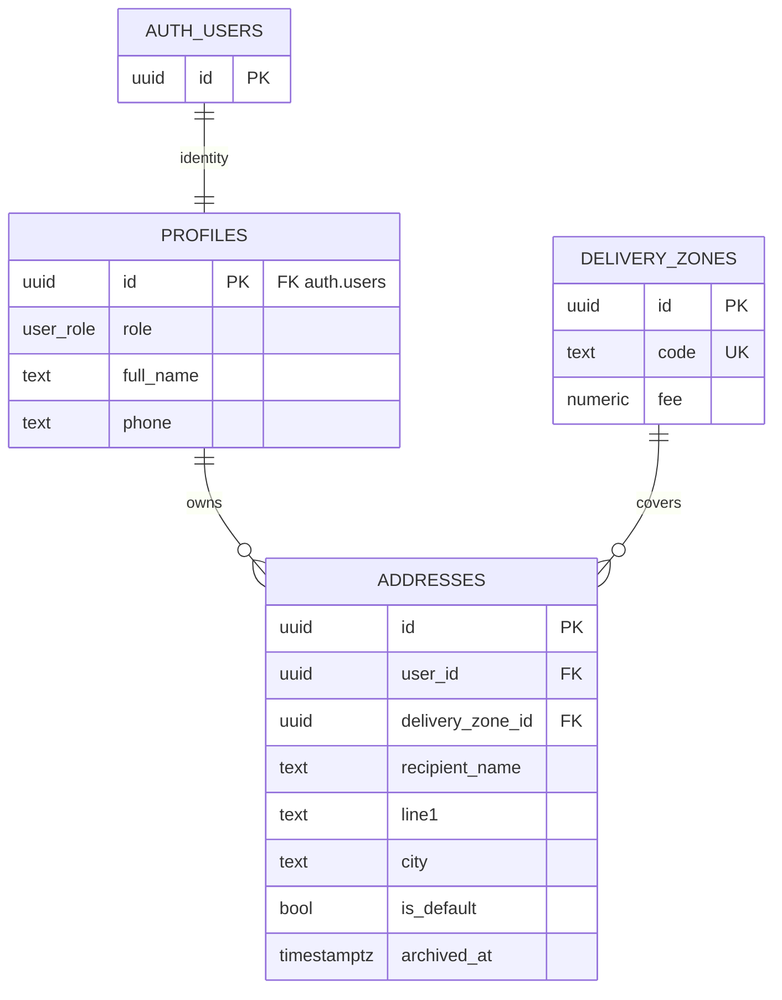
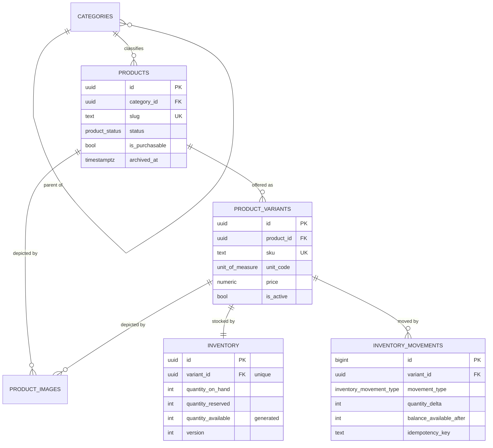
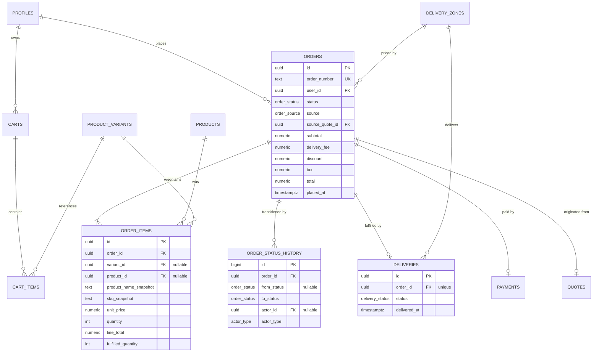
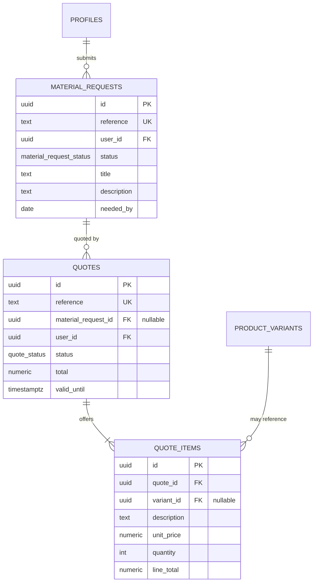
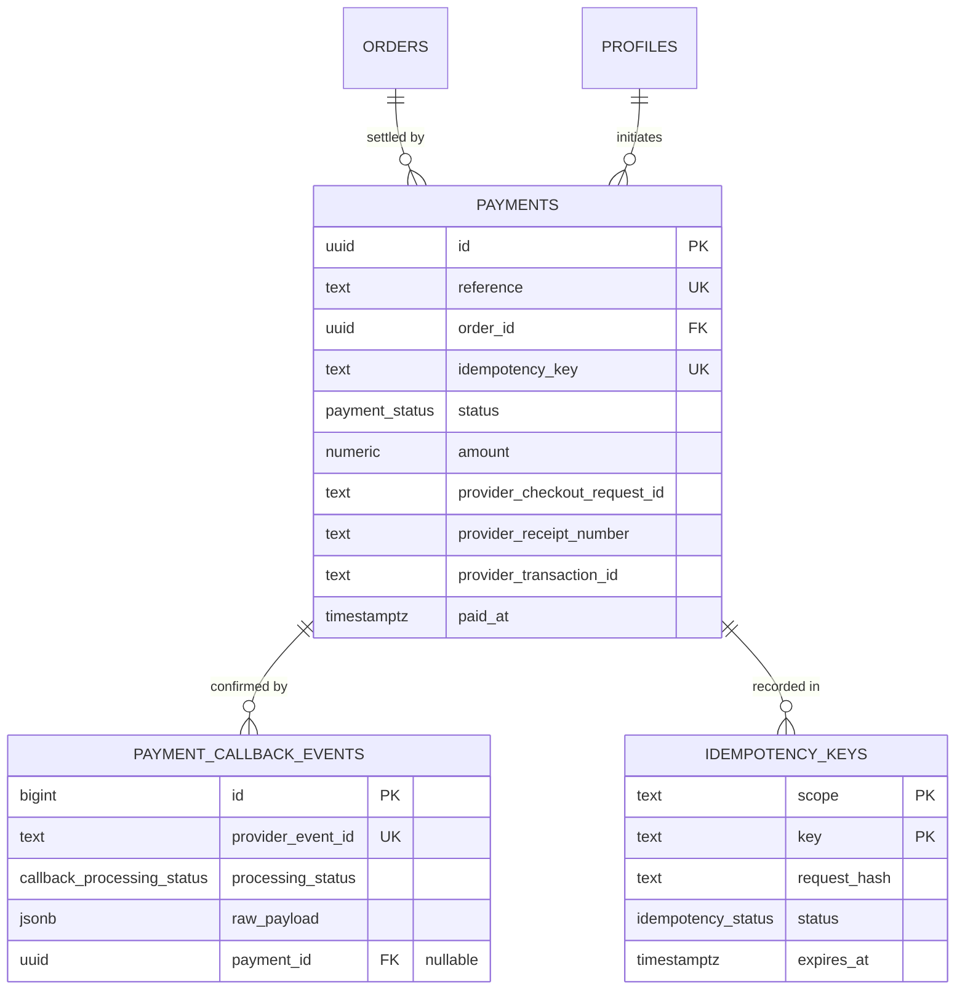
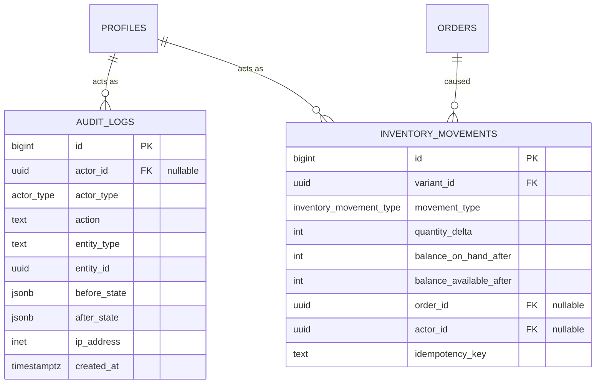

# Nakuru Hardware Commerce Platform — V1 Database Contract

| Field                | Value                              |
| -------------------- | ---------------------------------- |
| Repository           | Axiomwriters/Hardware-E-Shop       |
| Document             | `docs/database.md`                 |
| Version              | 1.0                                |
| Status               | PROPOSED — PENDING TEAM APPROVAL   |
| Scope                | V1                                 |
| Parent contract      | `docs/architecture.md` v1.0        |
| Audience             | Project Partner, Developer A — Kelvin Njau (Data/Platform), Developer B — Brian Yegon (Application/Integrations), Frontend/Product |
| Supersedes           | Nothing                            |
| Amends               | `docs/architecture.md` §7.2 (see §2.4) |

**Purpose of this document:** define the V1 data model as a reviewable
contract. It specifies the authoritative table for every business fact, the
keys, relationships, constraints, indexes, concurrency model, audit model and
row-level access model, so that migrations can be written once, correctly, and
reviewed as an implementation of a decided design rather than as a proposal.

This document is the **database** contract. `docs/architecture.md` is the
**system** contract. Where this document is silent, `architecture.md` governs.
Where this document proposes a change to `architecture.md`, that proposal is
recorded explicitly in §2.4 and must be approved with this document.

**This document does not authorize implementation.** It is the input to a
sign-off gate (§29), not the output of one.

---

## Table of Contents

1. [Database Contract Status](#1-database-contract-status)
2. [Scope, Precedence, and Document Boundaries](#2-scope-precedence-and-document-boundaries)
3. [V1 Product Context and Its Constraints on the Data Model](#3-v1-product-context-and-its-constraints-on-the-data-model)
4. [Database Technology Baseline](#4-database-technology-baseline)
5. [Data Modeling Conventions](#5-data-modeling-conventions)
6. [Domain Model and Entity Inventory](#6-domain-model-and-entity-inventory)
7. [Entity Relationship Model (ERD)](#7-entity-relationship-model-erd)
8. [Table Definitions](#8-table-definitions)
9. [Keys, Constraints, and Invariants](#9-keys-constraints-and-invariants)
10. [Enums and State Machines](#10-enums-and-state-machines)
11. [Concurrency, Transactions, and Idempotency](#11-concurrency-transactions-and-idempotency)
12. [Money, Pricing, and Totals](#12-money-pricing-and-totals)
13. [Audit and History Strategy](#13-audit-and-history-strategy)
14. [Retention, Deletion, and Privacy](#14-retention-deletion-and-privacy)
15. [RLS Access Model](#15-rls-access-model)
16. [Storage and Object Ownership](#16-storage-and-object-ownership)
17. [Indexing Strategy](#17-indexing-strategy)
18. [Performance and Scale Budgets](#18-performance-and-scale-budgets)
19. [Migration Strategy](#19-migration-strategy)
20. [Migration Plan](#20-migration-plan)
21. [Database Testing Strategy](#21-database-testing-strategy)
22. [Seed and Reference Data Strategy](#22-seed-and-reference-data-strategy)
23. [Observability and Operational Diagnostics](#23-observability-and-operational-diagnostics)
24. [Database Change Control and Governance](#24-database-change-control-and-governance)
25. [Database Security Checklist](#25-database-security-checklist)
26. [P0 Database Decision Register](#26-p0-database-decision-register)
27. [Open Questions and Challenged Assumptions](#27-open-questions-and-challenged-assumptions)
28. [Review Comprehension Check](#28-review-comprehension-check)
29. [Go / No-Go Migration Gate](#29-go--no-go-migration-gate)
30. [Final Database Contract](#30-final-database-contract)
- [Appendix A — Table Index](#appendix-a--table-index)
- [Appendix B — Naming and Convention Quick Reference](#appendix-b--naming-and-convention-quick-reference)
- [Appendix C — Database Review Record](#appendix-c--database-review-record)
- [Appendix D — Glossary](#appendix-d--glossary)

---

## 1. Database Contract Status

This document is not approved merely because it exists in Git and CI is green.
A green CI run proves the repository is internally consistent. It does not
prove the schema is correct.

Implementation of `supabase/migrations/` may not begin until this document is
approved and no P0 decision in §26 remains unresolved.

### 1.1 Approval checklist

- [ ] Project Partner reviewed
- [ ] Developer A — Data / Platform reviewed
- [ ] Developer B — Application / Integrations reviewed
- [ ] Frontend / Product reviewed
- [ ] Entity inventory (§6) challenged — every DROP/DEFER verdict agreed
- [ ] Every P0 decision in §26 resolved and marked
- [ ] `product_variants` and variant-level inventory confirmed for V1
- [ ] Inventory reservation timing resolved (`ARCH-014` / `DB-010`)
- [ ] Oversell prevention mechanism agreed (`DB-011`)
- [ ] Order/quote snapshot strategy agreed
- [ ] Delete-behavior matrix agreed (§9.4)
- [ ] RLS matrix agreed (§15.2) and no table left without a rule
- [ ] Migration plan (§20) agreed
- [ ] Database testing strategy agreed (§21)
- [ ] Amendments to `architecture.md` in §2.4 agreed
- [ ] No unresolved P0 database decision remains

### 1.2 Sign-off

| Role                                    | Name        | Approval      | Date |
| --------------------------------------- | ----------- | ------------- | ---- |
| Project Partner                         | TBD         | [ ] Approved  | TBD  |
| Developer A — Data / Platform           | Kelvin Njau | [ ] Approved  | TBD  |
| Developer B — Application / Integrations| Brian Yegon | [ ] Approved  | TBD  |
| Frontend / Product                      | TBD         | [ ] Approved  | TBD  |

**Implementation gate:** do not create production schema while any P0 database
decision is unresolved. In particular, do not begin `product_variants`,
`inventory` or `payments` migrations before §11 (concurrency) and §12 (money)
are approved, because those two decisions are expensive to reverse once code
depends on them.

---

## 2. Scope, Precedence, and Document Boundaries

### 2.1 What this document owns

- The authoritative table for each business fact.
- Table and column definitions for V1.
- Primary keys, foreign keys, uniqueness, and delete behavior.
- Check constraints and database-enforced invariants.
- Enum definitions and legal state transitions.
- Index strategy and the reasoning behind each index.
- Transaction boundaries for multi-step operations.
- Concurrency and oversell protection.
- Idempotency persistence strategy.
- Audit and history strategy.
- RLS intent per table (policy SQL is an implementation detail, not a contract).
- Migration strategy and migration order.
- Database-level testing expectations.
- Seed/reference data strategy.

### 2.2 What this document does not own

| Concern                       | Owner                                    |
| ----------------------------- | ---------------------------------------- |
| System layering and request flow | `docs/architecture.md` §4, §5        |
| HTTP/API envelopes and error codes | `docs/architecture.md` §10          |
| Zod request validation        | `docs/architecture.md` §11              |
| Order state machine semantics | This document (§10) states the data; `architecture.md` §14 states the workflow |
| Payment business semantics    | `architecture.md` §15; this document defines the storage that makes them enforceable |
| Service-layer code            | `architecture.md` §6                    |
| RLS policy SQL text           | Implementation. This document defines required behavior; `architecture.md` §9.3 defines the layering |
| Deployment                    | `architecture.md` §18, §20              |

### 2.3 Precedence

1. `docs/architecture.md` — system-level principles. This document must not
   contradict it.
2. Approved ADRs in `docs/decision-records/` — may amend either.
3. This document — database-level detail.
4. Migration files — the executable form of this document. A migration that
   contradicts this document is a bug in the migration, not a change to this
   document.

### 2.4 Proposed amendments to `docs/architecture.md`

These are proposals carried by this document. They are not in effect until this
document is approved.

| Ref       | Location in `architecture.md` | Current text                          | Proposed                                              |
| --------- | ----------------------------- | ------------------------------------- | ----------------------------------------------------- |
| `AMD-001` | §7.2 Domain ownership          | Identity owns `users`, `profiles`, `addresses` | Identity owns `profiles`, `addresses` only. No public `users` table — `auth.users` is authoritative (`DB-001`). |
| `AMD-002` | §13 Inventory and Concurrency  | Inventory ownership unstated           | Inventory is stored at `product_variants` granularity, 1:1, single location for V1 (`DB-003`). |
| `AMD-003` | §13 Retry rule                 | Reservation timing "must be decided"   | Recommend reserve-at-order-creation (`DB-010`). The recommendation is made here but the decision remains joint. |
| `AMD-004` | §7.2 Audit domain              | Audit owns `audit_logs`               | Audit owns `audit_logs`, `order_status_history`, `inventory_movements`, `payment_callback_events` — four append-oriented tables, not one. |

### 2.5 Change test

Ask before changing this document:

> "Would another developer have to change how they implement their part because
> of this change?"

If yes, it is a contract change: review it, and record it as an ADR.

---

## 3. V1 Product Context and Its Constraints on the Data Model

The schema exists to serve one measured outcome:

> **Confirmed hardware orders per week.**

Everything in the model is justified by that, or removed.

### 3.1 The two commerce paths the model must support

```
Standard commerce
Discover → Product → Cart → Delivery → Review → Payment → Confirmed Order
          → Fulfillment → Tracking

Assisted procurement
Material Request → Admin Review → Quote → Customer Acceptance → Payment
                 → Order → Fulfillment → Tracking
```

These are **not** two independent systems. Assisted procurement is a quote
workflow that *converges* on the same order, payment, inventory and delivery
model. The schema must make that convergence a data fact, not a code
convention. Concretely: a `quote` is a temporary offer; an `order` is the
committed transaction; both converge on `order_items` → `inventory` →
`payments` → `deliveries`.

### 3.2 V1 non-goals that remove tables

A non-goal is a table that must not exist yet. Listing them prevents the most
common failure mode in this project type: a schema that models a marketplace
because the codebase already knows how to model one.

| Non-goal (`architecture.md` §2)     | Tables deliberately NOT created in V1              |
| ----------------------------------- | ------------------------------------------------- |
| Multi-vendor marketplace            | `vendors`, `vendor_products`, `payouts`, `commissions` |
| Native mobile apps                  | `devices`, `push_tokens`                           |
| Fundi marketplace / contractor bidding | `fundi_profiles`, `bids`, `job_orders`         |
| AI procurement assistant            | `ai_conversations`, `ai_suggestions`               |
| Live driver GPS / fleet             | `vehicles`, `driver_locations`, `vehicle_assignments` |
| Loyalty programme                   | `loyalty_accounts`, `loyalty_transactions`, `points_ledger` |
| Customer reviews                    | `product_reviews`, `review_media`                  |
| Financing / loans                   | `credit_applications`, `loan_plans`, `repayments`  |
| Multi-branch inventory              | `locations`, `location_stock`, `stock_transfers`   |
| ERP / accounting integration        | `ledger_accounts`, `journal_entries`, `chart_of_accounts` |
| Advanced analytics                  | `fact_*`, `dim_*`, materialized-report schemas    |
| Automated supplier procurement      | `suppliers`, `purchase_orders`, `goods_receipts`  |

`inventory_movements` (§8.3.2) deliberately records stock *in* and stock *out*.
It is a stock ledger, not a purchase-order system. It has no supplier, no
expected date, no goods receipt workflow. Adding those later is a migration;
retrofitting a `purchase_orders` table that already assumes suppliers is not.

### 3.3 Consequences that are easy to get wrong

- **No multi-branch means one stock row per variant.** Not a row per variant
  per location. `locations` is deferred; if it is ever added, `inventory` is
  rewritten, so `inventory` must not hard-code the assumption in a way that
  cannot be migrated.
- **No marketplace means exactly one implicit seller.** There is no `seller_id`
  on `products`. Adding a seller is additive, so omitting it now is safe;
  adding a seller column later is cheaper than removing a multi-seller model
  later.
- **No reviews means no moderation, no reputation, no ranking.** `products` has
  no aggregate rating column.
- **No loyalty means no discount engine.** `orders` still has a `discount`
  column (§8.4.3) because the *total arithmetic* must be complete and auditable
  even when the V1 value is always zero. Omitting it would mean rewriting
  historical order totals later to add a column. A zero-valued column is
  cheaper than a migration over financial rows.

---

## 4. Database Technology Baseline

### 4.1 Platform

| Concern             | Decision                                                    |
| ------------------- | ----------------------------------------------------------- |
| Engine              | PostgreSQL (Supabase managed)                               |
| Extensions (V1)    | `pgcrypto` (or `pg_trgm` where noted) — `gen_random_uuid()` is built in on Supabase |
| Extensions (deferred) | `pg_trgm` (if `DB-023` selects trigram search), `vector` (not V1) |
| Identity provider   | Supabase Auth → `auth.users`                               |
| File storage        | Supabase Storage                                           |
| Migration tool      | Supabase CLI (`supabase migration`), §19                   |
| Connection pooling  | Supavisor (transaction mode) for serverless/Vercel, `DB-025` |
| Row security        | PostgreSQL RLS, enabled on every exposed table, §15         |
| Timezone            | Store `timestamptz`; display in `Africa/Nairobi` (`DB-026`) |

### 4.2 Hard platform rules

- PostgreSQL is the authoritative system of record for relational business
  state (`architecture.md` §3.2). No business fact lives only in the
  application, in a cache, or in an external system.
- Every table that a browser session can reach has RLS **enabled**. A table
  without RLS is a defect, not a default.
- The `service_role` key is server-only and is never used to satisfy a browser
  request's authorization decision (`DB-015`).
- No table may be created in a production database by dashboard edit. Schema
  changes arrive as committed migrations (`architecture.md` §8).

### 4.3 Roles and privileges

PostgreSQL roles in the database are distinct from application roles
(`customer`, `staff`, `admin`, §10.1). The distinction matters:

| Database role       | Used by                            | Bypasses RLS |
| ------------------- | ---------------------------------- | ------------ |
| `authenticated`     | Browser via PostgREST, carrying the user JWT | No |
| `anon`              | Browser, unauthenticated           | No (policies deny by default) |
| `service_role`      | Server-side service layer          | Yes — never from a browser path |
| `supabase_admin` / `postgres` | Migrations, maintenance | Yes |

Application roles are stored in `profiles.role` (§10.8) and are **not** PostgreSQL
roles. Mapping a `profiles.role` to a `GRANT` is explicitly rejected: it would
multiply the privilege surface by three and make every `GRANT` change a
migration. Authorization is expressed in RLS policies that read
`profiles.role`, not in the grant system.

---

## 5. Data Modeling Conventions

These are conventions, not preferences. A reviewer should reject a table that
breaks one.

### 5.1 Naming

| Element            | Rule                                                    | Example                        |
| ------------------ | ------------------------------------------------------- | ------------------------------ |
| Table              | `snake_case`, plural, semantic                            | `order_items`                  |
| Column             | `snake_case`                                             | `unit_price`                   |
| Primary key        | always `id`                                              | `id uuid`                      |
| Foreign key column | `<singular_table>_id`                                    | `order_id`, `variant_id`       |
| Boolean            | `is_…` / `has_…`                                          | `is_purchasable`               |
| Timestamp          | `created_at`, `updated_at`; event time named for the event | `paid_at`, `cancelled_at`     |
| Enum type          | `<entity>_<attribute>`                                    | `order_status`                 |
| Index              | `idx_<table>_<columns>`                                   | `idx_orders_user_status`       |
| Unique index       | `uq_<table>_<columns>`                                    | `uq_payments_idempotency_key`  |
| Check constraint   | `chk_<table>_<rule>`                                      | `chk_inventory_reserved_lte_on_hand` |
| Foreign key        | `fk_<table>_<column>`                                     | `fk_order_items_order_id`      |
| Trigger            | `trg_<table>_<event>`                                     | `trg_orders_set_updated_at`    |
| Database function  | `fn_<verb>_<object>`                                      | `fn_set_order_number`          |
| View              | `v_<subject>`                                             | `v_low_stock`                  |
| Sequence           | `<table>_number_seq`                                      | `orders_number_seq`            |

### 5.2 Primary keys

- `uuid` for all business tables. Generated by the database default
  (`gen_random_uuid()`), never by the client.
- `bigint GENERATED ALWAYS AS IDENTITY` for append-only high-volume tables
  (`audit_logs`, `order_status_history`, `inventory_movements`,
  `payment_callback_events`). These are write-only logs; a random UUID index
  would degrade append locality for no benefit, and the cardinality of
  "log" data does not require non-enumerability.
- UUIDs are chosen over `bigint` for business rows because the ID is exposed to
  clients, and an enumerable ID invites enumeration-based probing. Enumeration
  is not a substitute for RLS, but it removes an unnecessary tool.
- **UUID version is P0 (`DB-005`).** `v4` (random) is the proposed baseline for
  index locality predictability. `v7` (time-ordered) is a legitimate
  alternative with better write locality on B-tree indexes, at the cost of
  leaking creation timestamp. Decide once, here.

### 5.3 Time

- All timestamps are `timestamptz`. No `timestamp without time zone` anywhere.
- Business dates that are genuinely date-only (`orders.placed_on`,
  `material_requests.needed_by`) are `date`. Do not fake a date with a
  midnight timestamp.
- The application renders in `Africa/Nairobi` (`DB-026`). The database never
  stores a local-time assumption.

### 5.4 Money

- `numeric(14,2)` with an explicit currency column where the amount is
  multi-currency-capable, or where the table is financial. Never `float` /
  `double precision` / `real`.
- `numeric` arithmetic in PostgreSQL is exact, so `check (line_total =
  unit_price * quantity)` is a genuine equality test, not a tolerance test.
- Rounding is `ROUND(..., 2)` half-up, applied once, at the point a value is
  persisted. See §12.4.
- Rationale and the `integer minor units` alternative are in `DB-004`.

### 5.5 Enums

- Closed state sets are PostgreSQL `enum` types, not lookup tables, in V1.
- Enum types are **additive-only**. Adding a value is backward compatible for
  readers that do not handle it, so any reader must have a safe default branch
  anyway. Removing or renaming a value is a breaking change requiring an
  expand/migrate/contract migration (§19.4) and an ADR.
- Rationale versus lookup tables is in `DB-007`.

### 5.6 Deletion

- **No hard deletes on business data.** See §9.4 and §14.
- `archived_at timestamptz` for user- or admin-hideable records
  (`products`, `addresses`, `material_requests`).
- Financial and historical records (`orders`, `order_items`, `payments`,
  `quotes`, `quote_items`, `payments`, all four audit tables) are never
  updated destructively and never deleted.
- `ON DELETE CASCADE` is used **only** from a parent to a child that has no
  independent meaning and no audit value: `orders` → `order_items`,
  `quotes` → `quote_items`, `carts` → `cart_items`, `products` →
  `product_images`.

### 5.7 Audit columns

Present on all business tables:

```sql
created_at timestamptz not null default now(),
updated_at timestamptz not null default now()
```

`updated_at` is maintained by a single shared `trg_set_updated_at()` trigger
function, attached to every business table. It is never set by application
code.

`updated_at` is **not** an audit trail. It answers "when did this row last
change", not "who changed it and what did they change". Those are §13.

### 5.8 JSONB usage

`jsonb` is permitted **only** for:

- immutable snapshots of an external or composite value
  (`orders.delivery_address_snapshot`);
- genuinely open payloads (`product_variants.attributes`,
  `payment_callback_events.raw_payload`, `audit_logs.*_state`).

`jsonb` is **not** permitted for:

- a value that is queried, filtered, joined, or constrained;
- anything with a cardinality above trivial;
- anything that should have been a column.

Rule of thumb: if you cannot write the `WHERE` clause, it is a column. If
`jsonb` starts accumulating sub-objects with stable internal keys, that is an
un-versioned table and it needs a schema version or a real table.

### 5.9 Text, case, and search

- Emails are `citext` (or `text` with a `lower()` unique index) so identity
  matching is case-insensitive without application cooperation.
- Free-text customer input (`products.description`,
  `material_requests.description`) is `text`, never `varchar(n)` with an
  arbitrary limit. Truncation is a business rule; if one is needed it is
  enforced by Zod at the boundary and stated in the column comment.
- Product search is `DB-023` (PostgreSQL full-text vs. `pg_trgm`).

### 5.10 Naming of destructive and privileged objects

Any function capable of bypassing RLS, writing to audit tables, or mutating
financial rows is named `fn_*_internal` and must be listed in §24.2's
privileged-object review. V1 should contain as few of these as possible.

---

## 6. Domain Model and Entity Inventory

### 6.1 Bounded contexts

| Context       | Owns                                                                       | V1 criticality |
| ------------- | -------------------------------------------------------------------------- | -------------- |
| Identity      | `profiles`, `addresses`                                                    | Critical       |
| Catalog       | `categories`, `products`, `product_variants`, `product_images`             | Critical       |
| Inventory     | `inventory`, `inventory_movements`                                         | Critical       |
| Commerce      | `carts`, `cart_items`, `orders`, `order_items`, `order_status_history`     | Critical       |
| Procurement   | `material_requests`, `quotes`, `quote_items`                              | Critical       |
| Payments      | `payments`, `payment_callback_events`                                      | Critical       |
| Fulfillment   | `delivery_zones`, `deliveries`                                            | Critical       |
| Audit         | `audit_logs`, `order_status_history`, `inventory_movements`, `payment_callback_events` | Critical |
| Platform      | `idempotency_keys`, reference sequences                                    | Supporting     |

`order_status_history`, `inventory_movements` and `payment_callback_events`
appear in two contexts because they are both functional and audit data. The
functional context owns the write; the audit context owns the immutability
guarantee. This duplication is intentional and is resolved by a single answer
to the ownership question: **the functional owning context writes, and only
the audit guarantee applies.** One writer, not two.

### 6.2 Entity inventory — the starting proposal

The team was given this candidate list. It is recorded here for traceability.

```
Identity      users, profiles, addresses
Catalog       categories, products, product_variants, product_images
Inventory     inventory
Commerce      carts, cart_items, orders, order_items, order_status_history
Procurement   material_requests, quotes, quote_items
Payments      payments
Fulfillment   delivery_zones, deliveries
Audit         audit_logs
```

### 6.3 Verdicts

This list is **not** accepted as given. Each entity receives a verdict, and
every non-`KEEP` verdict carries a reason.

| # | Candidate entity       | Verdict        | Reason                                                                                                     |
| - | ---------------------- | -------------- | ---------------------------------------------------------------------------------------------------------- |
| 1 | `users`                | **DROP**       | Supabase Auth owns identity in `auth.users`. A public `users` table creates two sources of identity, and RLS policies on the shadow table can disagree with the auth system. `profiles` already holds what the application needs. Requires `AMD-001`. |
| 2 | `profiles`             | KEEP           | Application-owned profile and the single place application role lives. 1:1 with `auth.users`.              |
| 3 | `addresses`            | KEEP           | Delivery destination. Snapshot onto the order at checkout.                                                  |
| 4 | `categories`           | KEEP           | Catalog structure. `parent_id` self-reference, depth-limited in application logic.                          |
| 5 | `products`             | KEEP           | Sellable item *type* (e.g. "Cement"). Never priced directly.                                                  |
| 6 | `product_variants`     | **KEEP (confirmed)** | Required in V1 — see §27.1. Hardware is sold in units of trade; price belongs to the package, not the item type. |
| 7 | `product_images`       | KEEP           | Storage-backed image references. Stores paths, not URLs (§16.3).                                            |
| 8 | `inventory`            | **KEEP — revised** | Rebased from product-level to **variant-level**, 1:1, and split into on-hand / reserved / available. See `DB-003`. |
| 9 | —                      | **ADD**        | `inventory_movements` — an append-only stock ledger. Missing from the original list but required by `architecture.md` §13 ("record inventory effect") and §23 ("inventory adjustments"). |
| 10| `carts`                | KEEP           | Mutable purchase intent, exactly one active per user.                                                       |
| 11| `cart_items`           | KEEP           | Cart lines. Price snapshot is advisory only.                                                                |
| 12| `orders`               | **KEEP — revised** | Gains human reference number, money columns, delivery/zone snapshot, and `source_quote_id`.               |
| 13| `order_items`          | **KEEP — revised** | Gains nullable `variant_id`/`product_id` for analytics **and** mandatory snapshot columns. See `DB-009`.  |
| 14| `order_status_history` | KEEP           | Append-only state transition log with actor.                                                                |
| 15| `material_requests`    | KEEP           | Entry point of assisted procurement.                                                                        |
| 16| `quotes`               | KEEP           | A dated, expiring offer. Gains `source`-order link.                                                          |
| 17| `quote_items`          | KEEP           | Quote lines may be non-catalog, hence a required `description` and nullable `variant_id`.                    |
| 18| `payments`             | **KEEP — revised** | Gains `idempotency_key` (unique), provider references (unique where present), timestamps per outcome, and a partial unique index allowing only one successful payment per order. |
| 19| —                      | **ADD**        | `payment_callback_events` — raw, append-only, uniquely-keyed inbox of Daraja callbacks. The idempotency mechanism required by `architecture.md` §15.4. |
| 20| `delivery_zones`       | KEEP           | Where delivery pricing and eligibility live.                                                                 |
| 21| `deliveries`           | KEEP           | 1:1 with `orders`.                                                                                          |
| 22| `audit_logs`           | **KEEP — expanded** | One of four append-only tables, not the only one. See `AMD-004`.                                            |
| 23| —                      | **ADD**        | `idempotency_keys` — general request idempotency store backing `architecture.md` §3.5 for non-payment operations (checkout, quote acceptance, callbacks). |
| 24| —                      | **ADD**        | `orders_number_seq`, `payments_number_seq`, `quotes_number_seq`, `material_requests_number_seq` — reference-number sequences. `DB-006`. |
| 25| `product_attributes` / EAV | **DEFER**   | No demonstrated V1 requirement. V1 uses `product_variants.attributes jsonb` as a bounded escape hatch (§5.8). A general EAV table makes filtering and indexing hostile. |
| 26| `vendors` / `suppliers` | **DEFER**     | Multi-vendor and automated procurement are explicit non-goals.                                               |
| 27| `locations` / `stock_transfers` | **DEFER** | Multi-branch is a non-goal. See §3.2 and §3.3.                                                             |
| 28| `coupons` / `discounts` / `loyalty_*` | **DEFER** | Loyalty is a non-goal. `orders.discount` exists for arithmetic completeness only.                            |
| 29| `product_reviews`     | **DEFER**      | Customer social/review system is a non-goal.                                                               |
| 30| `refunds`              | **DEFER** (`DB-022`) | V1 has no refund workflow. `payments.status = 'refunded'` plus `refunded_at` and `refund_reference` reserve the shape without committing to a refunds subsystem. |
| 31| `notifications`       | **DEFER**      | No V1 requirement. Email/SMS is not in the V1 success condition.                                            |
| 32| `audit_logs` as the only history | **REJECT** | A single generic audit table cannot answer "what did this order look like at 14:03". Domain history (order status, stock ledger, callback inbox) is required *in addition*, not instead. |

**Resulting V1 table count: 22 tables** — 18 business, 4 append-oriented
audit/history, plus 4 sequences.

### 6.4 Answering the six challenge questions

The team was asked to challenge these before writing migrations. Each is
answered with a proposal and a falsifier.

| # | Question                                              | Proposed answer                                                                                            | What would change the answer |
| - | ----------------------------------------------------- | --------------------------------------------------------------------------------------------------------- | ----------------------------- |
| 1 | Is `product_variants` needed in V1?                    | **Yes.** Price is per package, and packages differ. See §27.1.                                              | Only if V1 committed to exactly one package per product for all hardware SKUs. Unlikely. |
| 2 | Does inventory belong to a product or a variant?       | **Variant**, 1:1, single location. See §27.2.                                                             | Multi-branch introduction, or a decision to sell only "base units".                  |
| 3 | Does an order item store current price or a snapshot?  | **Both, and the snapshot is the record of truth.** See §27.3.                                             | Only if the business accepts that historical invoices may display today's price.       |
| 4 | What happens if a product is deleted after an order?   | It cannot be. Products are archived. FKs `RESTRICT` for priced history, `SET NULL` for analytics-only. See §27.4 and §9.4. | An approved hard-delete requirement, or a product-import workflow that must purge PII-bearing rows. |
| 5 | Where does delivery pricing live?                      | `delivery_zones.fee`, server-calculated, snapshotted onto the order. See §27.5.                              | Per-product or weight-based delivery, which is not a V1 requirement.                  |
| 6 | How do quote items differ from order items?           | A quote line is an *offer*; an order line is a *committed transaction*. Structurally parallel, semantically distinct, and copied on acceptance. See §27.6. | If quotes were ever required to stay in lockstep with a mutable order, a shared line table would be simpler. That is a worse model. |

---

## 7. Entity Relationship Model (ERD)

The model is presented per bounded context. A single diagram spanning 22 tables
is not reviewable; a reviewer cannot hold it in their head, and a defect in one
corner becomes invisible. Each diagram below is small enough to check line by
line.

### 7.1 Identity



### 7.2 Catalog and Inventory



Note the cardinality `PRODUCT_VARIANTS ||--|| INVENTORY`. Exactly one inventory
row per variant, enforced by a unique constraint on `inventory.variant_id`, not
by convention. A variant that is not stocked has **no** inventory row, not a
row with zero stock. This distinction matters: "we do not stock this" and "we
stock zero of this" produce different customer-facing behavior, and conflating
them makes `is_purchasable` lie.

### 7.3 Commerce



`ORDERS ||--o| QUOTES` reads as "an order has at most one originating quote".
`QUOTES` has no `order_id`; the link is one-directional by design to avoid a
circular foreign key (§8.4.3, `DB-020`).

### 7.4 Procurement



A `quote` may exist without a `material_request` (an admin quotes a walk-in or
a direct enquiry). That is why `material_request_id` is nullable and the FK is
`SET NULL` rather than `CASCADE`.

### 7.5 Payments and Platform



### 7.6 Audit and the stock ledger



`AUDIT_LOGS` and `INVENTORY_MOVEMENTS` have **no** foreign key to a single
parent because they are the record *of* many entity types. `entity_type` +
`entity_id` is a soft polymorphic reference, which is acceptable **only**
because these tables are append-only and are never joined for business
decisions. If a business decision ever needs to traverse that link, the correct
fix is a real foreign key column, not a join on two columns.

### 7.7 Cardinality summary

| Relationship                                | Cardinality | Enforced by                                     |
| ------------------------------------------- | ----------- | ----------------------------------------------- |
| `auth.users` → `profiles`                    | 1 : 1       | PK/FK on `profiles.id`                          |
| `profiles` → `addresses`                     | 1 : n       | FK                                              |
| `categories` → `categories`                  | 1 : n       | Self-FK, depth limited in application           |
| `products` → `product_variants`              | 1 : n       | FK                                              |
| `product_variants` → `inventory`             | 1 : 1       | `unique (variant_id)`                           |
| `carts` → `cart_items`                       | 1 : n       | FK                                              |
| `profiles` → `carts` (active)                | 1 : 1       | Partial `unique (user_id) where status='active'` |
| `orders` → `order_items`                     | 1 : n       | FK + `check (count >= 1)` deferred trigger (`DB-012`) |
| `orders` → `payments` (succeeded)            | 1 : 1       | Partial `unique (order_id) where status='succeeded'` |
| `orders` → `deliveries`                      | 1 : 1       | `unique (order_id)`                             |
| `quotes` → `quote_items`                     | 1 : n       | FK                                              |
| `quotes` → `orders` (originating)            | 1 : 1       | `unique (orders.source_quote_id)`               |
| `product_variants` → `inventory_movements`   | 1 : n       | FK                                              |
| `payments` → `payment_callback_events`       | 1 : n       | FK, nullable                                    |
| `profiles` → `addresses` (default, active)   | 1 : 1       | Partial `unique (user_id) where is_default and archived_at is null` |

---

## 8. Table Definitions

Column tables use the notation: **Null** is whether `NOT NULL` is applied.
"Generated" columns are computed by the database and must never be written by
the application. Every table not listed in this section is not part of V1.

### 8.1 Identity

#### 8.1.1 `profiles`

The single application-owned projection of an authenticated user, and the only
place an application role lives.

| Column        | Type        | Null    | Default              | Notes                                              |
| ------------- | ----------- | ------- | -------------------- | -------------------------------------------------- |
| `id`          | `uuid`      | no      | `gen_random_uuid()`  | PK; FK → `auth.users(id)` `ON DELETE CASCADE`     |
| `role`        | `user_role` | no      | `'customer'`         | `customer` \| `staff` \| `admin`                   |
| `full_name`   | `text`      | no      | —                    |                                                   |
| `phone`       | `text`      | yes     | —                    | E.164; M-Pesa destination                          |
| `avatar_path` | `text`      | yes     | —                    | Storage object path, not a URL                     |
| `created_at`  | `timestamptz` | no    | `now()`              |                                                   |
| `updated_at`  | `timestamptz` | no    | `now()`              |                                                   |

**Constraints**

- `chk_profiles_role_not_null` — enforced by the column.
- `idx_profiles_role` — partial `where role <> 'customer'`. Role lookups are
  always "list the non-customers"; there is no reason to index the 99%.
- A `profiles` row is created by a trigger on `auth.users` insert, not by
  client code. A user who does not exist in `profiles` does not exist to the
  application.
- `role` is **not** self-editable. RLS (§15.4) denies `update` on `role` for the
  owning user, and only a privileged server path may change it, always with an
  `audit_logs` row.

#### 8.1.2 `addresses`

| Column                    | Type          | Null | Default             | Notes                                    |
| ------------------------- | ------------- | ---- | ------------------- | ---------------------------------------- |
| `id`                      | `uuid`        | no   | `gen_random_uuid()` | PK                                        |
| `user_id`                 | `uuid`        | no   | —                   | FK → `profiles(id)` `ON DELETE CASCADE`  |
| `label`                   | `text`        | yes  | —                   | "Home", "Office"                         |
| `recipient_name`          | `text`        | no   | —                   |                                         |
| `recipient_phone`         | `text`        | no   | —                   | E.164; M-Pesa destination for this order |
| `line1`                   | `text`        | no   | —                   |                                         |
| `line2`                   | `text`        | yes  | —                   |                                         |
| `city`                    | `text`        | no   | `'Nakuru'`          |                                         |
| `county`                  | `text`        | no   | `'Nakuru'`          |                                         |
| `postal_code`             | `text`        | yes  | —                   |                                         |
| `delivery_zone_id`        | `uuid`        | yes  | —                   | FK → `delivery_zones(id)` `ON DELETE SET NULL` |
| `place_id`                | `text`        | yes  | —                   | Google Places ID                         |
| `location_lat`            | `numeric(9,6)`| yes  | —                   |                                         |
| `location_lng`            | `numeric(9,6)`| yes  | —                   |                                         |
| `delivery_instructions`   | `text`        | yes  | —                   |                                         |
| `is_default`              | `boolean`     | no   | `false`             |                                         |
| `archived_at`             | `timestamptz` | yes  | —                   | Soft delete (§14)                        |
| `created_at`              | `timestamptz` | no   | `now()`             |                                         |
| `updated_at`              | `timestamptz` | no   | `now()`             |                                         |

**Constraints**

- `uq_addresses_one_default_per_user` — partial `unique (user_id) where
  is_default and archived_at is null`. This is the guarantee that "the default
  address" is well defined. A plain `unique (user_id, is_default)` is wrong: it
  would also forbid two non-default addresses.
- `chk_addresses_lat_lng` — both coordinates present or both absent; lat in
  `[-90, 90]`, lng in `[-180, 180]`.
- `idx_addresses_user_active` — `(user_id) where archived_at is null`.

**Note.** `delivery_zone_id` is a *cached convenience* for the customer's
address. The authoritative delivery eligibility and fee for an order are
computed and snapshotted onto the order at checkout (§8.4.3, §12.5). Editing
an address must never change a placed order.

### 8.2 Catalog

#### 8.2.1 `categories`

| Column        | Type          | Null | Default             | Notes                             |
| ------------- | ------------- | ---- | ------------------- | --------------------------------- |
| `id`          | `uuid`        | no   | `gen_random_uuid()` | PK                                 |
| `parent_id`   | `uuid`        | yes  | —                   | Self-FK → `categories(id)` `ON DELETE RESTRICT` |
| `name`        | `text`        | no   | —                   |                                   |
| `slug`        | `text`        | no   | —                   | `unique`                           |
| `description` | `text`        | yes  | —                   |                                   |
| `position`    | `integer`     | no   | `0`                 | Manual ordering                    |
| `is_active`   | `boolean`     | no   | `true`              |                                   |
| `created_at`  | `timestamptz` | no   | `now()`             |                                   |
| `updated_at`  | `timestamptz` | no   | `now()`             |                                   |

**Constraints**

- `idx_categories_parent` — `(parent_id, position)`.
- Hierarchy depth is limited in application logic (V1: 2 levels). Depth is
  **not** enforced by a trigger: a recursive depth check on every category
  write is disproportionate to V1 risk, and the consequence of a fourth level
  is a slightly wrong navigation menu, not data loss. Revisit if categories
  become user-authored.

#### 8.2.2 `products`

The sellable **item type**. Never priced. Never stocked directly.

| Column              | Type          | Null | Default             | Notes                                   |
| ------------------- | ------------- | ---- | ------------------- | --------------------------------------- |
| `id`                | `uuid`        | no   | `gen_random_uuid()` | PK                                       |
| `category_id`       | `uuid`        | no   | —                   | FK → `categories(id)` `ON DELETE RESTRICT` |
| `name`              | `text`        | no   | —                   | "Portland Cement"                       |
| `slug`              | `text`        | no   | —                   | `unique`                                 |
| `summary`           | `text`        | yes  | —                   | Short description                        |
| `description`       | `text`        | yes  | —                   |                                         |
| `brand`             | `text`        | yes  | —                   |                                         |
| `status`            | `product_status` | no | `'draft'`          | `draft` \| `active` \| `archived`       |
| `is_purchasable`   | `boolean`     | no   | `true`              | Business purchasability, not stock       |
| `has_variants`      | `boolean`     | no   | `true`              | `false` only for a degenerate placeholder row |
| `search_document`   | `tsvector`    | no   | generated           | `GENERATED ALWAYS AS (...) STORED`       |
| `archived_at`       | `timestamptz` | yes  | —                   |                                         |
| `created_at`        | `timestamptz` | no   | `now()`             |                                         |
| `updated_at`        | `timestamptz` | no   | `now()`             |                                         |

**Constraints**

- `idx_products_category_status` — `(category_id, status) where status = 'active'`.
- `idx_products_search_document` — GIN on `search_document` (if `DB-023`
  selects full-text search).
- `idx_products_purchasable` — `(id) where status = 'active' and is_purchasable`.
- `has_variants = false` rows may have no `product_variants`. The application
  must still not read a price from `products`. This flag exists only so
  merchandising can represent "coming soon" without a placeholder variant
  priced at zero.

**Note.** `search_document` is a generated column so that search cannot drift
from the source columns. If `DB-023` selects `pg_trgm`, it is not generated; a
GIN trigram index is built on `name` instead.

#### 8.2.3 `product_variants`

The purchasable SKU. **Price lives here and only here** (§12.2).

| Column             | Type            | Null | Default             | Notes                                       |
| ------------------ | --------------- | ---- | ------------------- | ------------------------------------------- |
| `id`               | `uuid`          | no   | `gen_random_uuid()` | PK                                           |
| `product_id`       | `uuid`          | no   | —                   | FK → `products(id)` `ON DELETE RESTRICT`    |
| `sku`              | `text`          | no   | —                   | `unique`                                     |
| `name`             | `text`          | no   | —                   | "50 kg Bag", "1 Litre"                       |
| `unit_code`        | `unit_of_measure` | no | —                   | Unit the price refers to                     |
| `price`            | `numeric(14,2)` | no   | —                   | Current authoritative price                  |
| `compare_at_price` | `numeric(14,2)` | yes  | —                   | Strike-through; display only                 |
| `pack_size`        | `numeric(12,3)` | yes  | —                   | Physical size, e.g. `50` for 50 kg           |
| `barcode`          | `text`          | yes  | —                   | Partial `unique` where not null              |
| `attributes`       | `jsonb`         | yes  | —                   | Bounded open attributes (§5.8)               |
| `is_active`        | `boolean`       | no   | `true`              |                                               |
| `created_at`       | `timestamptz`   | no   | `now()`             |                                               |
| `updated_at`       | `timestamptz`   | no   | `now()`             |                                               |

**Constraints**

- `chk_product_variants_price_non_negative` — `price >= 0`.
- `chk_product_variants_compare_at` — `compare_at_price is null or
  compare_at_price > price`. A "compare at" price that is not above the real
  price is a data-entry error, and it is the kind of error that becomes a
  pricing-integrity incident.
- `uq_product_variants_product_id_id` — `unique (product_id, id)`. Exists purely
  to support the composite foreign key in `product_images` (§8.2.4), so that a
  variant-scoped image cannot point at a variant of a different product.
- `idx_product_variants_product_active` — `(product_id) where is_active`.

**Note.** `price` is mutable. Historical purchases are protected by
`order_items.unit_price`, not by freezing this column. See §27.3.

#### 8.2.4 `product_images`

| Column         | Type          | Null | Default             | Notes                                    |
| -------------- | ------------- | ---- | ------------------- | ---------------------------------------- |
| `id`           | `uuid`        | no   | `gen_random_uuid()` | PK                                        |
| `product_id`   | `uuid`        | no   | —                   | FK → `products(id)` `ON DELETE CASCADE`  |
| `variant_id`   | `uuid`        | yes  | —                   | Variant-scoped image                     |
| `bucket`       | `text`        | no   | `'product-images'`  | Storage bucket name                      |
| `object_path`  | `text`        | no   | —                   | Path within the bucket — **never a URL**  |
| `alt_text`     | `text`        | yes  | —                   | Accessibility                            |
| `position`     | `integer`     | no   | `0`                 |                                           |
| `width`        | `integer`     | yes  | —                   |                                           |
| `height`       | `integer`     | yes  | —                   |                                           |
| `created_at`   | `timestamptz` | no   | `now()`             |                                           |

**Constraints**

- `uq_product_images_product_position` — `unique (product_id, position)`.
  Gallery ordering is therefore always total and deterministic.
- `uq_product_images_bucket_path` — `unique (bucket, object_path)`: the same
  object cannot be registered twice.
- `fk_product_images_variant_belongs_to_product` — composite
  `foreign key (variant_id, product_id) references product_variants
  (id, product_id)`. This is enforced in the database, not in a service
  function. A mismatch is impossible, not merely unlikely.
- `chk_product_images_variant_or_product` — at least one of the two is present.

**Note.** Storing `object_path` rather than a rendered URL is deliberate. A
stored URL embeds a bucket, a region and possibly a signature, and it goes
stale when any of those change. Rendering the URL at read time keeps the
database free of infrastructure detail.

### 8.3 Inventory

#### 8.3.1 `inventory`

Exactly one row per stocked variant. **Variant-level, single location.**

| Column                | Type          | Null   | Default             | Notes                              |
| --------------------- | ------------- | ------ | ------------------- | ---------------------------------- |
| `id`                  | `uuid`        | no     | `gen_random_uuid()` | PK                                  |
| `variant_id`          | `uuid`        | no     | —                   | `unique`; FK → `product_variants(id)` `ON DELETE RESTRICT` |
| `quantity_on_hand`    | `integer`     | no     | `0`                 | Physical units present              |
| `quantity_reserved`   | `integer`     | no     | `0`                 | Allocated to unfulfilled orders     |
| `quantity_available`  | `integer`     | no     | **generated**       | `quantity_on_hand - quantity_reserved` |
| `reorder_level`       | `integer`     | no     | `0`                 | Operational alert threshold         |
| `version`             | `integer`     | no     | `0`                 | Optimistic-locking counter          |
| `last_counted_at`     | `timestamptz` | yes    | —                   | Last physical stock count           |
| `created_at`          | `timestamptz` | no     | `now()`             |                                     |
| `updated_at`          | `timestamptz` | no     | `now()`             |                                     |

**Constraints**

- `chk_inventory_on_hand_non_negative` — `quantity_on_hand >= 0`.
- `chk_inventory_reserved_non_negative` — `quantity_reserved >= 0`.
- `chk_inventory_reserved_lte_on_hand` — `quantity_reserved <= quantity_on_hand`.
- `chk_inventory_reorder_level_non_negative`.
- **The oversell invariant is a consequence of the two checks above, enforced
  structurally.** `quantity_available` is a stored generated column. Because
  `quantity_reserved` can never exceed `quantity_on_hand`, and neither can be
  negative, `quantity_available` can never be negative. This is stronger than
  a `check (quantity_available >= 0)`: it is impossible to express a state
  where available stock is negative, rather than merely forbidden.

`quantity_available` is `GENERATED ALWAYS ... STORED` rather than a view or an
application-computed value for three reasons: it cannot be written by mistake;
it cannot drift from its inputs; and it can be indexed and filtered on
directly, which is the query the catalog needs on every product page.

**Note.** `version` is not used for the primary concurrency mechanism (§11.3)
but is available for admin editing paths, where a stale read-then-write from
two admin tabs is a more likely failure than a high-contention race.

#### 8.3.2 `inventory_movements`

An append-only stock ledger. Every change to `inventory` writes exactly one
row here, in the same transaction.

| Column                   | Type                     | Null | Default             | Notes                                     |
| ------------------------ | ------------------------ | ---- | ------------------- | ----------------------------------------- |
| `id`                     | `bigint identity`        | no   | generated           | PK                                         |
| `variant_id`             | `uuid`                   | no   | —                   | FK → `product_variants(id)` `ON DELETE RESTRICT` |
| `movement_type`          | `inventory_movement_type`| no   | —                   | §10.2                                      |
| `quantity_delta`         | `integer`                | no   | `0`                 | Signed delta to `quantity_on_hand`          |
| `reserved_delta`         | `integer`                | no   | `0`                 | Signed delta to `quantity_reserved`         |
| `balance_on_hand_after`  | `integer`                | no   | —                   | Running balance, denormalized             |
| `balance_reserved_after` | `integer`                | no   | —                   | Running balance, denormalized             |
| `balance_available_after`| `integer`                | no   | —                   | Running balance, denormalized             |
| `reference_type`         | `text`                   | yes  | —                   | `order` \| `quote` \| `stock_take` \| `admin` |
| `reference_id`           | `uuid`                   | yes  | —                   |                                           |
| `order_id`               | `uuid`                   | yes  | —                   | FK → `orders(id)` `ON DELETE SET NULL`; present when `reference_type = 'order'` |
| `actor_id`               | `uuid`                   | yes  | —                   | FK → `profiles(id)` `ON DELETE SET NULL`  |
| `reason`                 | `text`                   | yes  | —                   | Required for `adjustment` / `damage_writeoff` |
| `idempotency_key`        | `text`                   | yes  | —                   | See below                                  |
| `created_at`             | `timestamptz`            | no   | `now()`             |                                           |

**Constraints**

- `chk_inventory_movements_nonzero` — `(quantity_delta <> 0 or reserved_delta <> 0)`.
  A movement that changes nothing is a bug and pollutes the ledger. Two delta
  columns are required because `reservation` and `release` alter only the
  reserved balance; see §10.2.
- `chk_inventory_movements_available_non_negative`.
- `uq_inventory_movements_idempotency` — partial `unique (variant_id,
  idempotency_key) where idempotency_key is not null`. **This is the guarantee
  that a retried checkout cannot decrement stock twice.** The key is derived
  deterministically from the order and the line, so a replay collides and the
  second attempt is rejected at the database level rather than depending on
  application-side locking being correct.
- `idx_inventory_movements_variant_created` — `(variant_id, id desc)`, the
  per-variant ledger view.
- `idx_inventory_movements_order` — `(order_id) where order_id is not null`.
- No `UPDATE` and no `DELETE` grant (§13.3). Balances are written, never
  recomputed by a job.

**Note.** `balance_*_after` is denormalized. A normalized alternative
(`sum(quantity_delta)`) makes "what was stock at time T" a window function over
the whole ledger, which is fine at V1 volume and unacceptable at year-two
volume. Writing the running balance costs one redundant column and makes the
common operational question — "what happened to this SKU?" — a single index
scan.

### 8.4 Commerce

#### 8.4.1 `carts`

| Column             | Type          | Null | Default                        | Notes                            |
| ------------------ | ------------- | ---- | ------------------------------ | -------------------------------- |
| `id`               | `uuid`        | no   | `gen_random_uuid()`            | PK                                |
| `user_id`          | `uuid`        | no   | —                              | FK → `profiles(id)` `ON DELETE CASCADE` |
| `status`           | `cart_status` | no   | `'active'`                     | `active` \| `converted` \| `abandoned` |
| `delivery_zone_id` | `uuid`        | yes  | —                              | FK → `delivery_zones(id)` `ON DELETE SET NULL` |
| `expires_at`       | `timestamptz` | no   | `now() + interval '30 days'`   | Abandonment sweep                |
| `converted_at`     | `timestamptz` | yes  | —                              | Set when checkout creates an order |
| `abandoned_at`     | `timestamptz` | yes  | —                              |                                   |
| `created_at`       | `timestamptz` | no   | `now()`                        |                                   |
| `updated_at`       | `timestamptz` | no   | `now()`                        |                                   |

**Constraints**

- `uq_carts_one_active_per_user` — partial `unique (user_id) where status =
  'active'`. One live cart per user, enforced in the database. Adding a
  product to a cart therefore cannot race with "create a cart if none exists"
  into two active carts.
- `idx_carts_expires_at` — `(expires_at) where status = 'active'`, for the
  abandonment sweep.

#### 8.4.2 `cart_items`

| Column                 | Type          | Null | Default             | Notes                                  |
| ---------------------- | ------------- | ---- | ------------------- | -------------------------------------- |
| `id`                   | `uuid`        | no   | `gen_random_uuid()` | PK                                      |
| `cart_id`              | `uuid`        | no   | —                   | FK → `carts(id)` `ON DELETE CASCADE`    |
| `variant_id`           | `uuid`        | no   | —                   | FK → `product_variants(id)` `ON DELETE RESTRICT` |
| `quantity`             | `integer`     | no   | `1`                 | `> 0`                                   |
| `unit_price_snapshot`  | `numeric(14,2)`| yes | —                   | **Advisory only.** Last observed price |
| `note`                 | `text`        | yes  | —                   | Customer line note                     |
| `created_at`           | `timestamptz` | no   | `now()`             |                                        |
| `updated_at`           | `timestamptz` | no   | `now()`             |                                        |

**Constraints**

- `uq_cart_items_cart_variant` — `unique (cart_id, variant_id)`. The same
  variant appears once; quantity changes instead of duplicating the row.
- `chk_cart_items_quantity_positive` — `quantity > 0`. Quantity lives on the
  row, so there is no way to represent a zero-quantity line.

**Note.** `unit_price_snapshot` exists for one reason: to render "your price
changed" in the cart without a join. It is **never** used to compute an order
total. Checkout re-reads `product_variants.price` (§12.3). Keeping the column
precisely because it is not authoritative is the point — the alternative is
leaving the price out of the cart view and making the customer hunt for it.

#### 8.4.3 `orders`

The committed transaction record. Immutable in substance; mutable only in
`status` and lifecycle timestamps.

| Column                       | Type          | Null | Default             | Notes                                    |
| ---------------------------- | ------------- | ---- | ------------------- | ---------------------------------------- |
| `id`                         | `uuid`        | no   | `gen_random_uuid()` | PK                                        |
| `order_number`               | `text`        | no   | from sequence       | `unique`; human reference `HW-2026-000042` |
| `user_id`                    | `uuid`        | no   | —                   | FK → `profiles(id)` `ON DELETE RESTRICT` |
| `status`                     | `order_status`| no   | `'pending_payment'` | §10.1                                      |
| `source`                     | `order_source`| no   | `'cart'`            | `cart` \| `quote` \| `admin`              |
| `source_cart_id`             | `uuid`        | yes  | —                   | FK → `carts(id)` `ON DELETE SET NULL`; traceability |
| `source_quote_id`            | `uuid`        | yes  | —                   | `unique`; FK → `quotes(id)` `ON DELETE SET NULL` |
| `currency`                   | `char(3)`     | no   | `'KES'`             |                                           |
| `subtotal`                   | `numeric(14,2)`| no  | —                   | Sum of line totals                       |
| `delivery_fee`               | `numeric(14,2)`| no  | `0`                 | Snapshotted from zone                    |
| `discount`                   | `numeric(14,2)`| no  | `0`                 | Always `0` in V1 (§3.3)                  |
| `tax`                        | `numeric(14,2)`| no  | `0`                 |                                           |
| `total`                      | `numeric(14,2)`| no  | —                   | Checked against the sum                  |
| `delivery_zone_id`           | `uuid`        | yes  | —                   | FK → `delivery_zones(id)` `ON DELETE RESTRICT` |
| `delivery_zone_name_snapshot`| `text`        | no   | —                   |                                           |
| `delivery_address_snapshot`  | `jsonb`       | no   | —                   | Frozen copy of the chosen address        |
| `customer_note`              | `text`        | yes  | —                   |                                           |
| `internal_note`              | `text`        | yes  | —                   | Admin-only; not exposed to customer APIs |
| `placed_at`                  | `timestamptz` | no   | `now()`             | Business "when" independent of `created_at` |
| `paid_at`                    | `timestamptz` | yes  | —                   |                                           |
| `confirmed_at`               | `timestamptz` | yes  | —                   |                                           |
| `cancelled_at`              | `timestamptz` | yes  | —                   |                                           |
| `delivered_at`              | `timestamptz` | yes  | —                   |                                           |
| `cancellation_reason`        | `text`        | yes  | —                   | Required when `status = 'cancelled'`     |
| `created_at`                 | `timestamptz` | no   | `now()`             |                                           |
| `updated_at`                 | `timestamptz` | no   | `now()`             |                                           |

**Constraints**

- `uq_orders_source_quote` — `unique (source_quote_id) where source_quote_id is
  not null`. One accepted quote produces at most one order. A retried
  "accept quote" collides here instead of creating a duplicate order — this is
  the second layer of quote-acceptance idempotency (§11.4).
- `chk_orders_money_non_negative` — all five money columns `>= 0`.
- `chk_orders_discount_within_subtotal` — `discount <= subtotal + delivery_fee`.
- `chk_orders_total_consistent` — **`total = subtotal + delivery_fee + tax -
  discount`**. A row that does not balance cannot be inserted or updated. Since
  PostgreSQL `numeric` arithmetic is exact, this is exact equality, not a
  tolerance. The server also computes the total, but the constraint means a
  server bug produces a rejected insert, not a wrong order.
- `chk_orders_cancel_reason` — `cancellation_reason is not null` when
  `status = 'cancelled'`.
- `chk_orders_paid_at` — `paid_at is not null` when `status` is any of `paid`,
  `confirmed`, `processing`, `partially_fulfilled`, `ready_for_dispatch`,
  `out_for_delivery`, `delivered`.
- `uq_orders_order_number` — `unique (order_number)`.
- `idx_orders_user_placed` — `(user_id, placed_at desc)`. The customer order
  list.
- `idx_orders_status_placed` — `(status, placed_at desc)`. The admin work queue,
  which is the highest-frequency operational query in the system.
- `idx_orders_source_quote` — `(source_quote_id) where source_quote_id is not null`.

**Note on `placed_at` vs `created_at`.** They are both present because they
answer different questions. `created_at` is the row's technical insertion time;
`placed_at` is the business moment the customer committed. For `source = 'cart'`
they are normally identical. For `source = 'quote'` they differ by however long
the customer took to accept and pay, and that difference is a real business
metric that would be lost if only one column existed.

**Note on the delivery snapshot.** `delivery_address_snapshot` is a `jsonb`
copy taken at checkout, alongside the structured `delivery_zones` FK. Editing
or archiving an address must never change a placed order's delivery target, and
a historical invoice must still be renderable after the customer's address book
is edited. This is the one place where a duplicated value is unambiguously
correct.

#### 8.4.4 `order_items`

Snapshot columns are `NOT NULL` and are the record of truth. The FKs are
nullable and exist for analytics.

| Column                   | Type            | Null | Default             | Notes                                            |
| ------------------------ | --------------- | ---- | ------------------- | ------------------------------------------------ |
| `id`                     | `uuid`          | no   | `gen_random_uuid()` | PK                                                |
| `order_id`               | `uuid`          | no   | —                   | FK → `orders(id)` `ON DELETE CASCADE`             |
| `product_id`             | `uuid`          | yes  | —                   | FK → `products(id)` `ON DELETE SET NULL`; analytics only |
| `variant_id`             | `uuid`          | yes  | —                   | FK → `product_variants(id)` `ON DELETE SET NULL`; analytics only |
| `product_name_snapshot`  | `text`          | no   | —                   | At purchase                                       |
| `variant_name_snapshot`  | `text`          | no   | —                   | At purchase                                       |
| `sku_snapshot`           | `text`          | no   | —                   | At purchase; not a live FK                        |
| `unit_code_snapshot`     | `unit_of_measure` | no | —                   | At purchase                                       |
| `unit_price`             | `numeric(14,2)` | no   | —                   | **Purchased unit price. Immutable.**              |
| `quantity`               | `integer`       | no   | —                   | `> 0`                                             |
| `line_total`             | `numeric(14,2)` | no   | —                   | `= unit_price * quantity`                         |
| `fulfilled_quantity`     | `integer`       | no   | `0`                 | `0 <= fulfilled_quantity <= quantity`            |
| `created_at`             | `timestamptz`   | no   | `now()`             |                                                   |

**Constraints**

- `chk_order_items_quantity_positive`.
- `chk_order_items_line_total_consistent` — `line_total = unit_price * quantity`.
- `chk_order_items_fulfilled_within_quantity`.
- `idx_order_items_order` — `(order_id)`.
- `idx_order_items_variant` — `(variant_id) where variant_id is not null`; drives
  "which products are ordered most" without touching snapshot text.

**Note.** The nullable FKs use `ON DELETE SET NULL` and the snapshot columns are
`NOT NULL`. Together these answer §27.4 completely: a product can be archived
and, in a future migration, hard-deleted, and the order item survives with full
historical fidelity while losing only its analytics link. That is the correct
trade for a sales-history table. A cascading delete from `products` into
`orders` would be indefensible.

#### 8.4.5 `order_status_history`

| Column        | Type          | Null | Default     | Notes                                    |
| ------------- | ------------- | ---- | ----------- | ---------------------------------------- |
| `id`          | `bigint identity` | no | generated   | PK; monotonic, so it is also the sequence |
| `order_id`    | `uuid`        | no   | —           | FK → `orders(id)` `ON DELETE CASCADE`     |
| `from_status` | `order_status`| yes  | —           | `null` for creation                      |
| `to_status`   | `order_status`| no   | —           |                                          |
| `actor_id`    | `uuid`        | yes  | —           | FK → `profiles(id)` `ON DELETE SET NULL`  |
| `actor_type`  | `actor_type`  | no   | —           | `customer` \| `admin` \| `system` \| `integration` |
| `reason`      | `text`        | yes  | —           | Required for `cancelled`                 |
| `metadata`    | `jsonb`       | yes  | —           | Free-form context                        |
| `created_at`  | `timestamptz` | no   | `now()`     |                                          |

**Constraints**

- `idx_order_status_history_order` — `(order_id, id)`. The order timeline.
- `idx_order_status_history_actor` — `(actor_id, id desc) where actor_id is not null`.
- No `UPDATE` / `DELETE` grant.
- `from_status <> to_status` for all non-creation rows.

**Note.** A bigint identity is used rather than `timestamptz` ordering because
two transitions for the same order can share a timestamp under transaction
concurrency, and "the order of these two rows" is a real question during
incident review.

### 8.5 Procurement

#### 8.5.1 `material_requests`

| Column                     | Type                     | Null | Default             | Notes                                 |
| -------------------------- | ------------------------ | ---- | ------------------- | ------------------------------------- |
| `id`                       | `uuid`                   | no   | `gen_random_uuid()` | PK                                     |
| `reference`                | `text`                   | no   | from sequence       | `unique`; `MR-2026-000017`             |
| `user_id`                  | `uuid`                   | no   | —                   | FK → `profiles(id)` `ON DELETE RESTRICT` |
| `status`                   | `material_request_status`| no   | `'submitted'`       | §10.3                                  |
| `title`                    | `text`                   | no   | —                   | Short summary                          |
| `description`              | `text`                   | no   | —                   | Free text                              |
| `needed_by`                | `date`                   | yes  | —                   | Customer's deadline                   |
| `delivery_address_snapshot`| `jsonb`                  | no   | —                   | Frozen at submission                  |
| `attachments`              | `jsonb`                  | yes  | —                   | Storage object paths                  |
| `review_note`              | `text`                   | yes  | —                   | Admin's note to customer              |
| `reviewed_by`              | `uuid`                   | yes  | —                   | FK → `profiles(id)` `ON DELETE SET NULL` |
| `reviewed_at`              | `timestamptz`            | yes  | —                   |                                        |
| `archived_at`              | `timestamptz`            | yes  | —                   |                                        |
| `created_at`               | `timestamptz`            | no   | `now()`             |                                        |
| `updated_at`               | `timestamptz`            | no   | `now()`             |                                        |

**Constraints**

- `idx_material_requests_user_created` — `(user_id, created_at desc)`.
- `idx_material_requests_status_created` — `(status, created_at desc)`; the
  admin triage queue.
- No `product_id` and no `variant_id`. A material request is an *unstructured
  ask*. Modelling it as a set of product lines is the classic mistake that turns
  procurement into a badly-built cart; the whole point of the quote workflow is
  that the business interprets the ask.

#### 8.5.2 `quotes`

| Column                        | Type          | Null | Default             | Notes                                       |
| ----------------------------- | ------------- | ---- | ------------------- | ------------------------------------------- |
| `id`                          | `uuid`        | no   | `gen_random_uuid()` | PK                                           |
| `reference`                   | `text`        | no   | from sequence       | `unique`; `QT-2026-000009`                   |
| `material_request_id`         | `uuid`        | yes  | —                   | FK → `material_requests(id)` `ON DELETE SET NULL` |
| `user_id`                     | `uuid`        | no   | —                   | FK → `profiles(id)` `ON DELETE RESTRICT`    |
| `status`                      | `quote_status`| no   | `'draft'`           | §10.4                                        |
| `currency`                    | `char(3)`     | no   | `'KES'`             |                                              |
| `subtotal`                    | `numeric(14,2)`| no  | —                   |                                               |
| `delivery_fee`                | `numeric(14,2)`| no  | `0`                 |                                               |
| `discount`                    | `numeric(14,2)`| no  | `0`                 |                                               |
| `total`                       | `numeric(14,2)`| no  | —                   | `= subtotal + delivery_fee - discount`       |
| `delivery_zone_id`            | `uuid`        | yes  | —                   | FK → `delivery_zones(id)` `ON DELETE RESTRICT` |
| `delivery_zone_name_snapshot` | `text`        | yes  | —                   |                                               |
| `delivery_address_snapshot`   | `jsonb`       | yes  | —                   |                                               |
| `valid_from`                  | `timestamptz` | no   | `now()`             |                                               |
| `valid_until`                 | `timestamptz` | no   | —                   | **Quote expiry is a business rule**          |
| `notes`                       | `text`        | yes  | —                   | Customer-visible terms                      |
| `sent_at`                     | `timestamptz` | yes  | —                   |                                               |
| `viewed_at`                   | `timestamptz` | yes  | —                   |                                               |
| `accepted_at`                 | `timestamptz` | yes  | —                   |                                               |
| `declined_at`                 | `timestamptz` | yes  | —                   |                                               |
| `expired_at`                  | `timestamptz` | yes  | —                   |                                               |
| `decline_reason`              | `text`        | yes  | —                   |                                               |
| `created_at`                  | `timestamptz` | no   | `now()`             |                                               |
| `updated_at`                  | `timestamptz` | no   | `now()`             |                                               |

**Constraints**

- `chk_quotes_total_consistent`.
- `chk_quotes_validity_window` — `valid_until > valid_from`.
- `chk_quotes_accepted_at` — `accepted_at is not null` when `status in
  ('accepted', 'payment_pending', 'paid', 'fulfilling')`.
- `chk_quotes_decline_reason` — `decline_reason is not null` when
  `status = 'declined'`.
- `idx_quotes_user_status` — `(user_id, status)`.
- `idx_quotes_expiry_sweep` — `(valid_until) where status in ('sent',
  'viewed')`. Drives the expiry job.
- `idx_quotes_material_request` — `(material_request_id) where
  material_request_id is not null`.

**Note.** Acceptance after `valid_until` is rejected by the service layer
(§10.4) and *additionally* guarded at the database level by a `BEFORE UPDATE`
trigger in `DB-012`. Quote expiry is a commercial commitment — a customer who
accepted on day 30 must not be told the price expired — so it is worth two
layers.

#### 8.5.3 `quote_items`

| Column               | Type            | Null | Default             | Notes                                       |
| -------------------- | --------------- | ---- | ------------------- | ------------------------------------------- |
| `id`                 | `uuid`          | no   | `gen_random_uuid()` | PK                                           |
| `quote_id`           | `uuid`          | no   | —                   | FK → `quotes(id)` `ON DELETE CASCADE`        |
| `product_id`         | `uuid`          | yes  | —                   | FK → `products(id)` `ON DELETE SET NULL`     |
| `variant_id`         | `uuid`          | yes  | —                   | FK → `product_variants(id)` `ON DELETE SET NULL` |
| `description`        | `text`          | no   | —                   | **Required.** A quote line may have no catalog product |
| `sku_snapshot`       | `text`          | yes  | —                   |                                           |
| `unit_code_snapshot` | `unit_of_measure` | yes | —                   |                                           |
| `unit_price`         | `numeric(14,2)` | no   | —                   | Offered price                               |
| `quantity`           | `integer`       | no   | —                   | `> 0`                                       |
| `line_total`         | `numeric(14,2)` | no   | —                   | `= unit_price * quantity`                   |
| `availability_note`  | `text`          | yes  | —                   | "7 days lead time", "substituted on arrival" |
| `position`           | `integer`       | no   | `0`                 |                                           |
| `created_at`         | `timestamptz`   | no   | `now()`             |                                           |

**Constraints**

- `chk_quote_items_quantity_positive`.
- `chk_quote_items_line_total_consistent`.
- `uq_quote_items_quote_position` — `unique (quote_id, position)`.

**Note.** `description` is `NOT NULL` while `variant_id` is nullable, and that
asymmetry is the entire design. The business quotes "12 bags of cement — we
will source Dala River brand, colour may vary", which has no `product_variants`
row and must still be quotable. When a quote line *does* reference a variant,
`sku_snapshot` and `unit_code_snapshot` are filled, so the quote remains
readable if the variant is later archived.

### 8.6 Payments

#### 8.6.1 `payments`

| Column                         | Type              | Null | Default             | Notes                                        |
| ------------------------------ | ----------------- | ---- | ------------------- | -------------------------------------------- |
| `id`                           | `uuid`            | no   | `gen_random_uuid()` | PK                                            |
| `reference`                    | `text`            | no   | from sequence       | `unique`; `PAY-2026-000133`                   |
| `order_id`                     | `uuid`            | no   | —                   | FK → `orders(id)` `ON DELETE RESTRICT`        |
| `user_id`                      | `uuid`            | no   | —                   | FK → `profiles(id)` `ON DELETE RESTRICT`     |
| `provider`                     | `payment_provider`| no   | `'mpesa'`           | Enum, extensible                              |
| `status`                       | `payment_status`  | no   | `'initiated'`       | §10.5                                         |
| `amount`                       | `numeric(14,2)`   | no   | —                   | `> 0`; must equal `orders.total` at initiation |
| `currency`                     | `char(3)`         | no   | `'KES'`             |                                              |
| `phone_number`                 | `text`            | no   | —                   | E.164 M-Pesa number                           |
| `idempotency_key`              | `text`            | no   | —                   | **`unique`**                                  |
| `provider_checkout_request_id` | `text`            | yes  | —                   | Daraja `CheckoutRequestID` / merchant request id |
| `provider_receipt_number`      | `text`            | yes  | —                   | `ReceiptNo`                                   |
| `provider_transaction_id`      | `text`            | yes  | —                   | Provider-side unique id                       |
| `result_code`                  | `text`            | yes  | —                   | Raw provider code, for diagnosis              |
| `result_desc`                  | `text`            | yes  | —                   |                                               |
| `failure_reason`               | `text`            | yes  | —                   | Normalized, customer-safe                     |
| `requested_at`                 | `timestamptz`     | no   | `now()`             |                                               |
| `completed_at`                 | `timestamptz`     | yes  | —                   | Any terminal outcome                          |
| `paid_at`                      | `timestamptz`     | yes  | —                   | Required when `succeeded`                     |
| `expired_at`                   | `timestamptz`     | yes  | —                   |                                               |
| `refunded_at`                  | `timestamptz`     | yes  | —                   | Reserved for `DB-022`                         |
| `refund_reference`             | `text`            | yes  | —                   |                                               |
| `reconciled_at`                | `timestamptz`     | yes  | —                   | Set by reconciliation (§11.5)                 |
| `created_at`                   | `timestamptz`     | no   | `now()`             |                                               |
| `updated_at`                   | `timestamptz`     | no   | `now()`             |                                               |

**Constraints**

- `uq_payments_idempotency_key` — **`unique (idempotency_key)`**. Client-supplied
  or server-derived per attempt. A retried "pay" request carrying the same key
  returns the existing payment instead of creating a second one. This is the
  first of three payment idempotency layers (§11.4).
- `uq_payments_provider_transaction` — partial `unique (provider,
  provider_transaction_id) where provider_transaction_id is not null`. The
  provider cannot charge the same transaction twice and the platform cannot
  record it twice.
- `uq_payments_one_success_per_order` — partial `unique (order_id) where status =
  'succeeded'`. **This is the most important single constraint in the payments
  domain.** It makes a second successful payment for one order
  *unrepresentable*, not merely rejected by a service check. Duplicate
  callbacks, a race between two tabs, and a reconciliation job all collide here.
- `chk_payments_amount_positive`.
- `chk_payments_succeeded_has_paid_at` — `status = 'succeeded'` implies
  `paid_at is not null`. A successful payment without a settlement time is
  unauditable, so it cannot be stored.
- `chk_payments_refunded_consistency` — `status = 'refunded'` implies
  `refunded_at is not null`.
- `idx_payments_order_created` — `(order_id, created_at desc)`.
- `idx_payments_user_created` — `(user_id, created_at desc)`.
- `idx_payments_reconciliation` — `(status, requested_at) where status in
  ('initiated', 'pending', 'reconciliation_required')`. Drives the
  reconciliation sweep for ambiguous payments.

**Note.** `amount` is duplicated from `orders.total` deliberately. Payments are
a financial ledger; a payment must remain readable even if the order's totals
are ever recomputed, and the "amount charged" fact is a property of the
payment, not a derived value.

**Note.** Provider columns are nullable, because an STK push that never produced
a `CheckoutRequestID`, or a callback that arrives with only a `ReceiptNo`, still
needs a row. The unique index is partial so that many nulls do not collide.

#### 8.6.2 `payment_callback_events`

The raw, append-only inbox of everything the payment provider told us. Written
**before** any interpretation.

| Column               | Type                       | Null | Default     | Notes                                     |
| -------------------- | -------------------------- | ---- | ----------- | ----------------------------------------- |
| `id`                 | `bigint identity`          | no   | generated   | PK                                         |
| `provider`           | `payment_provider`         | no   | `'mpesa'`   |                                           |
| `provider_event_id`  | `text`                     | no   | —           | **Deterministic**; see below              |
| `event_type`         | `text`                     | no   | —           | `callback` \| `timeout` \| `reconciliation` |
| `raw_payload`        | `jsonb`                    | no   | —           | Verbatim, unparsed                        |
| `signature_verified` | `boolean`                  | no   | `false`     | Whether integrity was verified            |
| `processing_status`  | `callback_processing_status`| no  | `'received'`| §10.6                                     |
| `payment_id`         | `uuid`                     | yes  | —           | FK → `payments(id)` `ON DELETE SET NULL`; set after processing |
| `error`              | `text`                     | yes  | —           | Processing failure                        |
| `attempt_count`      | `integer`                  | no   | `0`         |                                           |
| `received_at`        | `timestamptz`              | no   | `now()`     |                                           |
| `processed_at`       | `timestamptz`              | yes  | —           |                                           |

**Constraints**

- `uq_payment_callback_events_provider_event` — **`unique (provider,
  provider_event_id)`**. This is the callback idempotency guarantee
  (`architecture.md` §15.4). Duplicate delivery of the same callback is rejected
  by this constraint: **no second row is created**, no state changes, and the
  existing row's `attempt_count` is incremented so that repeated delivery is
  still observable. This is deliberately different from a *distinct* event that
  must be rejected on its merits — a bad signature, or a callback for a payment
  we have no record of. Those are inserted as new rows with
  `processing_status = 'ignored'`, because refusing to record them would
  destroy the evidence that the provider said something we did not accept.
- `idx_payment_callback_events_unprocessed` — `(received_at) where
  processing_status in ('received', 'failed')`.
- `idx_payment_callback_events_payment` — `(payment_id) where payment_id is not null`.
- No `UPDATE` / `DELETE` grant, with one documented exception: `processing_status`,
  `payment_id`, `error`, `processed_at` and `attempt_count` must be updatable
  during processing. The table therefore gets a narrow, explicitly enumerated
  column-level grant, or a `SECURITY DEFINER` function that performs only that
  update. See `DB-019`.

**Note on `provider_event_id`.** Daraja callbacks are not guaranteed to carry a
globally unique event identifier. The platform must therefore *derive* a
deterministic one — a hash over the stable identifying fields
(`ReceiptNo`, `CheckoutRequestID`, `ResultCode`, `Amount`, `TransactionDate`) —
and store it. The derivation must be implemented once, in one place, and be
byte-stable; if it changes, historical rows become unmatched and reconciliation
becomes impossible. This is recorded as `DB-028`.

### 8.7 Fulfillment

#### 8.7.1 `delivery_zones`

Where delivery eligibility and pricing live (§27.5).

| Column              | Type            | Null | Default             | Notes                                    |
| ------------------- | --------------- | ---- | ------------------- | ---------------------------------------- |
| `id`                | `uuid`          | no   | `gen_random_uuid()` | PK                                        |
| `code`              | `text`          | no   | —                   | `unique`; stable short key, e.g. `NKR-CENTRAL` |
| `name`              | `text`          | no   | —                   | `unique`                                 |
| `description`       | `text`          | yes  | —                   |                                          |
| `fee`               | `numeric(14,2)` | no   | `0`                 | Flat fee in KES                          |
| `min_order_amount`  | `numeric(14,2)` | no   | `0`                 | Subtotal threshold for this zone         |
| `eta_min_days`      | `integer`       | no   | `1`                 |                                          |
| `eta_max_days`      | `integer`       | no   | `7`                 |                                          |
| `coverage`          | `jsonb`         | yes  | —                   | Estates/areas served — display + validation aid |
| `is_active`         | `boolean`       | no   | `true`              |                                          |
| `created_at`        | `timestamptz`   | no   | `now()`             |                                          |
| `updated_at`        | `timestamptz`   | no   | `now()`             |                                          |

**Constraints**

- `chk_delivery_zones_fee_non_negative`.
- `chk_delivery_zones_eta_order` — `0 <= eta_min_days <= eta_max_days`.
- `idx_delivery_zones_active` — `(id) where is_active`.

**Note.** A zone is deactivated, never deleted: historical orders reference it
with `ON DELETE RESTRICT` and must remain renderable. `coverage` is advisory
for the UI and for admin selection; **the authoritative eligibility decision is
the server-side zone lookup**, and a customer-chosen zone outside coverage is
rejected by the service, not by a `jsonb` containment query.

#### 8.7.2 `deliveries`

Exactly one per order (`DB-021`).

| Column                     | Type             | Null | Default             | Notes                                     |
| -------------------------- | ---------------- | ---- | ------------------- | ----------------------------------------- |
| `id`                       | `uuid`           | no   | `gen_random_uuid()` | PK                                         |
| `order_id`                 | `uuid`           | no   | —                   | **`unique`**; FK → `orders(id)` `ON DELETE RESTRICT` |
| `zone_id`                  | `uuid`           | no   | —                   | FK → `delivery_zones(id)` `ON DELETE RESTRICT` |
| `status`                   | `delivery_status`| no   | `'pending'`         | §10.7                                      |
| `recipient_name_snapshot`  | `text`           | no   | —                   |                                           |
| `recipient_phone_snapshot` | `text`           | no   | —                   | Needed to call the customer on delivery   |
| `address_snapshot`         | `jsonb`          | no   | —                   |                                           |
| `assigned_to`              | `uuid`           | yes  | —                   | FK → `profiles(id)` `ON DELETE SET NULL`  |
| `scheduled_for`            | `timestamptz`    | yes  | —                   |                                           |
| `dispatched_at`            | `timestamptz`    | yes  | —                   |                                           |
| `delivered_at`             | `timestamptz`    | yes  | —                   |                                           |
| `failed_at`                | `timestamptz`    | yes  | —                   |                                           |
| `attempt_count`            | `integer`        | no   | `0`                 |                                           |
| `failure_reason`           | `text`           | yes  | —                   |                                           |
| `proof_object_path`        | `text`           | yes  | —                   | Storage path of proof photo               |
| `signature_name`           | `text`           | yes  | —                   |                                           |
| `created_at`               | `timestamptz`    | no   | `now()`             |                                           |
| `updated_at`               | `timestamptz`    | no   | `now()`             |                                           |

**Constraints**

- `uq_deliveries_order_id` — `unique (order_id)`. 1:1 with the order, enforced.
- `chk_deliveries_delivered_has_timestamp` — `status = 'delivered'` implies
  `delivered_at is not null`.
- `chk_deliveries_attempt_count_non_negative`.
- `idx_deliveries_status_scheduled` — `(status, scheduled_for)`. The dispatch
  work queue.
- `idx_deliveries_assigned` — `(assigned_to) where assigned_to is not null`.

**Note.** `status` here duplicates an aspect of `orders.status`. That is
accepted duplication with a clear owner: `orders.status` is the **customer-
facing commercial state**, `deliveries.status` is the **operational physical
state**. They move together, they are not the same fact, and conflating them
would either expose internal logistics state to customers or block the customer
view from progressing when a delivery is retried. `order_status_history` and
`audit_logs` record the coupling.

### 8.8 Platform

#### 8.8.1 `idempotency_keys`

Generic request idempotency store, backing `architecture.md` §3.5 for operations
that are not payments.

| Column           | Type                | Null | Default             | Notes                                     |
| ---------------- | ------------------- | ---- | ------------------- | ----------------------------------------- |
| `scope`          | `text`              | no   | —                   | Part of PK; e.g. `checkout`, `quote.accept`, `cart.add` |
| `key`            | `text`              | no   | —                   | Part of PK; caller-supplied opaque value  |
| `request_hash`   | `text`              | no   | —                   | Hash of the normalized request body       |
| `status`         | `idempotency_status`| no   | `'in_progress'`    | `in_progress` \| `completed` \| `failed`  |
| `response_status`| `integer`           | yes  | —                   | Cached HTTP status                        |
| `response_body`  | `jsonb`             | yes  | —                   | Cached response body                      |
| `resource_type`  | `text`              | yes  | —                   | What was created                          |
| `resource_id`    | `uuid`              | yes  | —                   |                                           |
| `locked_at`      | `timestamptz`       | no   | `now()`             | In-flight marker                          |
| `expires_at`     | `timestamptz`       | no   | —                   | Retention window                          |
| `created_at`     | `timestamptz`       | no   | `now()`             |                                           |
| `updated_at`     | `timestamptz`       | no   | `now()`             |                                           |

**Constraints**

- PK `(scope, key)`. The insert **is** the lock: the first writer wins, and a
  concurrent duplicate gets a primary-key violation and must wait or return the
  in-progress state. No advisory locks, no distributed lock service.
- `uq_idempotency_keys` is the PK; no separate unique index is needed.
- `idx_idempotency_keys_expires` — `(expires_at)`, for the purge job.
- **Same key with a different `request_hash` is a client bug** and must return
  `409 IDEMPOTENCY_KEY_REUSED`, not replay the cached response. The service
  layer compares hashes; the database cannot, because it does not know the
  normalization.

**Note.** This table stores **no** M-Pesa-specific data and no secrets. It may
contain a cached error response, so `response_body` must never include internal
diagnostics (§22 of `architecture.md`).

#### 8.8.2 Reference sequences

| Sequence                      | Consumed by                | Format                  |
| ----------------------------- | -------------------------- | ----------------------- |
| `orders_number_seq`           | `orders.order_number`      | `HW-{year}-{000000}`    |
| `payments_number_seq`         | `payments.reference`       | `PAY-{year}-{000000}`   |
| `quotes_number_seq`           | `quotes.reference`         | `QT-{year}-{000000}`    |
| `material_requests_number_seq`| `material_requests.reference` | `MR-{year}-{000000}`  |

Assigned by `BEFORE INSERT` trigger functions so the application never sets a
reference. Rationale, and the `uuid`-only alternative, are in `DB-006`. Note
that sequences are **not gapless**; a rolled-back transaction consumes a value.
That is correct and expected — do not "fix" it.

### 8.9 Audit

#### 8.9.1 `audit_logs`

| Column           | Type             | Null | Default     | Notes                                    |
| ---------------- | ---------------- | ---- | ----------- | ---------------------------------------- |
| `id`             | `bigint identity` | no  | generated   | PK                                        |
| `actor_id`       | `uuid`           | yes  | —           | FK → `profiles(id)` `ON DELETE SET NULL`  |
| `actor_type`     | `actor_type`     | no   | —           | `customer` \| `admin` \| `system` \| `integration` |
| `actor_label`    | `text`           | yes  | —           | Snapshot of the actor's name/email at write time |
| `action`         | `text`           | no   | —           | Dotted verb, e.g. `order.status.changed` |
| `entity_type`    | `text`           | no   | —           | `order`, `product`, `profile`, …        |
| `entity_id`      | `uuid`           | yes  | —           |                                           |
| `order_id`       | `uuid`           | yes  | —           | FK → `orders(id)` `ON DELETE SET NULL`; denormalized for support queries |
| `before_state`   | `jsonb`          | yes  | —           | Redacted (§14.3)                          |
| `after_state`    | `jsonb`          | yes  | —           | Redacted (§14.3)                          |
| `changed_fields` | `text[]`         | yes  | —           |                                           |
| `reason`         | `text`           | yes  | —           |                                           |
| `ip_address`     | `inet`           | yes  | —           |                                           |
| `user_agent`     | `text`           | yes  | —           |                                           |
| `request_id`     | `text`           | yes  | —           | Correlation id (`architecture.md` §23)   |
| `created_at`     | `timestamptz`    | no   | `now()`     |                                           |

**Constraints**

- `idx_audit_logs_entity` — `(entity_type, entity_id, id desc)`. "Everything
  that happened to this order."
- `idx_audit_logs_actor` — `(actor_id, id desc) where actor_id is not null`.
- `idx_audit_logs_action_created` — `(action, id desc)`.
- `idx_audit_logs_order` — `(order_id, id desc) where order_id is not null`.
- `idx_audit_logs_created` — `(id desc)`.
- **No `UPDATE` and no `DELETE` grant to any application role** (§13.3).

**Note.** `actor_label` is a denormalized snapshot of a human-readable actor
identifier. Without it, an audit row whose `actor_id` has been nulled by an
account deletion becomes unreadable, and the audit log's whole purpose is to be
readable by a human during an incident. The privacy consequence of keeping a
name after account deletion is addressed in §14.3.

### 8.10 Snapshot integrity rule

Four tables duplicate data on purpose: `order_items`, `quote_items`,
`deliveries`, `orders`. The rule that makes this safe:

> A snapshot column is written **once**, at the moment the parent record is
> created, and is never updated afterwards.

The only exception is `orders.status` and its lifecycle timestamps, which
progress by design. This rule is what allows `products`, `product_variants`,
`addresses` and `delivery_zones` to be edited freely without corrupting
history, and it is why the "delete" questions in §27 resolve cleanly.

---

## 9. Keys, Constraints, and Invariants

### 9.1 Key policy

| Rule                                                                              | Reason                                                                 |
| --------------------------------------------------------------------------------- | ----------------------------------------------------------------------- |
| Every table has a surrogate primary key                                           | Natural keys change; surrogate keys keep FKs stable and joins uniform    |
| Business keys are enforced by **uniques**, not by the PK                           | Order number, SKU and idempotency key are business identities and need their own guarantees |
| FK columns are `NOT NULL` unless the relationship is explicitly optional           | A nullable FK usually means "unknown", which is a modelling error        |
| A nullable FK is always paired with a `NOT NULL` snapshot or a documented reason    | `order_items.variant_id` is nullable and paired with `sku_snapshot`      |
| `ON DELETE CASCADE` is never used on a table holding financial or audit data       | See §9.4                                                                 |
| Cross-context references use `RESTRICT`                                            | A catalog row that commerce depends on must not vanish silently          |
| No unique business key is ever reused                                              | Order numbers and references are permanent identifiers                  |

### 9.2 Invariant catalogue

This is the heart of the document. Each invariant states **where** it is
guaranteed. The point of the layer column is to separate "impossible to
represent" from "the service checks it", because those have very different
failure modes.

Enforcement layers:

- **DDL** — `NOT NULL`, `UNIQUE`, `CHECK`, `FOREIGN KEY`, `GENERATED`. Cannot be
  violated by any code path, including a direct SQL mistake.
- **Trigger** — a database function on insert/update. Enforced, but the rule
  lives somewhere non-SQL developers must remember to look.
- **Transaction** — a multi-statement `BEGIN`/`COMMIT` unit.
- **Service** — application code inside a transaction. Only as strong as the
  transaction.
- **Grant** — the absence of a privilege. Enforced by the database refusing.
- **Test** — a regression test. Detects a violation; does not prevent one.

#### 9.2.1 Order

| ID        | Invariant                                                                              | Layer                     |
| --------- | -------------------------------------------------------------------------------------- | ------------------------- |
| `INV-O01` | An order belongs to exactly one customer (`user_id NOT NULL`, FK `RESTRICT`)             | DDL                       |
| `INV-O02` | An order contains at least one order item                                                | Deferred trigger          |
| `INV-O03` | `total = subtotal + delivery_fee + tax - discount`                                        | DDL                       |
| `INV-O04` | All money columns are `>= 0`                                                            | DDL                       |
| `INV-O05` | `discount <= subtotal + delivery_fee`                                                    | DDL                       |
| `INV-O06` | Every line satisfies `line_total = unit_price * quantity`                                | DDL                       |
| `INV-O07` | `subtotal = sum(order_items.line_total)`                                                  | Deferred trigger          |
| `INV-O08` | `status` is a member of the `order_status` enum                                           | DDL                       |
| `INV-O09` | Transitions follow only the legal edges of §10.1                                          | Service + Trigger (`DB-012`) |
| `INV-O10` | A customer cannot initiate a transition their role does not own (`architecture.md` §14.3) | Service + RLS             |
| `INV-O11` | `paid_at IS NOT NULL` for every status at or beyond `paid`                               | DDL                       |
| `INV-O12` | `cancellation_reason IS NOT NULL` when `status = 'cancelled'`                             | DDL                       |
| `INV-O13` | `order_number` is unique and assigned by a trigger, never by the client                   | DDL + Trigger             |
| `INV-O14` | Each quote produces at most one order                                                     | DDL (partial unique)      |
| `INV-O15` | Totals are computed server-side and never accepted from a client                         | Service                   |
| `INV-O16` | A retried checkout does not create a second order                                         | Service + `idempotency_keys` |

`INV-O02` and `INV-O07` are deferred `CONSTRAINT TRIGGER`s, not `CHECK`
constraints, because a `CHECK` cannot reference another table. They must be
`DEFERRABLE INITIALLY DEFERRED` because checkout inserts the order before its
items exist; a non-deferred trigger would fire on the order insert and fail.
This is the reason `INV-O02` cannot be a `CHECK`, and getting it wrong makes
checkout impossible to implement.

#### 9.2.2 Order item

| ID         | Invariant                                                                              | Layer         |
| ---------- | -------------------------------------------------------------------------------------- | ------------- |
| `INV-OI01` | `quantity > 0`                                                                          | DDL           |
| `INV-OI02` | `line_total = unit_price * quantity`                                                    | DDL           |
| `INV-OI03` | `0 <= fulfilled_quantity <= quantity`                                                   | DDL           |
| `INV-OI04` | `unit_price`, `sku_snapshot`, `product_name_snapshot`, `variant_name_snapshot`, `unit_code_snapshot` are `NOT NULL` and immutable | DDL (§8.10) |
| `INV-OI05` | `variant_id` / `product_id` are analytics links only; no business decision reads them     | Policy        |
| `INV-OI06` | An order item cannot be deleted individually                                             | Grant         |

#### 9.2.3 Inventory

| ID        | Invariant                                                                                    | Layer            |
| --------- | -------------------------------------------------------------------------------------------- | ---------------- |
| `INV-I01` | `quantity_on_hand >= 0`                                                                      | DDL              |
| `INV-I02` | `quantity_reserved >= 0`                                                                     | DDL              |
| `INV-I03` | `quantity_reserved <= quantity_on_hand`                                                       | DDL              |
| `INV-I04` | `quantity_available = quantity_on_hand - quantity_reserved` (generated)                        | DDL              |
| `INV-I05` | **Available stock never goes negative under concurrent checkout**                              | DDL + Transaction (§11.3) |
| `INV-I06` | Every `inventory` change writes exactly one `inventory_movements` row in the same transaction | Service + Test   |
| `INV-I07` | A retried checkout does not decrement stock twice                                              | DDL (ledger partial unique) |
| `INV-I08` | Every movement changes on-hand, reserved, or both                                             | DDL             |
| `INV-I09` | A variant has at most one `inventory` row                                                     | DDL (`unique (variant_id)`) |
| `INV-I10` | Movements are never updated or deleted                                                        | Grant           |
| `INV-I11` | A customer has no write access to `inventory`                                                 | RLS             |
| `INV-I12` | Stock is never taken from a client-supplied value                                             | Service         |

`INV-I05` deserves emphasis. The naive form, `check (quantity_available >= 0)`,
prevents a *row* from holding a negative value but does nothing about a race:
two transactions can each read `available = 5`, each conclude `5 >= 4`, and each
write `1`. Both checks pass. The real protection is structural — `INV-I03` plus a
conditional update that only succeeds while the row still satisfies the
predicate (§11.3). The check is the floor; the transaction is the ceiling.

#### 9.2.4 Payment

| ID        | Invariant                                                                                    | Layer                  |
| --------- | -------------------------------------------------------------------------------------------- | ---------------------- |
| `INV-P01` | `idempotency_key` is unique — one key, one payment                                            | DDL                    |
| `INV-P02` | `(provider, provider_transaction_id)` is unique where present                                  | DDL                    |
| `INV-P03` | **At most one `succeeded` payment per order**                                                  | DDL (partial unique)   |
| `INV-P04` | `amount > 0`                                                                                  | DDL                    |
| `INV-P05` | `status = 'succeeded'` implies `paid_at IS NOT NULL`                                           | DDL                    |
| `INV-P06` | `status = 'refunded'` implies `refunded_at IS NOT NULL`                                        | DDL                    |
| `INV-P07` | A duplicate callback inserts no second `payment_callback_events` row                          | DDL (partial unique)   |
| `INV-P08` | A callback is verified before it may change payment state                                      | Service                |
| `INV-P09` | STK initiation never sets a payment to `succeeded` (`architecture.md` §15.1)                  | Service + Policy       |
| `INV-P10` | A payment settles exactly one order, for the amount that order required                        | Service + Transaction  |
| `INV-P11` | A payment cannot be deleted                                                                   | Grant                  |
| `INV-P12` | `status` follows only the transitions in §10.5                                                 | Service + Trigger (`DB-012`) |

`INV-P03` is the constraint that makes the whole M-Pesa story safe. Duplicate
callbacks, two browser tabs, a timeout followed by a late callback, and a
reconciliation job re-asserting a success are four independent code paths. All
four produce the same database outcome: the second attempt violates a unique
index. None of them needs to agree with the others on a locking protocol.

#### 9.2.5 Quote

| ID        | Invariant                                                                       | Layer                |
| --------- | ------------------------------------------------------------------------------- | -------------------- |
| `INV-Q01` | `valid_until > valid_from`                                                      | DDL                  |
| `INV-Q02` | `total = subtotal + delivery_fee - discount`                                     | DDL                  |
| `INV-Q03` | `accepted_at IS NOT NULL` for every status at or beyond `accepted`               | DDL                  |
| `INV-Q04` | `decline_reason IS NOT NULL` when `status = 'declined'`                           | DDL                  |
| `INV-Q05` | A quote cannot be accepted after `valid_until`                                   | Trigger + Service    |
| `INV-Q06` | Only the owning customer or an authorized admin may accept                       | RLS                  |
| `INV-Q07` | Accepting a quote creates at most one order                                       | DDL (partial unique) |
| `INV-Q08` | `quote_items` are immutable once the quote leaves `draft`                         | Trigger (§8.10)      |
| `INV-Q09` | The quote retains its own snapshot after the order exists                         | Policy               |
| `INV-Q10` | A quote contains at least one line                                               | Deferred trigger     |
| `INV-Q11` | A customer sees only quotes addressed to them                                     | RLS                  |

#### 9.2.6 Cart, catalog, address, delivery, audit

| ID         | Invariant                                                              | Layer            |
| ---------- | ---------------------------------------------------------------------- | ---------------- |
| `INV-C01`  | A user has at most one `active` cart                                   | DDL (partial unique) |
| `INV-C02`  | `quantity > 0` on every cart line                                      | DDL              |
| `INV-C03`  | A variant appears at most once per cart                                | DDL              |
| `INV-C04`  | `cart_items.unit_price_snapshot` is never used to compute a total       | Policy           |
| `INV-C05`  | A cart is not modified after conversion                                | Trigger          |
| `INV-PD01` | `price >= 0` on every variant                                          | DDL              |
| `INV-PD02` | `compare_at_price > price` when present                                | DDL              |
| `INV-PD03` | `sku` is unique                                                        | DDL              |
| `INV-PD04` | An archived product cannot be purchased                                | Service + RLS    |
| `INV-PD05` | Price is read from `product_variants`, never from the client            | Service          |
| `INV-A01`  | A user has at most one default address                                 | DDL (partial unique) |
| `INV-A02`  | Latitude and longitude are present together and in range               | DDL              |
| `INV-A03`  | Archiving an address does not affect any existing order                | Policy (§8.10)   |
| `INV-D01`  | An order has at most one delivery                                      | DDL (`unique (order_id)`) |
| `INV-D02`  | `status = 'delivered'` implies `delivered_at IS NOT NULL`              | DDL              |
| `INV-D03`  | Delivery proof objects are never world-readable                        | Storage policy   |
| `INV-AL01` | `audit_logs` cannot be updated or deleted by any application role      | Grant            |
| `INV-AL02` | `order_status_history` and `inventory_movements` are append-only        | Grant            |
| `INV-AL03` | Every admin state change writes an audit row in the same transaction   | Service + Test   |

### 9.3 Layer selection rule

When choosing where to enforce a rule:

1. Expressible with `NOT NULL`, `UNIQUE`, `CHECK`, `FOREIGN KEY` or
   `GENERATED` → **DDL**. Always prefer this; it cannot be bypassed.
2. Depends on a value in another table → **deferred constraint trigger**.
3. Depends on the request, the session, or a business role → **Service**, inside
   a transaction, covered by a **Test**.
4. Is a commercial commitment that must hold even against a future code path
   written by someone else (quote expiry, one success per order) → enforce in
   **both** the service and the database.

Rule 4 is the one skipped in practice, and the one that causes incidents
eighteen months later.

### 9.4 Delete-behavior matrix

Every foreign key in the model. This table is the complete answer to "what
happens if X is deleted".

| #  | Child column                              | Parent                         | Behavior      | Rationale                                                             |
| -- | ----------------------------------------- | ------------------------------ | ------------- | --------------------------------------------------------------------- |
| 1  | `profiles.id`                             | `auth.users`                   | CASCADE       | Identity removal removes the projection. No commerce history may exist (#17) |
| 2  | `addresses.user_id`                      | `profiles`                     | CASCADE       | Addresses have no independent meaning                                  |
| 3  | `addresses.delivery_zone_id`             | `delivery_zones`               | SET NULL      | Losing a zone hint must not delete an address                          |
| 4  | `categories.parent_id`                   | `categories`                   | RESTRICT      | Prevents orphaning a subtree                                          |
| 5  | `products.category_id`                   | `categories`                   | RESTRICT      | A category with products is not empty                                 |
| 6  | `product_variants.product_id`            | `products`                     | RESTRICT      | Variants are the priced, stocked entity                                |
| 7  | `product_images.product_id`              | `products`                     | CASCADE       | Images have no meaning without a product                               |
| 8  | `product_images.variant_id`              | `product_variants`             | CASCADE       | Variant-scoped images likewise                                         |
| 9  | `inventory.variant_id`                   | `product_variants`             | RESTRICT      | Stock must never be orphaned                                           |
| 10 | `inventory_movements.variant_id`         | `product_variants`             | RESTRICT      | The ledger must stay complete                                          |
| 11 | `inventory_movements.order_id`           | `orders`                       | SET NULL      | The ledger outlives its parent; ordering context is preserved         |
| 12 | `inventory_movements.actor_id`           | `profiles`                     | SET NULL      | An employee leaving must not erase stock history                       |
| 13 | `carts.user_id`                          | `profiles`                     | CASCADE       | Carts are disposable                                                   |
| 14 | `carts.delivery_zone_id`                 | `delivery_zones`               | SET NULL      | As #3                                                                  |
| 15 | `cart_items.cart_id`                     | `carts`                        | CASCADE       | Child of a disposable parent                                           |
| 16 | `cart_items.variant_id`                  | `product_variants`             | RESTRICT      | A referenced variant is still a catalog record                         |
| 17 | `orders.user_id`                         | `profiles`                     | **RESTRICT**  | **A customer with orders cannot be deleted — deactivate instead (§14.2)** |
| 18 | `orders.source_cart_id`                  | `carts`                        | SET NULL      | The order is permanent; the cart is not                                |
| 19 | `orders.source_quote_id`                 | `quotes`                       | SET NULL      | An order survives even if the quote is purged                           |
| 20 | `orders.delivery_zone_id`                | `delivery_zones`               | RESTRICT      | Invoices must stay renderable; zones are deactivated, not deleted      |
| 21 | `order_items.order_id`                   | `orders`                       | CASCADE       | Pure child; no independent meaning                                     |
| 22 | `order_items.product_id`                 | `products`                     | SET NULL      | Snapshot preserves the sale; only the analytics link is lost           |
| 23 | `order_items.variant_id`                 | `product_variants`             | SET NULL      | As #22                                                                 |
| 24 | `order_status_history.order_id`          | `orders`                       | CASCADE       | History has no meaning without its order and never outlives it         |
| 25 | `order_status_history.actor_id`          | `profiles`                     | SET NULL      | History must survive personnel changes                                 |
| 26 | `material_requests.user_id`              | `profiles`                     | **RESTRICT**  | As #17                                                                 |
| 27 | `material_requests.reviewed_by`          | `profiles`                     | SET NULL      | A withdrawn reviewer's history stays                                   |
| 28 | `quotes.material_request_id`             | `material_requests`            | SET NULL      | A quote is independently valid and may exist without a request         |
| 29 | `quotes.user_id`                         | `profiles`                     | **RESTRICT**  | As #17                                                                 |
| 30 | `quotes.delivery_zone_id`                | `delivery_zones`               | RESTRICT      | As #20                                                                 |
| 31 | `quote_items.quote_id`                   | `quotes`                       | CASCADE       | Pure child                                                             |
| 32 | `quote_items.product_id`                 | `products`                     | SET NULL      | `description` preserves the offer                                      |
| 33 | `quote_items.variant_id`                 | `product_variants`             | SET NULL      | As #32                                                                 |
| 34 | `payments.order_id`                      | `orders`                       | **RESTRICT**  | **Financial records are never cascaded from**                          |
| 35 | `payments.user_id`                       | `profiles`                     | **RESTRICT**  | As #34                                                                 |
| 36 | `payment_callback_events.payment_id`     | `payments`                     | SET NULL      | Raw provider evidence is never deleted by a financial record           |
| 37 | `deliveries.order_id`                    | `orders`                       | RESTRICT      | As #20                                                                 |
| 38 | `deliveries.zone_id`                     | `delivery_zones`               | RESTRICT      | As #20                                                                 |
| 39 | `deliveries.assigned_to`                 | `profiles`                     | SET NULL      | Delivery history survives staff changes                                |
| 40 | `audit_logs.actor_id`                    | `profiles`                     | SET NULL      | `actor_label` preserves readability (§14.3)                            |
| 41 | `audit_logs.order_id`                    | `orders`                       | SET NULL      | The audit log is broader than any single order                         |
| 42 | `product_images (variant_id, product_id)`| `product_variants (id, product_id)` | RESTRICT | Composite FK: a variant image cannot cross products                    |

**Delete philosophy — three behaviours, no others.**

- `CASCADE` — pure children of disposable parents.
- `SET NULL` — children with an independent, complete life and an optional link.
- `RESTRICT` — everything else, and specifically everything financial.

**There is no `ON DELETE CASCADE` on any table a human would call a record.** A
proposal that introduces one requires an ADR.

### 9.5 Deferred constraints

| Constraint                                        | Mechanism                                             |
| ------------------------------------------------- | ----------------------------------------------------- |
| `INV-O02` an order has at least one item           | `CONSTRAINT TRIGGER … DEFERRABLE INITIALLY DEFERRED` on `orders` |
| `INV-O07` `subtotal = sum(line_total)`             | Same, on `orders`, re-checked from `order_items`      |
| `INV-Q10` a quote has at least one line            | Same, on `quotes`                                     |

Deferred constraints are the correct tool and the most commonly misused one. The
rule that follows from them: a deferred failure surfaces at **commit** time, so
the service layer must map it to a domain error, never a 500. If `INV-O07` can
fail during normal operation, the service has a bug — not a missing constraint.

---

## 10. Enums and State Machines

Enums are **additive-only** (§5.5). The values below are the V1 set. Adding a
value is an ordinary migration. Removing or renaming one requires expand →
migrate → contract (§19.4) and an ADR.

### 10.1 `order_status`

| Value                 | Meaning                                                      | Customer-visible |
| --------------------- | ------------------------------------------------------------ | ---------------- |
| `pending_payment`     | Order committed, awaiting authoritative payment confirmation | Yes              |
| `payment_failed`      | Payment definitively failed; the order is dead               | Yes              |
| `paid`                | Payment confirmed by the platform                             | Yes              |
| `confirmed`           | Business accepted the order                                   | Yes              |
| `processing`          | Being picked and packed                                       | Yes              |
| `partially_fulfilled` | Some lines dispatched                                         | Yes              |
| `ready_for_dispatch`  | All lines ready                                               | Yes              |
| `out_for_delivery`    | With the rider                                                | Yes              |
| `delivered`           | Delivered and confirmed                                       | Yes              |
| `delivery_failed`     | A delivery attempt failed; not terminal                       | Yes              |
| `cancelled`           | Cancelled                                                     | Yes              |

#### 10.1.1 Legal transitions

| From                  | To                     | Initiator                            |
| --------------------- | ---------------------- | ------------------------------------ |
| — (creation)          | `pending_payment`      | Checkout service                     |
| `pending_payment`     | `paid`                 | Payment service, verified callback   |
| `pending_payment`     | `payment_failed`       | Payment service / reconciliation     |
| `pending_payment`     | `cancelled`            | Customer or authorized cancellation |
| `paid`                | `confirmed`            | Admin                                |
| `confirmed`           | `processing`           | Admin / fulfillment                  |
| `confirmed`           | `cancelled`            | Authorized cancellation             |
| `processing`          | `partially_fulfilled`  | Fulfillment                         |
| `processing`          | `ready_for_dispatch`   | Fulfillment                         |
| `partially_fulfilled` | `ready_for_dispatch`   | Fulfillment                         |
| `partially_fulfilled` | `cancelled`            | Authorized cancellation             |
| `ready_for_dispatch`  | `out_for_delivery`     | Fulfillment                         |
| `out_for_delivery`    | `delivered`            | Fulfillment                         |
| `out_for_delivery`    | `delivery_failed`      | Fulfillment                         |
| `delivery_failed`     | `out_for_delivery`     | Fulfillment (retry)                 |
| `delivery_failed`     | `cancelled`            | Authorized cancellation             |

Terminal states: `delivered`, `payment_failed`, `cancelled`.

#### 10.1.2 Notes

- This adds three edges that `architecture.md` §14 implied but did not draw:
  `pending_payment → cancelled` (the customer walks away),
  `delivery_failed → out_for_delivery` (a retry), and
  `partially_fulfilled → ready_for_dispatch`. Each is a real V1 situation.
  Adding them is exactly what the §2.4 process is for — they are **proposed**,
  not assumed.
- `payment_failed → pending_payment` is deliberately **absent**. A failed
  payment produces a *new* payment against the same order, not a backwards
  transition on the order. Making it a transition would muddy `INV-P03` and the
  order timeline.
- `paid → cancelled` is **absent** by design. Cancelling a paid order is a
  refund, refunds are `DB-022`, and a V1 migration must not invent a refund path.

### 10.2 `inventory_movement_type`

| Value             | On-hand delta | Reserved delta | `reference_type` | Meaning                                     |
| ----------------- | ------------- | -------------- | ---------------- | ------------------------------------------- |
| `purchase`        | positive      | 0              | `admin`          | Stock received                              |
| `sale`            | negative      | negative       | `order`          | Reservation consumed on payment             |
| `reservation`     | 0             | positive       | `order`          | Stock held for an unpaid order              |
| `release`         | 0             | negative       | `order`          | Reservation released (cancel or expiry)     |
| `adjustment`      | signed        | 0              | `admin`          | Manual correction; `reason` required        |
| `damage_writeoff` | negative      | 0              | `admin`          | `reason` required                           |
| `return_in`       | positive      | 0              | `order`          | Customer return — V1 records, does not process |
| `stock_take`      | signed        | 0              | `stock_take`     | Physical count reconciliation                |

**Correction to §8.3.2.** As originally drafted, `inventory_movements` had a
single signed `quantity_delta` with `check (quantity_delta <> 0)`. That check
contradicts `reservation` and `release`, which move only the reserved balance and
therefore have a zero on-hand delta. Recording the correction here rather than
quietly fixing it, because the alternative — dropping `reservation` from the enum
— would leave every reservation invisible in the ledger.

**Resolved shape.** `inventory_movements` has **two** delta columns:

```sql
quantity_delta        integer not null default 0,  -- delta applied to quantity_on_hand
reserved_delta        integer not null default 0,  -- delta applied to quantity_reserved
check (quantity_delta <> 0 or reserved_delta <> 0)
```

and the three balance columns then have unambiguous meanings:

```
balance_on_hand_after     = previous_on_hand     + quantity_delta
balance_reserved_after    = previous_reserved    + reserved_delta
balance_available_after   = balance_on_hand_after - balance_reserved_after
```

`INV-I08` is restated as: *every movement changes on-hand, reserved, or both.*

### 10.3 `material_request_status`

| Value                     | Meaning                                       | Terminal |
| ------------------------- | --------------------------------------------- | -------- |
| `submitted`               | Customer submitted, awaiting triage           | No       |
| `under_review`            | An admin is working on it                      | No       |
| `clarification_requested` | Admin asked the customer a question           | No       |
| `quoted`                  | A quote exists and is visible to the customer  | No       |
| `accepted`                | Customer accepted the quote                   | Yes      |
| `declined`                | Business declined                             | Yes      |
| `closed`                  | No longer active                              | Yes      |
| `cancelled`               | Customer withdrew                             | Yes      |

Transitions: `submitted → under_review`; `under_review ↔
clarification_requested`; `under_review → quoted`; `quoted → accepted | declined`;
and `submitted | under_review | clarification_requested → closed | cancelled`.

### 10.4 `quote_status`

| Value             | Meaning                                             | Customer can act |
| ----------------- | --------------------------------------------------- | ---------------- |
| `draft`           | Being built by an admin; not visible                 | No               |
| `sent`            | Issued to the customer                               | No               |
| `viewed`          | Customer opened it                                   | No               |
| `accepted`        | Customer accepted                                     | —                |
| `payment_pending` | Accepted, awaiting payment                           | Payment          |
| `paid`            | Payment confirmed                                    | —                |
| `fulfilling`      | Order created and being fulfilled                     | —                |
| `declined`        | Customer declined                                    | —                |
| `expired`         | `valid_until` passed                                 | —                |
| `cancelled`       | Withdrawn before acceptance                          | —                |

Transitions: `draft → sent → viewed → accepted → payment_pending → paid →
fulfilling`, with `sent | viewed → declined | expired | cancelled` and `draft →
cancelled`.

**`paid → fulfilling` is the convergence point.** Entering it requires an
`orders` row with `source_quote_id = quotes.id`, created in the same transaction.
This is the data expression of `architecture.md` §16.2.

### 10.5 `payment_status`

| Value                    | Meaning                                                 | Terminal        |
| ------------------------ | ------------------------------------------------------- | --------------- |
| `initiated`              | STK push sent, no provider result yet                   | No              |
| `pending`                | Provider acknowledged, awaiting confirmation             | No              |
| `succeeded`              | Authoritatively confirmed                               | No (refundable) |
| `failed`                 | Provider returned a failure                             | Yes             |
| `cancelled`              | Customer abandoned                                      | Yes             |
| `expired`                | Timed out with no callback                              | Yes             |
| `reconciliation_required`| Ambiguous — the provider may or may not have charged    | No              |
| `refunded`               | Refunded (`DB-022`)                                     | Yes             |

Transitions: `initiated → pending | succeeded | failed | expired`;
`pending → succeeded | failed`; `initiated | pending | reconciliation_required →
succeeded | failed | expired`; `succeeded → refunded`.

**No edge leaves `succeeded` other than to `refunded`.** A successful payment is
a fact. A second successful payment for the same order is not merely discouraged
— it is unrepresentable (`INV-P03`).

### 10.6 `callback_processing_status`

| Value       | Meaning                                                          |
| ----------- | ---------------------------------------------------------------- |
| `received`  | Row written, not yet interpreted                                 |
| `processed` | Applied to the domain                                             |
| `ignored`   | A **distinct** event that was recorded but not applied — unverifiable signature, or irrelevant to a known payment |
| `failed`    | Processing attempted and errored; `error` populated; retryable    |

`reconciliation_required` on a payment and `failed` on a callback are the escape
hatches that keep the platform honest when a provider behaves in a way we did not
predict (§11.5).

### 10.7 `delivery_status`

| Value              | Meaning                          |
| ------------------ | -------------------------------- |
| `pending`          | Order placed, nothing scheduled  |
| `scheduled`        | Assigned to a delivery slot      |
| `out_for_delivery` | Physically dispatched            |
| `delivered`        | Delivered and confirmed          |
| `failed`           | Attempt failed                   |
| `returned`         | Returned to the business         |
| `cancelled`        | Cancelled along with the order   |

### 10.8 Supporting enums

| Enum                       | Values                                                                     | Note                                                            |
| -------------------------- | -------------------------------------------------------------------------- | --------------------------------------------------------------- |
| `user_role`                | `customer`, `staff`, `admin`                                               | `DB-013`. One column; no RBAC join tables in V1                  |
| `product_status`           | `draft`, `active`, `archived`                                              | `archived` is terminal. No hard deletes (§14)                    |
| `unit_of_measure`          | `piece`, `kg`, `gram`, `litre`, `metre`, `roll`, `bag`, `box`, `packet`, `set`, `sheet`, `sqm` | Hardware units of trade. Adding a value is additive; removing one is breaking |
| `cart_status`              | `active`, `converted`, `abandoned`                                         |                                                                    |
| `order_source`             | `cart`, `quote`, `admin`                                                   | `admin` covers phone/walk-in orders created by staff             |
| `payment_provider`         | `mpesa`                                                                    | Single-member enum so adding a provider is additive, not a rewrite |
| `idempotency_status`       | `in_progress`, `completed`, `failed`                                       |                                                                    |
| `actor_type`               | `customer`, `admin`, `system`, `integration`                               | `system` for scheduled jobs, `integration` for M-Pesa            |

`unit_of_measure` is worth a note. It is the unit the **price** is quoted in,
not a physical dimension, and it is deliberately small. A `varchar` with a
lookup table would allow "each", "per pack", "per bag" and "per 20kg" to be
entered inconsistently, which is a data-quality problem that surfaces as
customer complaints about pricing. An enum forces the set to be chosen once,
deliberately.

### 10.9 State transition enforcement

`DB-012` decides this. The proposed baseline is a **two-layer** model:

| Layer                     | Enforces                                                        | Cost                                             |
| ------------------------- | ---------------------------------------------------------------- | ------------------------------------------------ |
| Service (authoritative)   | Role may initiate the transition, and business preconditions      | Full expressiveness, needs the service layer     |
| Database trigger          | The edge exists in the transition table; timestamps auto-filled   | Cannot express "actor may or may not" — role stays in the service |

The trigger catches the class of bug where a new endpoint, a script, or a future
developer writes `update orders set status = 'delivered'` directly. It cannot
decide whether a *staff* user may do that; that stays in the service and in RLS.

The transition table itself is implemented as one `fn_assert_order_transition`
function plus one table-valued mapping, not fifteen `if` branches, so adding an
edge is a data change reviewed in the same diff as everything else.

---

## 11. Concurrency, Transactions, and Idempotency

This section is the difference between a schema that looks right and a system
that does not oversell, double-charge, or lose money. It is the part of the
database contract that must be agreed **before** migrations are written,
because both the schema and every service depend on the answers.

### 11.1 The oversell problem, stated precisely

```
inventory.quantity_available = 5
Customer A requests 4
Customer B requests 3
```

The naive sequence:

```sql
-- Transaction A                      -- Transaction B
select quantity_available             select quantity_available
  from inventory                      from inventory
 where variant_id = 'X';              where variant_id = 'X';
-- returns 5                          -- returns 5
if (5 >= 4) { ... }                  if (5 >= 3) { ... }
update inventory                      update inventory
   set quantity_available = 1            set quantity_available = 2
 where variant_id = 'X';              where variant_id = 'X';
```

Both checks pass. Both writes succeed. The final state says 2 units are
available when only 1 exists. A `check (quantity_available >= 0)` constraint
does not help — neither row ever went negative in isolation. Under
`READ COMMITTED` (the PostgreSQL default) both `SELECT`s read the same snapshot
and the second `UPDATE` simply overwrites the first.

**The invariant is not "available never goes negative". The invariant is "total
committed demand never exceeds physical stock".** The first is expressible as a
`CHECK`. The second requires making the read and the write indivisible.

### 11.2 Canonical checkout transaction

```
BEGIN;

  1. claim idempotency key            -- insert into idempotency_keys (scope, key)
                                        -- PK collision ⇒ replay, return cached response
  2. lock and read the cart            -- select … from cart_items where cart_id = … for share
  3. for each line:
       a. read variant + product       -- confirm active, purchasable
       b. read price                   -- AUTHORITATIVE, from product_variants.price
       c. read delivery zone           -- confirm active, confirm min_order_amount
  4. compute subtotal, delivery fee, total            -- server-side, exact numeric
  5. INSERT orders                    -- status = 'pending_payment', snapshots taken
  6. INSERT order_items                -- one per line, snapshot columns filled
                                        -- deferred trigger verifies subtotal at commit
  7. reserve stock, line by line       -- conditional update; 0 rows ⇒ INSUFFICIENT_STOCK
  8. INSERT inventory_movements        -- one 'reservation' row per line
  9. UPDATE carts set status='converted', converted_at = now()
 10. UPDATE cart_items …               -- retained for forensics, no longer authoritative
 11. INSERT order_status_history      -- from_status = null, to_status = 'pending_payment',
                                        --   actor_type = 'customer'
 12. INSERT audit_logs                -- 'order.placed'

COMMIT;   -- if any step fails, nothing above happened
```

Two properties matter more than the step count.

**Stock is reserved at step 7, after the order row exists.** This is the
`DB-010` decision (§11.7). Reserving inside the same transaction as the order
means the order and its stock hold commit or roll back together; there is no
window in which an order exists without a hold, and no window in which stock is
held for an order that does not exist.

**A failure at any step aborts everything.** Because step 7 is a conditional
update rather than a read followed by a write, a partial reservation cannot
occur: if line 3 of 5 has insufficient stock, the transaction rolls back and
lines 1 and 2 release automatically with it. No compensating "release" job is
needed for the common case.

### 11.3 Oversell prevention mechanisms

Three mechanisms are viable. They are compared honestly.

#### Option A — Conditional update

```sql
update inventory
   set quantity_reserved = quantity_reserved + :qty,
       version            = version + 1,
       updated_at         = now()
 where variant_id = :variant
   and quantity_available >= :qty
returning quantity_available, quantity_on_hand, quantity_reserved;
```

**Zero rows returned ⇒ insufficient stock.** The read and the write are one
statement, so there is no window between them. This is the standard
compare-and-swap pattern and it is correct under `READ COMMITTED`.

- **Pros** — no explicit locking, no deadlock exposure, one round trip, the
  failure mode is a clean zero-row result rather than an exception, and it
  scales across rows without contention on a single lock.
- **Cons** — the caller must check that a row came back. A service that ignores
  the return value has reintroduced the bug. The predicate is evaluated against
  the row as locked at update time, so it is correct, but the discipline is
  required.
- **Required discipline** — the service must treat "0 rows" as a business
  outcome (`INSUFFICIENT_STOCK`, HTTP 409), never as an error to swallow.

#### Option B — Explicit row lock

```sql
select quantity_on_hand, quantity_reserved
  from inventory
 where variant_id = :variant
   for update;
-- then compute, then write
```

- **Pros** — the row is stable for the rest of the transaction, so the service
  can perform arbitrary multi-row logic against consistent values. Easier to
  reason about when a single transaction touches several variants in a
  user-defined order.
- **Cons** — holds locks for the transaction's full duration, serialises
  concurrent checkouts for the same SKU, and introduces a real deadlock surface
  when two carts contain overlapping variants in different orders.
- **Deadlock mitigation** — if this option is chosen, variant rows must be
  locked in a deterministic order (ascending `variant_id`), every time. The
  ordering convention must be documented in the service layer and enforced by a
  test.

#### Option C — `SERIALIZABLE`

- **Pros** — the database detects the anomaly and aborts one transaction; no
  application discipline required.
- **Cons** — `SERIALIZABLE` in PostgreSQL is implemented with predicate locks
  andSSI, which aborts transactions that were not actually conflicting. On a
  checkout path that retries, that produces user-visible errors under load for
  no correctness gain over Option A. It also makes every unrelated query in the
  transaction a potential source of serialization failures.
- **Verdict** — disproportionate to V1. Worth revisiting only if the business
  logic becomes genuinely multi-row and conditional.

#### Recommendation

**Option A as the default. Option B is permitted only where a transaction must
read several variants in one pass, and then only with a documented lock order.**

| Property                        | A: Conditional update | B: Row lock | C: `SERIALIZABLE` |
| ------------------------------- | --------------------- | ----------- | ----------------- |
| Correct under `READ COMMITTED`  | Yes                   | Yes         | Yes               |
| Application discipline required | Must check 0 rows     | Must order locks | None         |
| Deadlock risk                   | None                  | Yes         | Low               |
| Throughput at high contention   | Good                  | Serialised  | Reduced           |
| Failure surfaced as             | Empty result set      | Serialization error | Serialization error |
| V1 suitability                  | **Recommended**       | Conditional | Not recommended   |

The `version` column exists to support a belt-and-braces compare-and-swap
(`and version = :expected_version`) for admin edit paths, where optimistic
concurrency is more appropriate than blocking. It is not required for checkout,
because the predicate in Option A is already the compare-and-swap.

### 11.4 Idempotency model

`architecture.md` §3.5 requires idempotency for money and state-changing
operations. Idempotency is enforced in **four independent layers**, because
they defend against different failures. The four-layer architecture, the
non-negotiability of L3 and L4, and the rejected alternatives (Redis locks,
advisory locks, application-only deduplication) are recorded as `DB-016`.

| Layer | Mechanism                                  | Defends against                                          |
| ----- | ------------------------------------------ | -------------------------------------------------------- |
| L1    | Client-supplied key per attempt            | Double-tap, refresh, navigation away mid-request          |
| L2    | `idempotency_keys` PK `(scope, key)`       | Concurrent identical requests arriving at the same instant |
| L3    | Business partial-unique indexes            | Duplicate rows created by *different* code paths entirely |
| L4    | `inventory_movements` partial unique key    | Physical double-decrement of stock                        |

**L1 — request key.** Every retry-sensitive endpoint requires an
`Idempotency-Key` header. The same key replayed returns the cached response;
the same key with a different body returns `409 IDEMPOTENCY_KEY_REUSED` rather
than silently returning the wrong result.

**L2 — the claim insert.** The first statement of the transaction inserts
`(scope, key)`. The primary key *is* the lock: a concurrent duplicate gets a
unique violation and must either wait for the in-flight transaction or return
the in-progress state. No advisory locks, no Redis, no distributed lock service
— a pattern this project explicitly does not need (§3.7 of `architecture.md`).

**L3 — the business unique index.** `uq_payments_one_success_per_order` and
`uq_orders_source_quote` mean that even a completely new code path, written six
months from now by someone who has never heard of L1 or L2, still cannot create
a duplicate. This is the layer that survives the passage of time.

**L4 — the physical ledger.** The `inventory_movements` partial unique index on
`(variant_id, idempotency_key)` guarantees at most one stock movement per
`(variant, key)`. Because the movement row and the `inventory` update commit in
the same transaction, a replay cannot decrement twice.

**Rule for the team:** L3 and L4 are database constraints and are not optional.
L1 and L2 are service behaviour and may be improved. A code review that removes
an L3 constraint must be rejected.

### 11.5 Ambiguity and reconciliation

Three situations are not failures and must not be treated as such:

| Situation                                     | Correct handling                                                                 |
| --------------------------------------------- | -------------------------------------------------------------------------------- |
| STK push succeeded, no callback ever arrived   | `payments.status = 'reconciliation_required'` after a timeout. Not `failed`.       |
| Callback arrived for an unknown checkout id    | Write the `payment_callback_events` row anyway. Resolve later. Never discard.      |
| Callback says success, order was already paid  | Record the event as `ignored`, log it, alert. `INV-P03` prevents the double-record. |

The reconciliation sweep queries
`idx_payments_reconciliation` (§8.6.1): payments in
`initiated | pending | reconciliation_required` older than a configured window. It
queries the provider's transaction-status API and, on a positive result,
transitions the payment to `succeeded` and the order to `paid` through the same
code path as a callback.

**A payment that is genuinely ambiguous must be visible to an operator.** It is
not silently retried to death and not silently resolved optimistically. The
customer sees an order in a state that says "we are checking", and support can
see exactly which payment is uncertain and why.

### 11.6 Isolation level

**V1 uses the PostgreSQL default, `READ COMMITTED`, everywhere, with explicit
row-level control where it matters.**

`READ COMMITTED` plus the conditional update of Option A gives per-statement
atomicity and the compare-and-swap semantics we need. Raising the default
isolation level globally would make every read in the application susceptible to
serialization failures for no correctness benefit, and would make debugging
harder for the whole team for a problem confined to two statements.

Where stronger guarantees are genuinely required — the M-Pesa callback handler
processing the same payment concurrently — the transaction takes an explicit
`select … for update` on the `payments` row, scoping the stronger behaviour to
the one place that needs it.

### 11.7 Reservation timing — `DB-010`

This is the decision `architecture.md` §13 flagged as P0 and left open. It is
resolved here, with a recommendation, and it must be approved.

| Option                          | Behaviour                                                                  | Failure mode                                                       |
| ------------------------------- | -------------------------------------------------------------------------- | ------------------------------------------------------------------ |
| **A. Reserve at order creation** | `quantity_reserved` increases at checkout; `on_hand` falls only on payment  | Holds stock for customers who never pay. Needs a release job for abandoned/expired orders. |
| **B. Decrement on payment confirmation** | Nothing is held at checkout; `on_hand` falls when payment is confirmed     | Oversells: two customers can both pay for the same last unit, because availability was checked at checkout, not at payment. |
| **C. Reserve at checkout, expire after N minutes** | A, plus an automatic release when an order is unpaid past a deadline | Same as A, plus a background job and a customer-visible "your hold expired" moment. |

**Recommendation: Option A, with an explicit, scheduled release for cancelled
and `payment_failed` orders, and a hold-expiry review before production.**

Rationale:

- Option B is not viable. It makes the availability check and the stock
  decrement happen at different times with a network payment in between. That is
  the oversell race, widened.
- Option A guarantees that a confirmed payment is always backed by stock. The
  cost is stock held by non-payers, which is a known and bounded cost, and the
  release path is a single, auditable transition (`release` movement +
  reservation decrement).
- Option C is the honest refinement of A, but it introduces a hard customer
  deadline and a job whose failure is customer-visible. It should be adopted
  once there is real data on payment abandonment rates, not guessed at in the
  schema phase.

Under Option A, the release responsibilities are:

| Event                                | Release mechanism                                              |
| ------------------------------------ | -------------------------------------------------------------- |
| Order cancelled before payment        | Service transition, same transaction, `release` movement          |
| Payment failed                        | Payment service transition, same transaction, `release` movement |
| Order never paid, still `pending_payment` | Scheduled job, auditable, movement type `release`            |

Every release writes a `release` movement. There is no path that changes
`quantity_reserved` without a corresponding ledger row (`INV-I06`).

---

## 12. Money, Pricing, and Totals

### 12.1 The rule

> Every amount in this system is `numeric(14,2)` in `KES`, computed by the
> server from authoritative sources, snapshotted at the moment of commitment,
> and constrained so that a row cannot be internally inconsistent.

Nothing in this section is optional. Money bugs are found by customers.

### 12.2 Where price lives

| Fact                            | Authoritative location                        | Why there                                    |
| ------------------------------- | --------------------------------------------- | -------------------------------------------- |
| Current sell price of a SKU      | `product_variants.price`                       | One place, one row, one thing to change      |
| Discount display price           | `product_variants.compare_at_price`            | Display only; never used in arithmetic       |
| Price a customer actually paid   | `order_items.unit_price`                       | Historical fact, immutable                    |
| Delivery fee charged             | `orders.delivery_fee`                          | Snapshotted from the zone at checkout         |
| Delivery fee rule                | `delivery_zones.fee`                           | Configuration, not code                      |
| Price offered in a quote         | `quote_items.unit_price`                       | An offer, not a sale                         |
| Amount actually charged          | `payments.amount`                             | Ledger fact, independent of the order         |

**There is no price on `products`.** A reviewer who finds a `price` column on
`products` has found a bug: it means somewhere a product is being sold without
a variant, and its price is not the price.

### 12.3 Recalculation at checkout

`architecture.md` §12.3 requires the server to recalculate. The database
supports that with two independent mechanisms:

**Mechanism 1 — the service recomputes from source.**

```sql
select pv.id, pv.sku, pv.price, pv.unit_code,
       p.name as product_name, p.status, p.is_purchasable,
       inv.quantity_available
  from cart_items ci
  join product_variants pv on pv.id = ci.variant_id
  join products p          on p.id  = pv.product_id
  left join inventory inv  on inv.variant_id = pv.id
 where ci.cart_id = :cart_id;
```

`cart_items.unit_price_snapshot` is **not** in that projection. It is
structurally excluded from the calculation, so the pricing bug this document
exists to prevent cannot be introduced by a well-meaning "optimisation" that
reuses the cart column.

**Mechanism 2 — the database refuses inconsistency.**

`chk_orders_total_consistent` and `chk_order_items_line_total_consistent` mean
that even if the service computes a wrong total, the insert is rejected rather
than stored. The check is exact because `numeric` arithmetic in PostgreSQL is
exact — there is no floating-point drift to tolerate.

The two mechanisms are not redundant. The service produces the *right* value;
the constraint guarantees that a *wrong* value never becomes durable.

### 12.4 Rounding

**Rule: all money is stored at 2 decimal places. `numeric` multiplication of
two 2dp values is exact and needs no rounding. Rounding is applied only where
an actual rounding boundary is crossed, and only once, at persistence.**

| Situation                             | Handling                                                      |
| ------------------------------------- | ------------------------------------------------------------- |
| `unit_price (2dp) × quantity (int)`    | Exact. No rounding.                                            |
| `sum(line_total)`                      | Exact.                                                          |
| `subtotal + delivery_fee - discount`   | Exact.                                                          |
| KES has no circulating minor unit       | Display as whole shillings; store 2dp anyway for future safety. |

The temptation to write `round(unit_price * quantity, 2)` everywhere is
resisted: it is a no-op that hides intent, and if it ever becomes a non-no-op it
means the inputs are not what the schema claims.

**Future fractional units (e.g. selling sand by half-bag).** `quantity` is
`integer`, which forbids half-bag sales. That is a deliberate V1 constraint: a
hardware catalogue selling by the half-bag creates a large class of rounding and
stock questions for no demonstrated demand. If it is later required, the change
is `quantity numeric(12,3)` plus a review of every `check (quantity > 0)` and
the `line_total` equality — which is exactly why it is recorded as a known
limitation rather than designed for in advance.

### 12.5 Delivery fee

The authoritative calculation:

```
1. Resolve the delivery zone for the chosen address (server-side lookup)
2. Confirm the zone is_active
3. Confirm orders.subtotal >= zone.min_order_amount
4. fee = zone.fee                       -- read from configuration, never hard-coded
5. orders.delivery_fee = fee           -- snapshotted
6. orders.delivery_zone_name_snapshot = zone.name   -- snapshotted
```

Rules:

- The fee is computed by the server. A client-supplied fee is ignored, not
  compared.
- The fee is **snapshotted onto the order**. Changing `delivery_zones.fee`
  tomorrow must not change what a customer was charged yesterday.
- Eligibility uses the zone lookup, not a `jsonb` containment test on
  `delivery_zones.coverage`. `coverage` is a display and admin-selection aid.
  A `jsonb` query in the checkout path is an unindexed scan of a
  human-maintained field, and it is the kind of check that fails open.
- A customer outside every active zone cannot check out. This is a business
  rule, enforced in the service, and the error must be a specific
  `DELIVERY_UNAVAILABLE` code rather than a generic validation failure.

### 12.6 Quote pricing versus order pricing

A quote and an order both carry `unit_price` on their lines, and they are
different facts:

| Aspect            | `quote_items`                        | `order_items`                              |
| ----------------- | ------------------------------------ | ------------------------------------------ |
| Meaning           | What the business *offered*          | What the customer *bought*                |
| Source of price   | Admin input or variant price at issue | `product_variants.price` at checkout       |
| May be non-catalog | Yes (`variant_id` nullable)         | No — an order line is always a real SKU   |
| Mutability        | Frozen once the quote leaves `draft` | Immutable for the life of the order        |
| On acceptance     | Retained as the historical offer     | **Copied**, not referenced                |

**Acceptance copies, it does not link.** `order_items` rows are created from
`quote_items` rows with fresh snapshot columns, in the same transaction as the
order. The quote is then left untouched. This is what makes `INV-Q09` and
`architecture.md` §16.2 true at the data level: the quote remains an auditable
record of what was offered even after the order has been fulfilled, partially
refunded, or archived.

If instead the order referenced quote lines, editing the quote would silently
rewrite a financial record. That is the failure this design prevents.

### 12.7 Placeholder money columns

`discount` and `tax` exist on `orders` and `quotes` and are always `0` in V1
(§3.3). They are present because:

- the total arithmetic must be complete and checkable from day one
  (`chk_orders_total_consistent` reads them);
- adding a column to `orders` later means rewriting historical financial rows,
  which is a far larger migration than adding a defaulted column now.

A column that is always zero but participates in a real equation is cheaper
than a migration over money. It is not speculative generality: the alternative
is a `total` that cannot be decomposed, which is a genuinely worse design.

---

## 13. Audit and History Strategy

### 13.1 Four tables, not one

`architecture.md` §7.2 named `audit_logs` as the audit domain. That is
insufficient, and this document amends it (`AMD-004`). One generic table cannot
answer "what did this order look like at 14:03", and it cannot enforce
per-domain append-only guarantees.

| Table                      | Question it answers                                   | Append-only | Volume class    |
| -------------------------- | ----------------------------------------------------- | ----------- | --------------- |
| `order_status_history`     | How did this order get to its current state, and who moved it? | Yes   | Per-order, low  |
| `inventory_movements`      | What happened to this SKU's stock, and why?           | Yes         | High            |
| `payment_callback_events`  | What exactly did the payment provider tell us?         | Yes (narrow update exception, §8.6.2) | High |
| `audit_logs`               | Who did what to which record, when, from where?        | Yes         | Moderate        |

The first three are **domain** history with structured columns and real foreign
keys. The fourth is **cross-cutting** activity with a polymorphic target. They
are not substitutes: an order status change belongs in both
`order_status_history` (for the order timeline) and `audit_logs` (for the
cross-domain activity view), and that duplication is intentional because the
two consumers query differently.

### 13.2 What must be audited

Derived from `architecture.md` §23, made specific:

| Event                                   | `audit_logs.action`             | Also in                  |
| --------------------------------------- | ------------------------------- | ------------------------ |
| Order status change                     | `order.status.changed`          | `order_status_history`   |
| Order cancellation                      | `order.cancelled`               | `order_status_history`   |
| Payment status change                   | `payment.status.changed`        | `payment_callback_events` |
| Payment reconciliation decision          | `payment.reconciled`            | —                         |
| Quote created / sent / accepted / declined / expired | `quote.<verb>`     | —                         |
| Inventory adjustment or write-off       | `inventory.adjusted`            | `inventory_movements`    |
| Stock reservation / release             | `inventory.<verb>`              | `inventory_movements`    |
| Role change                             | `profile.role.changed`          | —                         |
| Product create / update / archive       | `product.<verb>`                | —                         |
| Delivery assignment / proof upload      | `delivery.<verb>`               | —                         |
| Authorization denial on a privileged action | `access.denied`             | —                         |

`access.denied` deserves comment. Logging only successes means a breach is
invisible. Logging denials on privileged resources is how an attack attempt
becomes evidence.

### 13.3 Immutability enforcement

`INV-AL01` and `INV-AL02` are enforced by **grants**, not triggers. A trigger
that raises on `UPDATE` is a convention; a missing `GRANT` is a fact.

```sql
revoke update, delete on audit_logs            from authenticated, anon, service_role;
revoke update, delete on order_status_history  from authenticated, anon, service_role;
revoke update, delete on inventory_movements   from authenticated, anon, service_role;
grant  insert on audit_logs                    to service_role;
grant  insert on order_status_history          to service_role;
grant  insert on inventory_movements           to service_role;
```

Notes:

- `service_role` is revoked the update/delete privileges and granted only
  `insert`. Even the server layer cannot rewrite history through its normal
  role. Repairing a mistake in an audit log requires an explicit,
  out-of-band, logged DBA action — which is the point.
- `payment_callback_events` is the one documented exception: processing must
  move `processing_status` from `received` to `processed | ignored | failed`
  and set `payment_id`, `processed_at` and `error`. This is a **narrow,
  enumerated column-level grant**, not a blanket `update`. The two designs were
  compared:

| Design                                    | Assessment                                                                    |
| ----------------------------------------- | ----------------------------------------------------------------------------- |
| Blanket `update` on the table              | Rejected. A bug could rewrite `raw_payload`, destroying the evidence the table exists to preserve. |
| Column-level grant for the 5 processing columns | **Adopted.** The raw payload and the provider identifiers are protected. |
| `SECURITY DEFINER` function performing the update | Also acceptable; preferred if the service cannot be trusted to restrict itself. Chosen as a hardening follow-up, not a V1 requirement. |

- `DB-019` records this decision.

### 13.4 Redaction

`audit_logs.before_state` and `after_state` are `jsonb` snapshots and are the
most likely place for a PII leak in the system, because they are written by
generic serialisation code that nobody reviews row by row.

Requirements:

- A redaction allowlist, not a denylist. Only explicitly approved fields may be
  written. A denylist fails the first time someone adds `password_hash` or a
  new column to `addresses`.
- Never write: `SUPABASE_SERVICE_ROLE_KEY`, `MPESA_CONSUMER_SECRET`,
  `MPESA_PASSKEY`, any `Authorization` header, full card or M-Pesa PIN data,
  raw Daraja credentials.
- Redact to a *shape*, not by truncating strings. `{"phone": "+2547***812"}` is
  better than a full number plus a regex that someone forgets to apply.
- The redaction function is a single shared utility with its own unit tests.
  "Remember to redact" is not a control.

### 13.5 What is deliberately not audited

| Not audited                     | Why                                                                       |
| ------------------------------- | ------------------------------------------------------------------------- |
| Every read of a customer-owned row | Volume with no diagnostic value; a read is not a change of state      |
| Frontend page views              | Not a database concern; belongs in analytics if ever needed              |
| Failed validation at the Zod boundary | Rejected before the database is involved; would be pure noise         |
| `updated_at` changes            | `updated_at` already records that *something* changed; `audit_logs` records *what* and *who* |
| Transient `in_progress` idempotency rows | Not business state                                     |

The last row is a real judgement. An `in_progress` row with no `completed`
follow-up means a crashed request. Those are worth counting, but through a
counter on a metric the sweep job already reads, not by keeping abandoned
idempotency rows forever as pseudo-audit data.

### 13.6 Audit query patterns the schema must support

| Question                                            | Query                                                             | Index                       |
| --------------------------------------------------- | ----------------------------------------------------------------- | --------------------------- |
| "What happened to order X?"                          | by `entity_type`, `entity_id`                                     | `idx_audit_logs_entity`     |
| "What did Kelvin do last week?"                      | by `actor_id`                                                     | `idx_audit_logs_actor`      |
| "Who cancelled orders in the last 7 days?"           | by `action`, time                                                 | `idx_audit_logs_action_created` |
| "Full timeline of order Y"                           | `order_status_history` by `order_id`                              | `idx_order_status_history_order` |
| "Why is this SKU short?"                             | `inventory_movements` by `variant_id`                             | `idx_inventory_movements_variant_created` |
| "Did Daraja tell us twice about this payment?"      | `payment_callback_events` by `payment_id`                         | `idx_payment_callback_events_payment` |

If an operational question cannot be answered by one of these shapes, the
schema is missing an index, and that is a finding against this document rather
than a reason to run an unindexed query in production.

---

## 14. Retention, Deletion, and Privacy

### 14.1 Deletion taxonomy

Three different operations are all colloquially called "delete". They are
separated here because they have different risk and different rules.

| Operation        | What it is                    | Applies to                                              | Mechanism                     |
| ---------------- | ----------------------------- | ------------------------------------------------------- | ----------------------------- |
| **Archive**      | Hide from the UI, keep the row | `products`, `addresses`, `material_requests`           | `archived_at` / `status`      |
| **Redact**       | Remove PII, keep the record   | `profiles` on account closure                            | Overwrite PII, keep references |
| **Purge**        | Delete the row                | Reference data with no history, nothing else            | `DELETE` under review         |

**There is no purge path for `orders`, `order_items`, `payments`,
`quotes`, `quote_items`, `deliveries`, or any of the four history tables.** This
is not a policy preference; it is a consequence of §9.4. Most of those tables
are the *parent* of a `RESTRICT` constraint, so a purge attempt fails at the
database level. That is the design working as intended.

### 14.2 Account deletion

Because `orders.user_id`, `material_requests.user_id`, `quotes.user_id` and
`payments.user_id` are all `RESTRICT`, **a user with commerce history cannot be
deleted from `auth.users`.** Attempting it raises a foreign-key violation.

The supported flow is **deactivation**, not deletion:

| Step | Action                                                                 |
| ---- | ---------------------------------------------------------------------- |
| 1    | `profiles.role` is not used for this; an explicit `is_deactivated` or an auth-level ban is applied |
| 2    | Carts are abandoned and their stock reservations released                |
| 3    | Active unpaid orders are cancelled through the normal state machine     |
| 4    | The account can no longer authenticate                                   |
| 5    | Historical records remain intact and renderable                          |
| 6    | `audit_logs`, `order_status_history`, `inventory_movements` are untouched |

**Adding `is_deactivated` to `profiles` is a proposed addition** arising from
this analysis. It is recorded in `DB-027` rather than added silently to §8.1.1,
because a deactivation flag that nothing checks is a security control that
looks present and is not.

### 14.3 PII in historical and log data

| Data                                    | Position                                                      |
| --------------------------------------- | ------------------------------------------------------------- |
| `orders.delivery_address_snapshot`      | Retained. Required to deliver and to re-render an invoice.    |
| `deliveries.*_snapshot`                 | Retained. Required to deliver.                                 |
| `audit_logs.actor_label`                | Retained after account closure. See below.                     |
| `audit_logs.before_state` / `after_state`| Redacted at write time (§13.4).                                |
| `payments.phone_number`                 | Retained. Required for reconciliation and refund.              |
| `payment_callback_events.raw_payload`    | Retained. Provider evidence; may contain a masked number.      |
| `material_requests.description`          | Retained. May contain free-text PII written by the customer.   |
| `carts`, `cart_items`                    | Purgable after abandonment expiry. They hold no history.       |
| `idempotency_keys`                       | Purgable after `expires_at`. Must never contain secrets.       |

**The `actor_label` trade-off.** `audit_logs` keeps a human-readable actor name
so an incident review remains possible after an account is closed. The cost is
that a name and email are retained beyond the account's life. This is accepted
because the audit log's purpose is to attribute consequential actions for
years, and an unattributable audit log is not an audit log. The retention
window in §14.5 bounds the exposure.

**Free-text is the real risk.** `material_requests.description` is the one field
where a customer may write anything at all, including their own phone number or
national ID "just to be safe". It is retained because the business record
requires it. The mitigation is the retention window, not a content filter —
content filters on legitimate business text create support burden and are
bypassable anyway.

### 14.4 Legal basis

The platform processes personal data for customers in Nakuru County, Kenya.
Kenya's Data Protection Act, 2019 and ODPC guidance apply, alongside any
future customer or contractual obligations.

Database-level implications, stated so they are designed for rather than
discovered:

| Obligation                     | Database implication                                                      |
| ------------------------------ | ------------------------------------------------------------------------- |
| Lawful processing              | Each column holding PII has a stated purpose. `phone` is for delivery and M-Pesa, not marketing. |
| Data minimisation               | No marketing-consent column, no tracking table, no behavioural profile. §3.2's exclusions are also a privacy control. |
| Purpose limitation             | Order snapshots are reused only for delivery, invoicing, support and dispute handling. |
| Accuracy                       | Customers can correct `profiles` and `addresses`. They cannot correct `order_items` snapshots, which are historical facts. |
| Storage limitation             | `carts` and `idempotency_keys` are purged on schedule (§14.5).           |
| Integrity & confidentiality    | RLS (§15), storage policies (§16), no secrets in the database.            |
| Accountability                 | `audit_logs` and the four history tables.                                 |

**This section is a design input, not legal advice.** Before production, the
data-protection obligations must be confirmed with the Project Partner. What
matters for this document is that the schema was built to support them, not that
this document interprets the law.

### 14.5 Retention schedule

| Data                            | Retained                                              | Basis                                    |
| ------------------------------- | ----------------------------------------------------- | ----------------------------------------- |
| `orders`, `order_items`         | Indefinite                                            | Financial record                          |
| `payments`, callback events     | Indefinite                                            | Financial record                          |
| `quotes`, `quote_items`         | Indefinite                                            | Contractual offer history                 |
| `order_status_history`, `audit_logs` | Indefinite                                        | Accountability                            |
| `inventory_movements`           | Indefinite                                            | Stock accountability                      |
| `deliveries`                    | Indefinite                                            | Delivery record                           |
| `material_requests`             | Indefinite, then archive                              | Business record                           |
| `profiles`                      | Account life, then redact                             | Relationship                              |
| `addresses`                     | Account life, then archive                            | Relationship                              |
| `carts` (abandoned)             | `expires_at` (30 days) then purge                     | Transient                                 |
| `idempotency_keys`              | 24 hours for `in_progress`; 7 days for `completed`    | Transient                                 |
| `products`, `categories`, `delivery_zones` | Indefinite, deactivated not deleted            | Reference data                            |

The two purge jobs are `purge-expired-carts` and `purge-idempotency-keys`. Both
are idempotent, both are safe to run repeatedly, and neither can delete a row
that is still referenced — the foreign keys make that impossible, not the job
author's care.

---

## 15. RLS Access Model

This section defines **required behaviour**. Policy SQL is an implementation
detail reviewed in the migration; the matrix below is the contract.

### 15.1 Design rules

1. **RLS is enabled on every table the browser can reach.** A table without RLS
   is a defect. Supabase exposes any table in the `public` schema through
   PostgREST; "nobody will query it" is not a control.
2. **The default is deny.** Every table gets at least one explicit policy. A
   table relying on "RLS with no policies denies everything" is a table nobody
   has thought about, and the first policy added later will be wrong.
3. **Ownership predicates are on `auth.uid()`, never on a client-supplied
   user id.** This is what defeats IDOR: changing an id in a request changes
   which row the policy matches, not which row the user may touch.
4. **The service layer may use `service_role` and therefore bypass RLS.** Every
   such call must already have performed authorization. `DB-015` records that
   bypass is a server-only capability and is reviewed as privileged code.
5. **No browser write path touches a money or ledger table.** `orders` totals,
   `payments`, `order_status_history`, `inventory_movements` and `audit_logs`
   are written by the service layer only, with `service_role`, inside a
   transaction.

### 15.2 Access matrix

Roles: **Customer** — the authenticated owner. **Staff** — operational access,
no catalog write. **Admin** — full operational and catalog control.

#### 15.2.1 Identity and profile

| Resource                | Customer                        | Staff                  | Admin                      | Enforcement notes                          |
| ----------------------- | ------------------------------- | ---------------------- | ------------------------- | ------------------------------------------ |
| `profiles` (own)        | Read; update own except `role` | Read own               | Read all                  | `using (id = auth.uid())`; `with check` forbids changing `role` |
| `profiles` (others)     | No                              | No                     | Read                      | Admin read is for support; no customer listing of other profiles |
| `addresses`             | CRUD own                        | No                     | Read all (support)        | `archived_at is null` on select              |
| `addresses.role` change | No                              | —                      | No                        | Roles are not part of the address model     |

#### 15.2.2 Catalog

| Resource           | Customer                        | Staff        | Admin            | Enforcement notes                                    |
| ------------------ | ------------------------------- | ------------ | ---------------- | ---------------------------------------------------- |
| `categories`       | Read active                     | Read         | CRUD             | Read filtered to `is_active` for non-admins          |
| `products`         | Read active                     | Read         | CRUD             | Never read `archived`; read filtered to `status = 'active'` |
| `product_variants` | Read active                     | Read         | CRUD             | Read filtered to `is_active and products.status = 'active'` |
| `product_images`   | Read                           | Read         | CRUD             | Read only for visible products                        |
| `inventory`        | **Read only, and only a safe projection** | Read | CRUD (adjust)  | Customers must not see supplier cost or reorder internals; see below |

**Inventory for customers is a genuine design question.** A product page needs
availability, and "in stock" / "out of stock" is useful. But `reorder_level` and
`last_counted_at` are operational data. Options were considered:

| Option                                | Assessment                                                              |
| ------------------------------------- | ----------------------------------------------------------------------- |
| Deny all `inventory` access to customers; expose availability via a view | **Adopted.** RLS denies, and a `SECURITY DEFINER` view exposes only `quantity_available > 0`. |
| Grant read on `inventory`, rely on the UI not showing internals | Rejected. A determined user reads the REST endpoint directly.        |
| Deny all access; the API infers availability from cart validation | Rejected. Defeats the product page and turns "add to cart" into a 409. |

`DB-014` records the claim-resolution and view decision. A customer seeing
"only 3 left" is acceptable; a customer seeing our reorder threshold is not.

#### 15.2.3 Cart and orders

| Resource                | Customer                                    | Staff           | Admin          | Enforcement notes                              |
| ----------------------- | ------------------------------------------- | --------------- | -------------- | ---------------------------------------------- |
| `carts`                 | CRUD own, only while `active`               | Read            | CRUD           | `status = 'active'` guards post-conversion edits (`INV-C05`) |
| `cart_items`            | CRUD own via cart ownership                  | Read            | CRUD           | Ownership resolved through the parent cart    |
| `orders`                | Read own; **no write**                       | Read all        | Read all       | Customer writes are impossible by grant, not just by policy |
| `order_items`           | Read own; **no write**                       | Read all        | Read all       | Snapshots must never be client-editable        |
| `order_status_history`  | Read own; **no write**                       | Read all        | Read all       | `insert` is `service_role` only               |
| `deliveries`            | Read own (status + ETA only)                 | Read all        | CRUD           | Customer sees no internal notes, no `assigned_to` |
| `payments`              | Read own; **no write**                       | Read all        | Read all       | `insert`/`update` are `service_role` only     |
| `payment_callback_events`| **No access at all**                         | **No access**  | Read (support) | Raw provider payloads and signature state are not customer- or staff-visible |

The `payments` row is a deliberate asymmetry: a customer must be able to see
*that* they paid and *when*, so `select` is allowed on their own rows. They must
never be able to write one, so there is no `insert` or `update` policy for the
`authenticated` role at all. RLS is not the only control here — the grant
system does the work, and RLS is the second lock on the same door.

#### 15.2.4 Procurement

| Resource             | Customer                                     | Staff / Admin                        | Enforcement notes                                |
| -------------------- | -------------------------------------------- | ------------------------------------ | ------------------------------------------------ |
| `material_requests`  | Create own; read own; archive own             | Read all; CRUD; review fields        | `reviewed_by`/`reviewed_at` are staff-writable    |
| `quotes`             | Read own, and only when not `draft`           | CRUD all                             | **`draft` quotes are invisible to customers** — a customer must never see a quote price under negotiation |
| `quote_items`        | Read via quote visibility                    | CRUD while `draft`                   | `INV-Q08` blocks edits once sent                  |
| Accepting a quote    | Own, unexpired quotes only                    | —                                    | `INV-Q05` + `INV-Q07`; RLS scopes to `auth.uid()` |

#### 15.2.5 Platform and audit

| Resource                  | Customer | Staff | Admin          | Enforcement notes                                     |
| ------------------------- | -------- | ----- | -------------- | ----------------------------------------------------- |
| `audit_logs`              | No       | No    | Read           | `insert` is `service_role` only; no update, no delete |
| `inventory_movements`     | No       | Read  | Read           | `insert` is `service_role` only                       |
| `idempotency_keys`        | No       | No    | No             | Service-layer only, never reachable from a browser    |
| `payment_callback_events` | No       | No    | Read           | Support diagnostics only                              |

`inventory_movements` is readable by staff and not by customers. A customer
watching every stock movement of every SKU in real time is a competitive
information leak.

### 15.3 Claim resolution

Every policy needs to know "who is calling?" and "what role do they have?".
The options:

| Option                                                            | Assessment                                                              |
| ----------------------------------------------------------------- | ----------------------------------------------------------------------- |
| `auth.jwt() ->> 'role'` from a custom claim                        | Fastest. Requires a hook to set the claim at sign-in, and a role change invalidates the claim until the next refresh — a real window where a demoted admin still reads as admin. |
| Subquery on `profiles` per statement                                | Always correct, no staleness. Costs a lookup per statement; acceptable at V1 volume. |
| A `SECURITY DEFINER` helper function, `fn_current_role()`          | **Adopted.** One definition, memoised per statement by PostgreSQL, `STABLE`, and reusable by every policy. |

```sql
create or replace function public.fn_current_role()
returns user_role
language sql stable security definer set search_path = public
as $$
  select role from public.profiles where id = auth.uid();
$$;
```

`security definer` is required so the function can read `profiles` without
recursing into `profiles`' own RLS policy. `set search_path` is not optional —
without it, a mutable `search_path` is a privilege-escalation vector. This
function is privileged code and appears in the §24.2 review list.

`DB-014` records the decision, including the explicit rejection of custom JWT
claims because of the demotion-staleness window.

### 15.4 Column-level restrictions

Some columns must be unwritable even to a role that can write the row. These
are enforced with **column-level `GRANT`**, not RLS, because RLS cannot express
"this row is writable except this column":

| Table                | Column(s)                                            | Writable by                          |
| -------------------- | ---------------------------------------------------- | ------------------------------------ |
| `profiles`           | `role`                                               | Server only, audited                 |
| `orders`             | `status`, `total`, `subtotal`, `delivery_fee`, `order_number` | Server only                     |
| `payments`           | All columns                                          | Server only                          |
| `order_items`        | All snapshot and money columns                       | Server only                          |
| `deliveries`         | `internal`-facing fields (`assigned_to`, `attempt_count`, `failure_reason`) | Admin only                |
| `quotes`             | `total`, `status`                                    | Server only                          |
| `material_requests`  | `reviewed_by`, `reviewed_at`, `review_note`, `status` | Staff and admin                 |

The pattern: a customer-facing `PATCH` grants row access via RLS, and the
column grant silently drops the fields it must not touch. A crafted request
containing `"role":"admin"` or `"status":"delivered"` updates nothing rather
than being rejected — which is the correct, non-leaky behaviour.

### 15.5 RLS testing requirement

Every policy requires a test that proves denial as well as allowance. A test
suite that only checks the happy path has not tested RLS.

Minimum per table:

1. The owner can read their own row.
2. A different authenticated user **cannot** read it (the IDOR test).
3. An unauthenticated request is denied.
4. A customer cannot write a column outside §15.4.
5. A `staff` user cannot perform an `admin`-only action.
6. A user whose role was downgraded loses access on the next request.

Test 6 is the one that catches the JWT-claim staleness class of bug, and it is
the reason this document rejects custom claims.

### 15.6 Storage policies

Covered in §16. In summary: bucket policies mirror the table RLS, path
convention encodes ownership, and no policy uses `public` for a
customer-owned object.

---

## 16. Storage and Object Ownership

### 16.1 Buckets

| Bucket                     | Public  | Owner            | Contents                                | Path convention                                       |
| -------------------------- | ------- | ---------------- | --------------------------------------- | ----------------------------------------------------- |
| `product-images`           | Yes     | The business     | Catalog photography                      | `product-images/{product_id}/{image_id}.{ext}`         |
| `customer-uploads`         | No      | The customer     | Checkout and request attachments         | `customer-uploads/{user_id}/{context_id}/{file_id}.{ext}` |
| `delivery-proofs`          | No      | The business     | Proof-of-delivery photos, signatures     | `delivery-proofs/{order_id}/{delivery_id}.{ext}`       |
| `quote-attachments`        | No      | The business     | Documents attached to quotes             | `quote-attachments/{quote_id}/{file_id}.{ext}`         |

Public means *deliberately* public: product photography is world-readable by
design, and the `product-images` bucket is the only public bucket. Everything
containing customer or operational data is private and served through a
short-lived signed URL generated server-side after an authorization check.

### 16.2 Path convention as an ownership encoding

The first path segment is the owner identifier. This is not cosmetic — it makes
the storage policy a simple prefix match that mirrors the table RLS, and it
means an object cannot be filed under someone else's prefix by a crafted
request.

```
customer-uploads/{user_id}/...
       ^^^^^^^^^^^^ must equal the authenticated user's id
```

`architecture.md` §18 already forbids trusting client filenames. Concretely:

| Rule                                                                        | Reason                                                   |
| ----------------------------------------------------------------------------- | -------------------------------------------------------- |
| The object key is generated server-side, never passed in by the client         | Otherwise the client chooses its own prefix               |
| Untrusted filenames are never used as path segments                            | Path traversal and extension spoofing                    |
| The extension is derived from server-side content-type sniffing, not the client's `Content-Type` | A `.png` that is a `.php` or an SVG with script is the actual attack |
| The `product_images` row is created only after the upload is verified          | Prevents an unverified object from entering the catalog  |
| Size and type limits are enforced server-side and re-checked at the bucket     | Two enforcement points, because one is always bypassed   |

This path convention is `DB-017`, and the rejected alternatives — client-supplied
paths, hashed flat names, and UUID-only names with no owner prefix — are recorded
there. The last of those is the instructive one: it removes path traversal
entirely while destroying the prefix match that makes storage authorization a
one-line policy instead of a database round trip.

### 16.3 Store paths, not URLs

Every table that references a file stores `bucket` + `object_path`
(§8.2.4, §8.7.2, §8.9.1). No table stores a full URL.

A stored URL embeds a bucket name, a region and possibly a signature. All three
change: buckets get renamed during a migration, and signed URLs expire in
minutes. Storing them guarantees a class of bug where a rendered invoice shows
a broken image. The URL is composed at read time, server-side, after the
authorization check.

### 16.4 Storage policies

| Bucket                | `select`                                             | `insert`                    | `update` / `delete`     |
| --------------------- | ---------------------------------------------------- | --------------------------- | ----------------------- |
| `product-images`      | Public (anon + authenticated)                        | Admin, service only         | Admin, service only     |
| `customer-uploads`    | Owner prefix, or admin                               | Owner prefix                | Owner, while context is not yet submitted |
| `delivery-proofs`     | Admin / staff                                        | Admin, service only         | Admin, service only     |
| `quote-attachments`   | Owner (the quoted customer) or admin                  | Admin, service only         | Admin, service only     |

Two properties hold across all four:

- **No policy is `public` on a customer-owned object.** The `public` flag on a
  bucket is a blanket grant, so it appears exactly once, on
  `product-images`, and nowhere else.
- **Every private read is preceded by a table-level authorization check.** A
  signed URL for a customer's delivery proof is generated only after the
  service confirms the requester may read that order.

### 16.5 Upload validation

Enforced at two points, because either alone is insufficient:

| Check                              | At the request        | At the bucket / DB                                   |
| ---------------------------------- | --------------------- | ---------------------------------------------------- |
| Declared size within limit          | Yes                   | Yes (bucket limit)                                   |
| Sniffed content type within allowlist| Yes                   | Yes (re-verify on ingest)                            |
| Extension matches sniffed type      | Yes                   | Yes                                                  |
| Image decodes successfully          | Yes                   | Yes                                                  |
| No executable content in SVGs       | Yes                   | — (sanitised, or SVG disallowed)                     |
| Path prefix matches owner           | Yes                   | Yes (policy)                                         |
| Malware scan                        | Recommended           | —                                                    |

`architecture.md` §19 requires this; §16 is where it becomes concrete. The
allowlist is images only in V1: `image/jpeg`, `image/png`, `image/webp`. SVG is
excluded despite being an image format, because SVG is an executable document
and "sanitise it correctly" is a standing risk for a V1 team.

---

## 17. Indexing Strategy

### 17.1 Principles

1. Every index exists to serve a **named query** in §17.2. An index with no
   query is write amplification and a future source of confusion.
2. Every foreign key column that is not covered by a purpose-built index gets
   one. PostgreSQL does **not** index the referencing side of a foreign key, and
   an unindexed FK turns a `DELETE` on the parent into a sequential scan of the
   child.
3. Partial indexes are preferred over full indexes when the predicate is stable
   (soft-deleted rows, terminal states, non-admin roles). The V1 data
   distribution is heavily skewed toward active rows, so partial indexes are
   small and effective.
4. Redundant indexes are a defect. If a composite index covers a leading column,
   the single-column index is removed.
5. Indexes on `audit_logs`, `payment_callback_events` and `inventory_movements`
   are **append-optimised**: the insert pattern is append-only, so the useful
   indexes are on the query side, and write amplification is the cost to
   avoid.

### 17.2 Index catalogue

#### 17.2.1 Uniqueness and integrity indexes

| Index                                                  | Table                    | Purpose                                    |
| ------------------------------------------------------ | ------------------------ | ------------------------------------------ |
| `uq_orders_order_number`                               | `orders`                 | Human reference is unique (`INV-O13`)      |
| `uq_orders_source_quote` *(partial)*                   | `orders`                 | One order per accepted quote (`INV-Q07`)   |
| `uq_order_items_order_line_total`                      | `order_items`            | Prevents accidental duplicate lines in one order |
| `uq_payments_idempotency_key`                          | `payments`               | L1 payment idempotency (`INV-P01`)         |
| `uq_payments_provider_transaction` *(partial)*         | `payments`               | Provider cannot be charged twice (`INV-P02`) |
| `uq_payments_one_success_per_order` *(partial)*        | `payments`               | **One success per order** (`INV-P03`)      |
| `uq_payment_callback_events_provider_event`            | `payment_callback_events`| Callback idempotency (`INV-P07`)           |
| `uq_inventory_movements_idempotency` *(partial)*       | `inventory_movements`    | No double decrement (`INV-I07`)            |
| `uq_inventory_variant`                                 | `inventory`              | One stock row per variant (`INV-I09`)      |
| `uq_product_variants_sku`                              | `product_variants`       | SKU is unique (`INV-PD03`)                 |
| `uq_product_variants_product_id_id`                    | `product_variants`       | Supports the composite image FK (#42)       |
| `uq_product_images_product_position`                   | `product_images`         | Total gallery ordering                      |
| `uq_product_images_bucket_path`                        | `product_images`         | An object is registered once               |
| `uq_carts_one_active_per_user` *(partial)*             | `carts`                  | One live cart (`INV-C01`)                  |
| `uq_cart_items_cart_variant`                           | `cart_items`             | One line per variant (`INV-C03`)           |
| `uq_addresses_one_default_per_user` *(partial)*        | `addresses`              | One default (`INV-A01`)                    |
| `uq_deliveries_order_id`                               | `deliveries`             | One delivery per order (`INV-D01`)         |
| `uq_categories_slug`, `uq_products_slug`               | `categories`, `products` | URL identity                               |
| PK `(scope, key)`                                      | `idempotency_keys`       | L2 idempotency claim                       |

`uq_order_items_order_line_total` deserves a note. It is
`unique (order_id, product_name_snapshot, unit_price, quantity)` — not a
perfect duplicate detector, since two genuinely identical lines are legal in a
cart-derived order. It is included as a cheap guard against an obvious
double-insert during checkout retries, **not** as a correctness mechanism.
Correctness for that case comes from the idempotency layers in §11.4. Stating
this explicitly prevents a future reader from mistaking it for a guarantee.

#### 17.2.2 Query-serving indexes

| Index                                          | Table                 | Serves                                                              |
| ---------------------------------------------- | --------------------- | ------------------------------------------------------------------- |
| `idx_orders_user_placed`                       | `orders`              | Customer order list                                                  |
| `idx_orders_status_placed`                     | `orders`              | **Admin work queue — the highest-frequency query in the system**     |
| `idx_orders_source_quote` *(partial)*          | `orders`              | Trace an order back to its quote                                     |
| `idx_order_items_order`                        | `order_items`         | Order detail render                                                  |
| `idx_order_items_variant` *(partial)*          | `order_items`         | "Which products are ordered most" without touching snapshot text     |
| `idx_order_status_history_order`               | `order_status_history`| Order timeline                                                       |
| `idx_order_status_history_actor` *(partial)*   | `order_status_history`| "What has Kelvin changed"                                            |
| `idx_payments_order_created`                   | `payments`            | Payment history for an order                                         |
| `idx_payments_user_created`                    | `payments`            | Customer's payment receipts                                          |
| `idx_payments_reconciliation` *(partial)*      | `payments`            | Ambiguous-payment sweep                                              |
| `idx_payment_callback_events_unprocessed` *(partial)* | `payment_callback_events` | Retry queue                                                  |
| `idx_payment_callback_events_payment` *(partial)* | `payment_callback_events` | Duplicate-callback investigation                              |
| `idx_deliveries_status_scheduled`              | `deliveries`          | Dispatch work queue                                                  |
| `idx_deliveries_assigned` *(partial)*          | `deliveries`          | "What is assigned to Kelvin"                                         |
| `idx_quotes_user_status`                       | `quotes`              | Customer quote list                                                  |
| `idx_quotes_expiry_sweep` *(partial)*          | `quotes`              | Expiry job                                                           |
| `idx_quotes_material_request` *(partial)*      | `quotes`              | Request → quote history                                              |
| `idx_material_requests_user_created`           | `material_requests`   | Customer request list                                                |
| `idx_material_requests_status_created`         | `material_requests`   | Admin triage queue                                                   |
| `idx_carts_expires_at` *(partial)*             | `carts`               | Abandonment sweep                                                    |
| `idx_inventory_movements_variant_created`      | `inventory_movements` | Per-variant stock ledger                                             |
| `idx_inventory_movements_order` *(partial)*    | `inventory_movements` | "What did this order do to stock"                                    |
| `idx_audit_logs_entity`                        | `audit_logs`          | Per-entity history                                                   |
| `idx_audit_logs_actor` *(partial)*             | `audit_logs`          | Per-actor history                                                    |
| `idx_audit_logs_action_created`                | `audit_logs`          | "All cancellations this week"                                        |
| `idx_audit_logs_order` *(partial)*             | `audit_logs`          | Per-order cross-domain history                                       |
| `idx_audit_logs_created`                       | `audit_logs`          | Global time-ordered feed                                             |
| `idx_idempotency_keys_expires`                 | `idempotency_keys`    | Purge job                                                            |
| `idx_profiles_role` *(partial)*                | `profiles`            | "List staff and admins" — the only role query that exists            |

#### 17.2.3 Catalog-serving indexes

| Index                                     | Table              | Serves                                                    |
| ----------------------------------------- | ------------------ | --------------------------------------------------------- |
| `idx_products_category_status` *(partial)*| `products`         | Category browse, active only                              |
| `idx_products_purchasable` *(partial)*   | `products`         | Purchasable-only queries                                  |
| `idx_product_variants_product_active` *(partial)* | `product_variants` | Variant list for a product page             |
| `idx_product_variants_barcode` *(partial)*| `product_variants` | Barcode scan (staff device / future)                       |
| `idx_categories_parent`                   | `categories`       | Ordered tree traversal                                     |
| `idx_inventory_low_stock` *(partial)*     | `inventory`        | Reorder report: `quantity_available <= reorder_level`      |
| `idx_inventory_movements_variant_created` | `inventory_movements` | Stock ledger per SKU                                    |

**Catalog search (`DB-023`).** Two candidates:

| Option                        | Supports                                            | Cost                                             | Assessment                                    |
| ----------------------------- | --------------------------------------------------- | ------------------------------------------------ | --------------------------------------------- |
| PostgreSQL full-text (`tsvector`, GIN) | Prefix and ranked stemming; no typos             | Requires a fixed text-search configuration; no typo tolerance | **Recommended baseline.** Simple, built in, sufficient for a Nakuru hardware catalogue |
| `pg_trgm` on `name`           | Typo-tolerant substring matching                   | GIN index on a text column; needs a similarity threshold that is hard to tune | Additive later for typo tolerance; do not start here |
| External search service       | Best relevance                                      | New infrastructure, new failure mode, V1 non-goal-adjacent | Rejected for V1 |

The GIN index on `search_document` is created in the same migration as the
generated column. Creating a generated column and its index in separate
migrations is legal and pointless.

#### 17.2.4 Foreign-key coverage audit

Every FK in §9.4 must be covered by an index on the **child** side. Verified
coverage:

| Child table           | FK columns covered by                                                   |
| --------------------- | ----------------------------------------------------------------------- |
| `addresses`           | `idx_addresses_user_active`; `delivery_zone_id` — low cardinality, filtered by the join direction used |
| `product_images`      | `product_id` via `uq_product_images_product_position` (leading); `variant_id` via the unique bucket/path plus small table size |
| `inventory`           | `variant_id` via `uq_inventory_variant`                                 |
| `inventory_movements` | `idx_inventory_movements_variant_created`; `order_id` via partial; `actor_id` — low selectivity, join-direction dependent |
| `carts`               | `user_id` via `uq_carts_one_active_per_user`; `delivery_zone_id` — as above |
| `cart_items`          | `cart_id` via `uq_cart_items_cart_variant`; `variant_id` via `uq_cart_items_cart_variant` (trailing) |
| `orders`              | `user_id` via `idx_orders_user_placed`; `source_quote_id` partial; `delivery_zone_id` — low cardinality |
| `order_items`         | `order_id` via `idx_order_items_order`; `variant_id` partial; `product_id` — analytics only, deferred |
| `order_status_history`| `order_id` via `idx_order_status_history_order`; `actor_id` partial       |
| `material_requests`   | `user_id` via `idx_material_requests_user_created`; `reviewed_by` — small table |
| `quotes`              | `user_id` via `idx_quotes_user_status`; `material_request_id` partial; `delivery_zone_id` — low cardinality |
| `quote_items`         | `quote_id` via `uq_quote_items_quote_position`; `variant_id` — analytics only |
| `payments`            | `order_id`, `user_id` via their indexes; unique `idempotency_key`        |
| `payment_callback_events` | `payment_id` partial                                                  |
| `deliveries`          | `order_id` unique; `zone_id` — low cardinality; `assigned_to` partial    |
| `audit_logs`          | `actor_id` partial; `order_id` partial                                   |

Where a FK to a low-cardinality column (`delivery_zones`, `profiles.role`
lookups) is deliberately not indexed, the justification is recorded here so it
is a decision rather than an oversight. If any of these tables grows enough for
that to change, the index is added with a measured reason.

### 17.3 Rejected index patterns

| Pattern                                              | Why rejected                                                     |
| ---------------------------------------------------- | ---------------------------------------------------------------- |
| An index on every column used in a `WHERE` clause      | Indexes are for access paths, not for individual predicates. `products.status` alone is useless; `(category_id, status)` partial is not. |
| A composite index whose leading column is low-cardinality | `order_id` leading a `(order_id, status)` index helps only if queries filter `order_id` first. An index on `(status, placed_at desc)` serves the admin queue because `status` is the selective prefix for that query. |
| Duplicate of a unique index                            | A `unique` constraint already creates an index.                    |
| Index on `updated_at` alone                            | No V1 query means "recently touched across all orders". Two of them exist; both are `partial` on `audit_logs.action`. |
| GIN on `jsonb` "just in case"                           | Unindexed `jsonb` access is worse than no index, because it encourages a query pattern that will not scale. §5.8 restricts `jsonb` for this reason. |
| BRIN on `created_at` for `audit_logs`                   | Tempting for append-only data, but `audit_logs` is small in V1 and BRIN's block-level granularity loses recent rows. Revisit at a volume that justifies it; `DB-018` records the volume trigger. |

### 17.4 Index change control

Index changes are schema changes. They require:

- a migration, reviewed like any other;
- an `EXPLAIN (ANALYZE, BUFFERS)` before and after, attached to the PR, for any
  index added to a table expected to exceed 10,000 rows;
- a note in the PR when an index is dropped, stating the query it served and
  why it is no longer needed.

Adding an index in production without a migration is prohibited, exactly as for
any other DDL (`architecture.md` §8).

---

## 18. Performance and Scale Budgets

### 18.1 V1 volume assumptions

These are planning inputs, not forecasts. If reality diverges materially, the
model is revisited rather than the numbers quietly adjusted.

| Table                    | Rows at 12 months | Rows at 36 months | Growth driver                    |
| ------------------------ | ----------------- | ----------------- | -------------------------------- |
| `profiles`               | 2,000             | 20,000            | Registered customers             |
| `addresses`              | 3,000             | 30,000            | ~1.5 per customer                |
| `products`               | 1,500             | 5,000             | Catalog expansion                |
| `product_variants`       | 4,000             | 15,000            | ~2.7 per product                 |
| `inventory`              | 2,500             | 10,000            | One per stocked variant          |
| `orders`                 | 6,000             | 40,000            | ~170/week                       |
| `order_items`            | 24,000            | 160,000           | ~4 lines per order               |
| `order_status_history`   | 60,000            | 400,000           | ~10 transitions per order        |
| `inventory_movements`    | 150,000           | 1,200,000         | Reservations, sales, adjustments |
| `payments`               | 7,000             | 50,000            | Retries and failures included    |
| `payment_callback_events`| 9,000             | 70,000            | Includes duplicates              |
| `quotes`                 | 800               | 6,000             | Assisted procurement             |
| `audit_logs`             | 200,000           | 2,000,000         | ~1M rows/year is the first real test |
| `deliveries`             | 6,000             | 40,000            | One per order                    |

### 18.2 The queries that define the performance envelope

| Query                                   | Budget   | Index                                    |
| --------------------------------------- | -------- | ---------------------------------------- |
| Catalog page (category, active)         | < 50 ms  | `idx_products_category_status`           |
| Product detail + variants + stock       | < 50 ms  | `idx_product_variants_product_active`    |
| Availability check for N variants       | < 50 ms  | `uq_inventory_variant`                   |
| Cart load                               | < 30 ms  | `uq_cart_items_cart_variant`             |
| Checkout (whole transaction)            | < 500 ms | §11.2                                    |
| Payment callback (whole transaction)    | < 300 ms | `uq_payment_callback_events_*`           |
| Customer order list (page)              | < 100 ms | `idx_orders_user_placed`                 |
| Admin order queue (page)                | < 150 ms | `idx_orders_status_placed`               |
| Order detail with items and timeline    | < 100 ms | `idx_order_items_order`, `idx_order_status_history_order` |
| Stock ledger for one SKU                | < 100 ms | `idx_inventory_movements_variant_created`|

Checkout at < 500 ms is the number that matters. It is a multi-row write
transaction with row locks, and it is on the critical path of every confirmed
order. Anything slower and mobile-network customers on Nakuru's connectivity
will abandon the flow.

### 18.3 Connection management

The application is deployed to Vercel, which is serverless: connection count is
bursty and unbounded relative to a fixed pool.

**Rule: all server-side database access goes through Supavisor in transaction
mode.** Direct connections from a serverless runtime will exhaust the
connection limit under load and take the database down for everyone.

| Setting                    | Value                          | Reason                                    |
| -------------------------- | ------------------------------ | ----------------------------------------- |
| Pooler                     | Transaction mode               | Correct for a stateless serverless request lifecycle |
| Direct connections        | Migrations and maintenance only | Never from application traffic            |
| Statement timeout          | 15 s for transactional paths; 3 s for reads | A hung query must not hold a pooled connection |
| Idle timeout               | Short                          | Return connections promptly                |

`DB-025` records this. It is not a tuning preference: unbounded serverless
connections against a small PostgreSQL instance is the most common way a
Supabase project falls over.

### 18.4 Pagination

Every list endpoint and every admin table is paginated. Cursor pagination is
the default; `OFFSET` pagination is not used on `audit_logs`,
`inventory_movements` or `order_status_history`.

Reason: `OFFSET 100000` requires the database to generate and discard 100,000
rows. On an append-only table that grows without bound, deep pagination
degrades linearly and will eventually time out. Keyset pagination on
`(created_at, id)` — or `(id)` for the identity tables — is stable under
concurrent inserts, which `OFFSET` is not.

### 18.5 Known scaling boundaries and their triggers

| Boundary                                            | Becomes a problem at | Action when it does                                    |
| --------------------------------------------------- | -------------------- | ------------------------------------------------------ |
| `audit_logs` exceeds ~5M rows                       | ~2–3 years           | Partition by month, or archive to cold storage. Trigger: `pg_total_relation_size` or a slow global feed query. `DB-018` |
| `inventory_movements` exceeds ~5M rows              | ~2 years             | Same. The running balance already avoids the aggregate query. |
| Catalog search needs typo tolerance                  | Immediately, if asked | Add `pg_trgm` alongside full-text. Additive.           |
| Full-text ranking is insufficient                   | When customers complain | External search service — a new ADR, since §3.7 forbids premature infrastructure |
| Row locks on a hot variant serialise checkouts      | A flash sale, which V1 does not have | Acceptable. If it ever matters, that is a queue, not a bigger database. |
| A single transaction touches more variants than a cart | Quotes with many lines | The lock-ordering discipline in §11.3 applies             |

Every row in this table is a **trigger with a named action**, not a vague worry.
A boundary with no trigger is a boundary nobody notices crossing.

---

## 19. Migration Strategy

### 19.1 Tooling and source of truth

| Concern              | Decision                                                                    |
| -------------------- | --------------------------------------------------------------------------- |
| Tool                 | Supabase CLI (`supabase migration`)                                          |
| Source of truth      | The committed `.sql` files. The live database is **not** the source of truth. |
| Local development    | `supabase start` + `supabase db reset` reproduces production exactly         |
| Drift detection      | `supabase db diff` in CI must produce an empty diff on a fresh reset         |
| Application access   | Never `db push` from application code                                        |
| Manual edits         | Prohibited outside a documented emergency procedure (`architecture.md` §8)  |

**`DB-024` records the source-of-truth decision.** The rejected alternative was
"the live database is canonical, and we reconcile the repository to it". That
inverts the guarantee: the schema would then be whatever the last person did,
and Git would be a historical artefact rather than a definition.

### 19.2 File conventions

```
supabase/
  migrations/
    20260930120000_extensions_and_schemas.sql
    20260930120500_identity_tables.sql
    ...
  seed/
    seed.sql
  tests/
    rls/…
    invariants/…
```

| Rule                                                                       | Reason                                                     |
| -------------------------------------------------------------------------- | ------------------------------------------------------------ |
| Filename is `<UTC timestamp>_<snake_case_summary>.sql`                     | Lexicographic order equals execution order                   |
| One logical change per file                                               | A migration that does three things is three migrations      |
| Timestamps are UTC, monotonically increasing, assigned at authoring time   | Prevents ordering ambiguity between two authors             |
| The summary names the **outcome**, not the mechanism                      | `add_variant_pricing`, not `alter_table_3`                  |
| Never edit an applied migration                                           | Environments have diverged; the file becomes a lie          |
| Never renumber an applied migration                                       | Same                                                         |

The "never edit an applied migration" rule has no exceptions. A migration
applied to any shared environment is history. Fixing a mistake means a new
migration.

### 19.3 Authoring workflow

```
Design approved (this document, signed off)
        ↓
Author migration locally
        ↓
supabase db reset        -- full replay from zero; must succeed
        ↓
Run database tests (§21)
        ↓
Verify the intended change is the ONLY change
        ↓
Pull Request with the migration + tests + doc update
        ↓
Joint review (contract-affecting changes, §24)
        ↓
CI green
        ↓
Merge
        ↓
Apply to the shared environment via the agreed path
```

### 19.4 Expand → migrate → contract

Any change that removes or renames a column, changes a type, tightens a
constraint, or drops an index is a three-release change. Never one.

**Expand** — additive only, backward compatible with the currently deployed
code:

```sql
alter table orders add column internal_ref text;
create index concurrently idx_orders_internal_ref on orders (internal_ref);
```

**Migrate** — dual-write and backfill, while both shapes exist:

```sql
-- application writes both shapes; a backfill job reads old → new
update orders set internal_ref = order_number where internal_ref is null;
```

**Contract** — only after the old shape is provably unused:

```sql
alter table orders drop column deprecated_col;
```

| Phase   | May the old code run? | May the new code run? | Reversible? |
| ------- | --------------------- | --------------------- | ----------- |
| Expand  | Yes                   | Yes                   | Yes         |
| Migrate | Yes                   | Yes                   | Yes         |
| Contract| **No**                | Yes                   | **No**      |

The rule that makes this work: **the expand release is merged and deployed
before the contract release is written.** A migration that drops a column
assumes the expand migration has been live in every environment for at least
one full deploy cycle. If it has not, the contract migration does not ship.

Examples in scope for V1: any future rename of `orders.internal_note`, any
change to `payments.amount` precision, any move of `order_items` quantity to
`numeric`.

### 19.5 Transaction and safety rules

| Rule                                                                       | Reason                                                             |
| -------------------------------------------------------------------------- | ------------------------------------------------------------------ |
| One transaction per migration, unless explicitly justified                | All-or-nothing schema change                                         |
| `create index concurrently` in production, never in a transaction           | A plain `CREATE INDEX` takes an `ACCESS EXCLUSIVE` lock and blocks all reads for the duration. `CONCURRENTLY` cannot run inside a transaction block, so it is the documented exception. |
| No `drop column` / `drop table` in the same release as its dependents' removal | Unrecoverable mid-migration                                          |
| `not null` is added as `check ... not valid`, then `validate constraint`, then the `not null` | Avoids a full-table rewrite and a long exclusive lock                 |
| Every migration sets a `statement_timeout`                                | A hung `ALTER TABLE` in production holds locks                        |
| `lock_timeout` is set explicitly on migrations                             | Fails fast rather than queueing behind a long-running transaction and blocking everything behind it |
| No `data` migrations without a stated row count and a `where` clause or a batching strategy | A full-table `update` on `audit_logs` is an outage                     |

The `not null` sequence deserves emphasis, because it is routinely skipped:

```sql
-- 1. add the constraint without validating existing rows (fast, no lock)
alter table orders add constraint chk_orders_internal_ref_not_null
  check (internal_ref is not null) not valid;
-- 2. backfill in batches
-- 3. validate (takes a share-update-excluslve lock, but allows reads)
alter table orders validate constraint chk_orders_internal_ref_not_null;
-- 4. now set the column NOT NULL (brief exclusive lock, metadata-only)
alter table orders alter column internal_ref set not null;
```

### 19.6 Roles and grants discipline

- Migrations run as the schema owner. Application roles never hold DDL rights.
- Every migration that creates a table must, in the same file, enable RLS and
  create at least one policy. A table created without RLS is a security defect
  that exists from the moment it is created (§15.1).
- Revocations that implement append-only tables (§13.3) are applied in the same
  migration that creates the table. A later "hardening" migration grants a window
  in which the table is writable by the wrong role.
- `service_role` receives explicit `insert`/`select` grants per table. The
  blanket Supabase default of full access to everything is narrowed deliberately
  and reviewed.

### 19.7 Environment promotion

```
Local (supabase start)  →  CI ephemeral DB  →  Preview/Shared  →  Production
```

| Rule                                                                      | Reason                                                    |
| ------------------------------------------------------------------------- | ------------------------------------------------------------ |
| Every environment is a full replay from `supabase/migrations`             | A partially applied environment is not an environment      |
| `supabase db reset` is the local test, every time                          | Catches ordering and idempotency errors before review     |
| `db diff` against a fresh reset must be empty in CI                       | Drift is a failure, not a warning                            |
| A migration merged to `main` is applied to shared environments automatically | An environment that lags `main` tests the wrong schema     |
| Production migrations are applied, never re-created                        | Reproducibility                                              |
| Large data backfills run as a separate, resumable migration                | A backfill is not a schema change and must not be atomic  |

### 19.8 Rollback policy

| Change type                              | Rollback                                                          |
| ---------------------------------------- | ----------------------------------------------------------------- |
| Additive (new table, nullable column, new index) | Revert the migration. No data loss.                       |
| Destructive (dropped column/table/index) | **No rollback.** Restore from backup. This is why §19.4 exists.  |
| Constraint tightening                    | Roll the constraint back to `not valid`                            |
| Data backfill                            | Forward-fix. A "rollback" of a backfill is a second data migration. |
| Enum value addition                       | No rollback needed. Extra values are harmless to old readers.      |
| Enum value **removal**                   | Prohibited except via the full expand/migrate/contract cycle.      |

The rule that follows: **a migration is only mergeable if its rollback is
understood and stated in the PR description.** A migration whose author cannot
describe the rollback has not thought about production.

### 19.9 Migration review checklist

Every migration PR confirms:

- [ ] `supabase db reset` succeeds from zero
- [ ] `db diff` against a fresh reset is empty
- [ ] Every new table has RLS enabled and at least one policy, in the same file
- [ ] Every new table has an `updated_at` trigger if it is a business table
- [ ] Every new FK has a child-side index or a documented justification (§17.2.4)
- [ ] Every new nullable FK is justified in the table definition
- [ ] Every snapshot column is `NOT NULL` and follows the §8.10 rule
- [ ] Every money column is `numeric(14,2)` with a `>= 0` check
- [ ] Every quantity column has an appropriate `> 0` or `>= 0` check
- [ ] Append-only tables have `update`/`delete` revoked
- [ ] `statement_timeout` and `lock_timeout` are set
- [ ] `CREATE INDEX` uses `CONCURRENTLY` if it targets a table expected to exceed 10,000 rows
- [ ] The rollback is described in the PR body
- [ ] Contract-affecting changes are jointly reviewed (§24.1)
- [ ] A contract change updates this document in the same PR
- [ ] Database tests cover the new invariant (§21)

### 19.10 Prohibited patterns

| Pattern                                              | Why prohibited                                        |
| ---------------------------------------------------- | ----------------------------------------------------- |
| `service_role` from any browser-executed code path     | Bypasses all authorization (§15.1)                   |
| `disable row level security` in a migration            | Silent, permanent security regression                |
| A `SECURITY DEFINER` function without `set search_path` | Privilege escalation via mutable `search_path`      |
| A `SECURITY DEFINER` function that does not itself authorise | It becomes a privilege-escalation endpoint       |
| Manually editing a shared or production database       | Git is the source of truth (§19.1)                    |
| Editing an applied migration file                      | Environment divergence (§19.2)                        |
| A `SECURITY DEFINER` view over `inventory` exposing more than availability | Leaks operational data to customers (§15.2.2) |
| Storing a rendered URL instead of an object path      | Goes stale; embeds infrastructure (§16.3)             |
| Storing money as `float` / `double precision`         | Not exact (§5.4, §12.1)                              |
| A client-side `role` in a `profiles` update            | Privilege escalation; use a column grant (§15.4)     |

---

## 20. Migration Plan

**This is a plan, not SQL.** No migration file is written until this document is
approved (§1.2). The plan exists so the team can review the *order* — which is
the part that is expensive to get wrong — before anyone writes DDL.

### 20.1 Ordering principles

1. **Extensions and schemas first.** Everything else assumes they exist.
2. **Enums before the tables that use them.** A type alteration later is more
   work than a creation now.
3. **Reference data before the tables that reference it.** `delivery_zones`
   before `addresses`.
4. **Shared helper functions early.** `fn_current_role()` (§15.3) is needed by
   the first policy; the `updated_at` trigger function is needed by the first
   business table.
5. **Identity before everything with a `user_id`.** Almost every table depends
   on `profiles`.
6. **Ledger tables with their parents**, because the grants and RLS policies
   belong together.
7. **Indexes in the same migration as the table or column they serve**, except
   where §19.5 requires `CONCURRENTLY`.
8. **Tests after the thing they test**, in the same PR.

### 20.2 The sequence

| # | Migration summary                          | Creates / does                                                                                                                                   | Depends on                     |
| - | ------------------------------------------ | ----------------------------------------------------------------------------------------------------------------------------------------------- | ------------------------------ |
| 1  | `extensions_and_schemas`                   | `pg_trgm` (if `DB-023` approves); `public` schema conventions; shared `search_path`; database-level comment header                        | —                              |
| 2  | `enum_types`                              | All 14 enums: `user_role`, `product_status`, `unit_of_measure`, `cart_status`, `order_source`, `order_status`, `material_request_status`, `quote_status`, `payment_provider`, `payment_status`, `callback_processing_status`, `delivery_status`, `inventory_movement_type`, `idempotency_status` | 1 |
| 3  | `shared_functions`                        | `trg_set_updated_at()`, `fn_current_role()` (§15.3), `fn_set_reference()` (§8.8.2)                                                             | 1, 2                           |
| 4  | `fulfillment_zones`                       | `delivery_zones`                                                                                                                                  | 2, 3                           |
| 5  | `identity_tables`                         | `profiles` (FK → `auth.users`, profile-creation trigger on `auth.users`, `role` column grant), `addresses` with partial unique defaults | 2, 3, 4                        |
| 6  | `catalog_tables`                          | `categories`, `products` (+ `search_document` generated column + GIN index), `product_variants`, `product_images` with the composite FK          | 2, 3                           |
| 7  | `inventory_tables`                        | `inventory` (generated `quantity_available`, four checks), `inventory_movements` (two delta columns, partial unique idempotency index)        | 2, 3, 6                        |
| 8  | `commerce_tables`                        | `carts` (partial unique active), `cart_items`, `order_number_seq` + `fn_set_order_number()`                                                     | 2, 3, 6, 7                     |
| 9  | `order_tables`                            | `orders` (money checks, `source_quote_id` unique — **FK added in step 12**), `order_items`, `order_status_history`                             | 2, 3, 4, 5, 6, 7, 8            |
| 10 | `procurement_tables`                      | `material_requests`, `material_requests_number_seq`, `quotes`, `quote_items`                                                                    | 2, 3, 4, 5, 6, 9               |
| 11 | `payment_tables`                          | `payments` (all payment invariants including the one-success-per-order partial unique), `payments_number_seq`                                  | 2, 3, 4, 9                     |
| 12 | `quote_order_linkage`                     | Adds `orders.source_quote_id` FK → `quotes` with its unique constraint                                                                         | 10, 11                         |
| 13 | `fulfillment_deliveries`                  | `deliveries` (1:1 with `orders`, delivered-timestamp check)                                                                                      | 2, 3, 4, 5, 9                  |
| 14 | `callback_inbox`                          | `payment_callback_events` (unique provider event id, narrow column grant for processing updates)                                                | 2, 3, 11                       |
| 15 | `platform_tables`                         | `idempotency_keys` (composite PK as the claim lock, expiry index)                                                                                 | 3                              |
| 16 | `audit_tables`                            | `audit_logs` (+ `revoke update, delete`), `order_status_history` grants                                                                          | 3, 4, 9                        |
| 17 | `rls_policies`                            | `alter table … enable row level security` for every table; all policies from §15.2; storage bucket policies from §16.4                          | all                            |
| 18 | `grants_and_revocations`                  | Explicit `grant`/`revoke` per role per table, implementing §13.3 and §15.4; narrows Supabase defaults                                             | 17                             |
| 19 | `availability_view`                      | `SECURITY DEFINER` `v_variant_availability` exposing only purchasable + `quantity_available > 0` (`DB-014`)                                     | 6, 7, 17                       |
| 20 | `state_transition_guards`                | `fn_assert_order_transition()`, `fn_assert_quote_expiry()`, and their triggers (`DB-012`)                                                        | 9, 10                          |
| 21 | `deferred_invariant_triggers`             | `INV-O02`, `INV-O07`, `INV-Q10` as `DEFERRABLE INITIALLY DEFERRED` constraint triggers                                                          | 9, 10                          |
| 22 | `seed_reference_data`                     | Roles/privileges review; initial `delivery_zones`; initial `categories`                                                                          | 18                              |
| 23 | `database_tests`                          | pgTAP or equivalent suites for invariants, RLS, and the concurrency harness (§21)                                                                  | all                             |

**23 migrations.** Each is small, each is independently reviewable, and each has
one job. A single "create the whole schema" migration would be faster to write
and impossible to review, which is the trade this plan refuses.

**Why `delivery_zones` precedes `identity_tables`.** `addresses.delivery_zone_id`
carries an FK to `delivery_zones` (§8.1.2), so zones must exist before addresses.
`delivery_zones` is reference data with no foreign keys of its own, so moving it
ahead of identity violates nothing in §20.1 and instead satisfies rule 1. Identity
is still created before every table that carries a `user_id` (rule 5), which is
what that rule actually protects. A migration plan whose ordering only looks
plausible in a diagram will fail on the first `create table` that references a
later sibling.

### 20.3 Notes on specific orderings

**Why `orders.source_quote_id` is added in step 12, not step 9.** `orders`
references `quotes`, and `quotes` references `material_requests`. Creating
`orders` in step 9 before `quotes` exists in step 10 would require either
deferring the column or ordering the contexts the other way. Splitting the
linkage into its own migration keeps each file focused and makes the circular
relationship explicit rather than hidden. `DB-020` records the single-direction
link decision.

**Why RLS is step 17 and not per-table.** Per-table RLS would mean twenty-odd
decisions spread across ten migrations, reviewed ten times in isolation. One
migration makes the **complete** access model reviewable in one diff, which is
the only way a reviewer can check §15.2 for holes. The mitigation for the
window in between is that no environment is reachable by the application until
step 17 is applied, because there are no tables to query.

**Why grants are separate from RLS.** RLS and privileges are different
mechanisms with different failure modes (§15.4). Reviewing them together in one
file conflates "who may see this row" with "who may change this column", and
that conflation is where privilege-escalation bugs live.

**Why the availability view is step 19.** It depends on both the catalog and
inventory RLS being in place, and it is a `SECURITY DEFINER` object, so it must
be reviewed as privileged code (§24.2).

**Why seed is step 22.** Reference data must not be inserted into a schema whose
grants are not yet final, or the seed runs with the wrong privileges and
silently omits rows it could not insert.

### 20.4 What is deliberately deferred to later migrations

| Deferred item                                        | Introduced by                                |
| ---------------------------------------------------- | -------------------------------------------- |
| `profiles.is_deactivated`                            | `DB-027`                                     |
| Full-text search index (if `DB-023` selects trigram) | `DB-023` decision, §17.2.3                    |
| `audit_logs` partitioning                            | Volume trigger in §18.5, `DB-018`             |
| Any `numeric(12,3)` quantity change                   | A demonstrated business need (§12.4)          |
| Refund workflow tables                               | `DB-022`                                      |
| `locations` / multi-branch stock                     | A multi-branch business decision (§3.2)       |

---

## 21. Database Testing Strategy

Testing follows the business risk (`architecture.md` §24). For the database,
that means three distinct suites with three distinct tools, because a single
tool cannot answer all three questions.

| Suite                          | Question it answers                                    | Runs in CI |
| ------------------------------ | ------------------------------------------------------ | ---------- |
| **Structural** (schema tests)  | Does the schema match this document?                     | Every push |
| **RLS** (policy tests)         | Can user A reach user B's row?                           | Every push |
| **Behavioural** (concurrency, idempotency) | Does the system behave correctly under real conditions? | Every push |

### 21.1 Structural tests

Assert that the schema still *is* the contract. These are cheap, fast, and
catch the class of regression where a migration quietly drops a constraint.

| Assertion                                                                    | Guards against                                    |
| ----------------------------------------------------------------------------- | ------------------------------------------------- |
| Every expected table exists                                                   | An incomplete migration merged                    |
| Every expected column exists with the expected type and nullability           | A silent type change                              |
| Every expected constraint exists, with the expected definition                | A dropped `CHECK`                                 |
| Every expected index exists                                                   | A missing index that only shows up under load     |
| Every table has RLS enabled                                                   | §15.1                                              |
| Every table has ≥ 1 policy                                                     | §15.1 rule 2                                      |
| Every expected enum exists with exactly the expected values                    | An enum value added or removed without an ADR     |
| Every `updated_at` business table has the trigger attached                    | §5.7                                               |
| Every FK's `ON DELETE` matches the §9.4 matrix                                | A cascade introduced into a financial table       |
| Append-only tables have `update`/`delete` revoked                             | §13.3                                              |
| No `security definer` function lacks `set search_path`                        | §19.10                                             |
| No `security definer` object exists outside the §24.2 allowlist              | Privilege escalation                              |

This suite is a machine-checkable encoding of this document. When the document
and the schema disagree, **the test fails** — which is exactly the desired
behaviour, because it means the drift is visible in CI rather than discovered
in production.

### 21.2 RLS tests

Per §15.5, every table gets the full set. Written as a data-driven suite so
adding a table adds test rows, not new test files.

```ts
const RLS_MATRIX = [
  { table: 'orders',            owner: 'select', other: 'deny',  anon: 'deny', customerWrite: false },
  { table: 'order_items',       owner: 'select', other: 'deny',  anon: 'deny', customerWrite: false },
  { table: 'payments',          owner: 'select', other: 'deny',  anon: 'deny', customerWrite: false },
  { table: 'addresses',         owner: 'crud',   other: 'deny',  anon: 'deny', customerWrite: true  },
  { table: 'quotes',            owner: 'select_visible', other: 'deny', anon: 'deny' },
  { table: 'inventory',         owner: 'deny',   other: 'deny',  anon: 'deny' },
  { table: 'audit_logs',        owner: 'deny',   other: 'deny',  anon: 'deny' },
  { table: 'idempotency_keys',  owner: 'deny',   other: 'deny',  anon: 'deny' },
  // …
];
```

Mandatory assertions per row:

1. **Owner read succeeds.** The feature works.
2. **Non-owner read is denied.** The IDOR test. This is the one that matters
   most and the one most often omitted.
3. **`anon` is denied.** An unauthenticated request gets nothing.
4. **Customer write is denied on money tables.** `orders.total`,
   `payments.status`, `profiles.role`.
5. **Staff cannot perform admin actions.** A `staff` user attempting a catalog
   write or a role change is denied.
6. **Role downgrade takes effect immediately.** A user who was `admin` and is
   now `staff` loses admin access on the **next request**, not after a token
   refresh. This test is why `DB-014` rejects custom JWT claims.
7. **Draft quotes are invisible to the customer.** A `draft` quote is not
   returned even to its own recipient.
8. **`insert` is impossible for a customer on every service-written table.**
   Assert the absence of a policy *and* the absence of a grant.

Assertions 4 and 8 matter because a policy can be correct while a `grant` is
not. Testing only policies produces a false sense of security.

### 21.3 Behavioural tests

These are the tests that prove the concurrency and idempotency claims, and they
are the reason this document exists.

#### 21.3.1 Oversell test — the canonical one

```ts
test('two concurrent checkouts cannot oversell the last units', async () => {
  // available = 5
  await setStock('VARIANT-1', { onHand: 5, reserved: 0 });

  // Customer A wants 4, Customer B wants 3. Run both without awaiting either.
  const [a, b] = await Promise.allSettled([
    reserveStock('VARIANT-1', 4, { idempotencyKey: 'checkout-A' }),
    reserveStock('VARIANT-1', 3, { idempotencyKey: 'checkout-B' }),
  ]);

  const succeeded = [a, b].filter((r) => r.status === 'fulfilled').length;

  // Exactly one may succeed. 5 < 4 + 3.
  expect(succeeded).toBe(1);

  const { quantity_available, quantity_reserved } = await getStock('VARIANT-1');
  expect(quantity_available).toBe(1);   // 5 - 4
  expect(quantity_reserved).toBe(4);
});
```

This test is the executable form of `INV-I05`. It must be able to fail — if it
passes because the two calls happened to serialise, it is not testing anything.
The suite therefore runs the pair repeatedly (e.g. 50 iterations) and against a
`READ COMMITTED` connection pool, so the race is genuinely exercised.

#### 21.3.2 The rest of the behavioural suite

| Test                                                                | Guards                                                                 |
| ------------------------------------------------------------------- | ---------------------------------------------------------------------- |
| A retried checkout with the same idempotency key creates one order and one reservation | §11.4 L1/L2                              |
| The **same** request through a **different** code path still yields one order | §11.4 L3                                                   |
| A replayed reservation with the same ledger key decrements once      | §11.4 L4                                                           |
| Duplicate Daraja callbacks: 5 identical deliveries → 1 payment, 1 transition, **1** inbox row with `attempt_count = 5` and no further state change | `INV-P07`, `architecture.md` §15.4 |
| A distinct callback with a failed signature → 1 inbox row, `processing_status = 'ignored'`, no payment transition | §8.6.2, `INV-P08` |
| A second successful payment for one order is rejected by the constraint | `INV-P03`                                                        |
| A quote accepted twice produces one order                             | `INV-Q07`                                                         |
| A quote accepted after `valid_until` is rejected                      | `INV-Q05`                                                         |
| An order with zero items fails at commit, not at insert               | `INV-O02`, §9.5                                                    |
| `subtotal` tampering is rejected by `chk_orders_total_consistent`      | `INV-O03`                                                         |
| `line_total` tampering is rejected                                     | `INV-O06`                                                         |
| Cancelling an order releases the reservation and writes a `release` movement | `INV-I06`                                                  |
| Stock cannot go negative via any path, including a direct SQL update   | `INV-I01`, `INV-I03`                                                |
| A negative `quantity` is rejected at the DDL level                     | `INV-C02`, `INV-OI01`                                              |
| `audit_logs` cannot be updated or deleted by any application role      | `INV-AL01`                                                         |
| `payment_callback_events.raw_payload` cannot be updated                | §13.3                                                              |
| A `cart` cannot be modified after conversion                          | `INV-C05`                                                          |
| `profiles.role` cannot be changed by the owning user                   | §15.4                                                             |
| A checkout that fails at the last step leaves no order and no reservation | §11.2 atomicity                                                |

The last test is the one teams skip and the one that matters most in
production: a partially applied checkout is worse than a failed one.

### 21.4 Test location and execution

```
supabase/
  tests/
    structure/    # schema assertions (§21.1)
    rls/          # the policy matrix (§21.2)
    behaviour/    # concurrency and idempotency (§21.3)
```

- **Structure and RLS suites run in CI on every push**, against a real
  PostgreSQL instance. They cannot be mocked — a mocked database tests the mock.
- **Behavioural suite runs in CI on every push**, but is the first thing to be
  moved to a schedule if it proves slow. It must not be moved to "later" without
  a replacement, because it is the only automated guard on the oversell
  invariant.
- Every test is deterministic. Tests that pass intermittently are worse than no
  tests, because the team learns to re-run on failure.
- No test may depend on a specific generated UUID or a wall-clock timestamp.
  Seed data is deterministic (§22).

---

## 22. Seed and Reference Data Strategy

### 22.1 Principles

- Seed data is **deterministic**: `supabase db reset` twice produces byte-identical
  logical state. `architecture.md` §8 requires this.
- Seed data is **idempotent**: safe to re-run, using `upsert` on a stable key.
- Seed data contains **no real personal data** and no production-derived data.
- Reference data lives in the database, not in code. Delivery fees and zones are
  configuration, and `architecture.md` §17 requires exactly that.
- Seed never runs with `service_role` against a shared environment.

### 22.2 Seed content

| Dataset             | Contents                                                        | Classification              |
| ------------------- | --------------------------------------------------------------- | --------------------------- |
| `delivery_zones`    | Real Nakuru zones with fees, minimum order values, and ETAs       | **Reference data — business-owned** |
| `categories`        | The top-level hardware categories agreed with the Project Partner | Reference data              |
| `units` (via enum)  | The `unit_of_measure` values — declared in the enum, not seeded   | Schema                       |
| `products` / `variants` | A small, representative hardware catalogue for development      | **Sample data**              |
| `inventory`         | Stock levels for the seeded variants                             | Sample data                 |
| `product_images`    | None. Real uploads are a manual step                             | —                           |
| `profiles`          | Two fixed test users: one `customer`, one `admin`                | **Test fixture**            |
| `material_requests` | None                                                             | —                           |

`product_images` is deliberately empty. Committing binary placeholder images
blows up the repository, and a base64 blob in a seed file is worse. The
development flow is: seed the catalogue, then upload images through the admin
UI or a script.

### 22.3 The two test users

Two fixtures, referenced by name throughout the RLS suite, with credentials in
`.env.example` as **development-only placeholders**:

| Role      | Email                        | Notes                                              |
| --------- | ---------------------------- | -------------------------------------------------- |
| Customer  | `customer1@example.test`     | Owns carts, orders, addresses, requests, quotes    |
| Admin     | `admin1@example.test`        | Full operational and catalog access                |

`.test` is a reserved TLD (RFC 2606) and can never resolve to a real mailbox.
**A seed file that creates a user with a real-looking email address is a defect**,
because someone will eventually receive mail at it.

Passwords are never committed. The seed either creates users without a password
and the developer sets one through the UI, or the password is read from an
environment variable that is absent in CI and skips the step.

### 22.4 Determinism

```sql
-- stable UUIDs, so every developer and CI run sees identical ids
insert into public.delivery_zones (id, code, name, fee, min_order_amount, eta_min_days, eta_max_days)
values
  ('11111111-1111-4111-8111-111111111111', 'NKR-CENTRAL', 'Nakuru Central',      150.00,    0.00, 1, 2),
  ('22222222-2222-4222-8222-222222222222', 'NKR-ENVIRON',  'Nakuru Environs',      250.00, 5000.00, 1, 3),
  ('33333333-3333-4333-8333-333333333333', 'NKR-OUTER',    'Outer Nakuru',         400.00, 10000.00, 2, 5)
on conflict (id) do update set
  code = excluded.code, name = excluded.name, fee = excluded.fee,
  min_order_amount = excluded.min_order_amount,
  eta_min_days = excluded.eta_min_days, eta_max_days = excluded.eta_max_days;
```

Rules:

- Fixed UUIDs, not `gen_random_uuid()`, for anything a test asserts on by id.
- `created_at` is left to the default rather than pinned to a literal date, so
  nothing develops a false assumption about absolute time.
- `on conflict (id) do update` makes a re-run a no-op rather than a duplicate
  or an error.
- No `now()`-dependent assertions in tests.

### 22.5 Promotion to production

**Seed data does not run against production.** Production reference data
(`delivery_zones` initially) is inserted through a reviewed, deliberate
migration or an admin operation recorded in `audit_logs`.

The reason is that seed data is test data. The fact that a fee of 150.00 in the
seed is also the correct fee in Nakuru today is a coincidence, and treating it
as authoritative config means nobody notices when it stops being true.

---

## 23. Observability and Operational Diagnostics

`architecture.md` §23 requires critical commerce operations to be diagnosable.
This section states what the database must make possible.

### 23.1 Required diagnostic queries

These are the questions support must be able to answer during an incident. Each
names the index that serves it, so "why is this slow" is answered at design
time.

| # | Question                                              | Query shape                                              | Index                       |
| - | ----------------------------------------------------- | -------------------------------------------------------- | --------------------------- |
| 1 | Where is this order?                                  | `orders` by `order_number` (unique)                       | `uq_orders_order_number`    |
| 2 | What is its full history?                             | `order_status_history` + `audit_logs` by `order_id`       | §17.2.2                      |
| 3 | Has this customer paid?                               | `payments` by `order_id`                                  | `idx_payments_order_created`|
| 4 | Did Daraja tell us about this payment more than once? | `payment_callback_events` by `payment_id`                 | `idx_payment_callback_events_payment` |
| 5 | Which payments are we unsure about?                   | `payments` by status + age                                | `idx_payments_reconciliation` |
| 6 | Why is this SKU short?                                | `inventory_movements` by `variant_id`                     | `idx_inventory_movements_variant_created` |
| 7 | What did this SKU's stock look like on date X?        | `inventory_movements` by `variant_id` + `created_at`      | same                        |
| 8 | Who changed this order's status, and when?            | `order_status_history` by `order_id`                      | `idx_order_status_history_order` |
| 9 | What did this admin do today?                         | `audit_logs` by `actor_id` + time                         | `idx_audit_logs_actor`      |
| 10| Which orders are stuck?                               | `orders` by `status` + `placed_at`                        | `idx_orders_status_placed`  |
| 11| Are there orders whose state and payment disagree?    | `orders` ⋈ `payments` status comparison                  | both covered                |
| 12| Is this variant oversold relative to its ledger?      | `inventory` ⋈ `sum(inventory_movements)`                  | both covered                |

**Query 11 is a genuine reconciliation invariant** and is worth writing as a
standing scheduled check, because the class of bug it detects — an order marked
`paid` with no succeeded payment — is exactly the kind that erodes trust in the
whole system. Violations are rare by construction (`INV-P03`, `INV-O11`), so any
occurrence indicates a bug worth investigating rather than a customer complaint
worth waiting for.

### 23.2 Operational views

| View                       | Purpose                                                            | Security                       |
| -------------------------- | ------------------------------------------------------------------ | ------------------------------ |
| `v_low_stock`              | Variants at or below `reorder_level`                               | Admin / staff only             |
| `v_payment_reconciliation` | Ambiguous payments with age                                        | Admin only                     |
| `v_stuck_orders`           | Orders in a non-terminal state far longer than expected            | Admin only                     |
| `v_variant_availability`   | Purchasable variants with a boolean availability                   | Public — the only public view  |

Every view is `security invoker` except `v_variant_availability`, which is
`security definer` and therefore appears in the §24.2 privileged-object
allowlist. A `security definer` view that does not itself filter is a data leak
with a nice name.

### 23.3 What the database must not do

| Anti-pattern                          | Reason                                                        |
| ------------------------------------- | -------------------------------------------------------------- |
| Emit `RAISE NOTICE` from business triggers as a logging strategy | Notices are not durable, are stripped in production, and are not queryable |
| Write application log lines into a table | Logs in a database become an unmaintained table nobody queries |
| Depend on a `pg_stat_*` view for business reporting | Statistics are reset by `pg_stat_reset()` and are not transactional |
| Use `RAISE EXCEPTION` messages as the only record of a rejection | A rolled-back transaction destroys the evidence; log in the service |

Rejected triggers are logged by the **service layer**, which can see the request,
the actor and the correlation id, and which writes to a real log sink. The
database's job is to refuse and to leave a durable trail in the tables that are
append-only by design.

---

## 24. Database Change Control and Governance

### 24.1 Who may change what

`architecture.md` §7.3 assigns primary database ownership to Developer A
(Kelvin Njau) and states that schema decisions affecting application contracts
are not unilateral. This document makes that operative.

| Change                                              | Owner        | Requires joint review |
| --------------------------------------------------- | ------------ | --------------------- |
| Index addition on a new table                        | Developer A  | No                    |
| Index addition on a table over 10,000 rows          | Developer A  | No, but with `EXPLAIN` evidence |
| New table in a new domain                            | Developer A  | **Yes**               |
| New column, nullable, not read by application code  | Developer A  | No                    |
| New column read by application code                  | Developer A  | **Yes**               |
| Constraint or unique index change                    | Developer A  | **Yes**               |
| RLS policy change                                    | Developer A  | **Yes**               |
| Enum value addition                                  | Developer A  | **Yes** (readers must handle it) |
| Enum value removal or rename                         | Either       | **Yes + ADR**         |
| Delete-behavior change                               | Either       | **Yes + ADR**         |
| Anything altering a snapshot column's nullability    | Either       | **Yes + ADR**         |
| `service_role` grant changes                         | Developer A  | **Yes**               |
| `security definer` object added or changed           | Developer A  | **Yes + ADR**         |
| Migration touching money columns                     | Developer A  | **Yes**               |
| Seed/reference data changes                          | Project Partner + Developer A | **Yes** |

**The change test from `architecture.md` §33 applies verbatim:** would another
developer have to change how they implement their part because of this? If yes,
it is reviewed.

The most important row is the third from the bottom. `service_role` grants and
`security definer` objects are the two mechanisms by which the entire RLS model
can be bypassed in a single line. They get the most scrutiny and the most
paperwork.

### 24.2 Privileged object allowlist

Every `security definer` object, its purpose, and its removal condition. A
`security definer` object that is not on this list is a finding.

| Object                            | Purpose                                        | Must be removed when                         |
| --------------------------------- | ---------------------------------------------- | --------------------------------------------- |
| `fn_current_role()`                | Read the caller's role for RLS policies (§15.3) | Never — it is the role resolution mechanism  |
| `v_variant_availability`          | Public availability without leaking internals  | When a public availability path is no longer needed |
| `fn_set_reference()`               | Assign `order_number` / `reference`             | Never                                        |
| `fn_assert_order_transition()`    | Enforce legal state edges (§10.9)               | Never                                        |
| `fn_assert_quote_expiry()`         | Enforce `INV-Q05`                              | Never                                        |
| `trg_set_updated_at()`             | Maintain `updated_at`                           | Never                                        |
| `fn_touch_audit()`                 | Write an `audit_logs` row on privileged change | When a `SECURITY DEFINER` audit trigger replaces it |

This table is checked by the structural test suite (§21.1): a
`security definer` object that is not listed fails CI. Privilege escalation
becomes a build failure rather than a code-review miss.

### 24.3 Documentation obligations

| Change                              | Documentation update                                |
| ----------------------------------- | --------------------------------------------------- |
| Any table or column                 | §8, in the same PR                                  |
| Any constraint or index             | §9 or §17, in the same PR                           |
| Any enum or transition              | §10, in the same PR                                 |
| Any RLS or grant change             | §15, in the same PR                                 |
| Any migration ordering change       | §20, in the same PR                                 |
| Any material trade-off              | ADR                                                 |

**A migration that changes the contract without updating the contract document
is an incomplete change**, and the PR is not ready for review. The document and
the schema are one deliverable, not two.

### 24.4 Contract versioning

`docs/database.md` carries a version, currently 1.0, and a status. Rules:

- A **material** change — a table removed or renamed, a money column retyped, a
  snapshot column made nullable, a delete behavior changed, a state machine
  altered — increments the minor version and requires sign-off per §1.2.
- A **non-material** change — an index added, a comment clarified, a test added
  — does not require re-approval.
- An **ADR is required** for any change to the invariants in §9.2, the
  transitions in §10, the RLS model in §15, or the grants in §13.3.

---

## 25. Database Security Checklist

Every item must be true before a migration touching these areas merges. This is
the database half of `architecture.md` §19.

### 25.1 Schema

- [ ] RLS enabled on every table in the `public` schema
- [ ] Every table has at least one explicit policy
- [ ] Every table is owned by a specific role, not `PUBLIC`
- [ ] No table is granted to `anon` beyond deliberate public read
- [ ] Every `security definer` object sets `search_path`
- [ ] Every `security definer` object is on the §24.2 allowlist
- [ ] No `security definer` function accepts an actor/user id parameter and uses it for authorization
- [ ] Append-only tables have `update` and `delete` revoked from all application roles
- [ ] `payment_callback_events` update grant is column-scoped, not table-scoped
- [ ] No secret, key or credential is stored in any column
- [ ] No rendered URL is stored where an object path belongs

### 25.2 Constraints

- [ ] Every FK is `NOT NULL` or has a documented justification
- [ ] Every nullable FK is paired with a `NOT NULL` snapshot
- [ ] Every business key has a unique constraint
- [ ] Every money column is `numeric(14,2)` with a `>= 0` check
- [ ] Every quantity column has a `> 0` or `>= 0` check
- [ ] `inventory` has all four checks and the generated available column
- [ ] `payments` has the one-success-per-order partial unique index
- [ ] `payment_callback_events` has the provider event unique index
- [ ] `inventory_movements` has the idempotency partial unique index
- [ ] No `ON DELETE CASCADE` on a financial or audit table
- [ ] `profiles.role` is not customer-writable

### 25.3 Operations

- [ ] `statement_timeout` and `lock_timeout` are set in every migration
- [ ] `CREATE INDEX CONCURRENTLY` is used for large tables
- [ ] Every migration runs in a transaction, or documents why not
- [ ] The rollback path is described in the PR
- [ ] `supabase db reset` succeeds from zero
- [ ] `db diff` against a fresh reset is empty
- [ ] Destructive changes use expand → migrate → contract
- [ ] All server-side access goes through the pooler
- [ ] Connection-pool settings are documented in `.env.example`

### 25.4 Testing

- [ ] Structural suite passes
- [ ] RLS suite covers denial, not just allowance, for every table
- [ ] The oversell test (§21.3.1) runs and is capable of failing
- [ ] Duplicate-callback idempotency is tested
- [ ] Deferred-constraint failures map to domain errors, not 500s
- [ ] Redaction of `audit_logs` state is unit tested

---

## 26. P0 Database Decision Register

Every decision below must be resolved and marked before migrations are written
(§1.2). "Proposed baseline" is this document's recommendation, not a decision
already taken. A reviewer may reject any of them; what is not acceptable is
writing schema for a decision that was never made.

| ID       | Decision                                | Proposed baseline                                                              | Alternatives considered                              | Status |
| -------- | --------------------------------------- | ------------------------------------------------------------------------------ | --------------------------------------------------- | ------ |
| `DB-001` | Public `users` table                    | **No.** `auth.users` is authoritative; `profiles` is the application projection. Requires `AMD-001`. | A public `users` mirroring `auth.users`; a view named `users` over the join | [ ] |
| `DB-002` | `product_variants` in V1                | **Yes.** Price is per package, and packages differ.                             | Product-level pricing with an ad-hoc unit column; a single "base unit" per product | [ ] |
| `DB-003` | Inventory granularity                   | **Variant**, 1:1, single location. Requires `AMD-002`.                           | Product-level; variant × location; warehouse model     | [ ] |
| `DB-004` | Money representation                    | `numeric(14,2)` + currency column. Exact arithmetic; readable; no float.          | `integer` minor units; `money` type                   | [ ] |
| `DB-005` | Primary key type and UUID version       | `uuid` v4 on business tables; `bigint identity` on append-only logs.            | UUID v7 for write locality; `bigint` throughout; ULID | [ ] |
| `DB-006` | Human reference numbers                 | Sequence-derived, trigger-assigned, non-gapless.                                 | UUID only; app-assigned; gapless via a counter table  | [ ] |
| `DB-007` | Enums vs lookup tables                  | PostgreSQL `enum`, additive-only.                                                | Lookup tables with FKs; `text` + `CHECK`              | [ ] |
| `DB-008` | Product/variant deletion                | **Archive, never hard-delete.** `status = 'archived'`, filtered from all reads.  | Hard delete with cascades; soft delete via `deleted_at` boolean | [ ] |
| `DB-009` | Order item: current price or snapshot   | **Both.** Nullable FK for analytics, `NOT NULL` immutable snapshot for truth.     | Snapshot only; live FK only; versioned price history  | [ ] |
| `DB-010` | Inventory reservation timing            | **Reserve at order creation**, with an explicit release on cancel/fail. Requires `AMD-003`. | Decrement on payment confirmation; hold with automatic expiry | [ ] |
| `DB-011` | Oversell prevention mechanism           | **Conditional `UPDATE … WHERE quantity_available >= n RETURNING`.** Row locks permitted only with documented lock ordering. | `SERIALIZABLE`; optimistic version CAS; advisory locks | [ ] |
| `DB-012` | State transition enforcement            | **Two-layer:** service for role, DB trigger for edge legality and timestamps.     | Service only; DB trigger only; none                  | [ ] |
| `DB-013` | Role model                              | Single `profiles.role` enum, three values.                                       | RBAC tables (roles, permissions, role_permissions); JWT-embedded roles | [ ] |
| `DB-014` | RLS role resolution                     | **`STABLE SECURITY DEFINER fn_current_role()`** reading `profiles`. Availability exposed only via a `security definer` view. | Custom JWT claims (rejected: demotion staleness); per-statement subquery | [ ] |
| `DB-015` | `service_role` boundary                 | Server-only, per-request authorization before use, reviewed as privileged code, never reachable from a browser path. | Per-request impersonation; `SECURITY DEFINER` functions only, no service role | [ ] |
| `DB-016` | Idempotency architecture                | **Four layers:** request key, claim insert, business unique indexes, ledger unique index. L3/L4 are non-negotiable. | Redis locks; advisory locks; application-only dedupe | [ ] |
| `DB-017` | Storage path convention                 | First segment encodes the owner; server-generated keys; extension from sniffed type. | Client-supplied paths; hashed flat names; UUID-only names with no owner prefix | [ ] |
| `DB-018` | `audit_logs` growth management          | No action below ~5M rows. **Trigger:** `pg_total_relation_size` or a slow global feed query → partition by month. | Partition from day one; archive job from day one; BRIN index | [ ] |
| `DB-019` | `payment_callback_events` mutability     | Insert-only, with a **column-scoped** update grant for the 5 processing columns.   | Blanket update (rejected: permits rewriting raw evidence); no update (rejected: breaks processing) | [ ] |
| `DB-020` | Quote → order conversion                | **Copy** `quote_items` into `order_items` in one transaction; the quote is retained untouched. Single-direction FK on `orders.source_quote_id`. | Reference quote lines from the order; shared line table | [ ] |
| `DB-021` | Delivery cardinality                    | 1:1 with `orders`, enforced by `unique (order_id)`.                               | 1:n for split shipments (deferred — not a V1 requirement) | [ ] |
| `DB-022` | Refunds in V1                           | **Deferred.** `payments.status = 'refunded'` + `refunded_at` + `refund_reference` reserve the shape. No refund workflow. | Full refunds subsystem in V1; treat refund as a negative payment | [ ] |
| `DB-023` | Product search                          | **PostgreSQL full-text**, generated `tsvector` + GIN. Add `pg_trgm` later for typo tolerance. | `pg_trgm` initially; external search service (rejected for V1) | [ ] |
| `DB-024` | Schema source of truth                  | **Committed migration files.** Live database is not canonical. `db diff` empty in CI. | Live database canonical; dashboard-managed schema    | [ ] |
| `DB-025` | Connection management                   | **Supavisor, transaction mode**, for all application traffic. Direct connections for migrations only. | Per-instance pool; PgBouncer in session mode; direct  | [ ] |
| `DB-026` | Time handling                           | `timestamptz` everywhere; `date` for date-only business fields; display in `Africa/Nairobi`. | Store local time; store UTC without timezone type | [ ] |
| `DB-027` | Account deletion and deactivation       | **`RESTRICT` on all commerce history**; deactivation, not deletion. `profiles.is_deactivated` is a proposed addition, and nothing may ship that checks a flag it does not enforce. | Hard delete with anonymisation; soft-delete the profile | [ ] |
| `DB-028` | `provider_event_id` derivation          | A **deterministic, byte-stable** hash over the provider's stable identifying fields, implemented once. | Trusting a provider-supplied id that may be absent; a random id (rejected: destroys callback idempotency) | [ ] |

**Count: 28.** Twenty-eight open decisions is an honest number for a document
written before any schema exists. The alternative — presenting a schema as
settled when these are genuinely unsettled — is how a team discovers in month
three that a decision was made by accident.

### 26.1 Decisions that most affect the schedule

If time is short, these five must be resolved before the corresponding
migration, and three of them before *any* migration:

| Priority | Decisions                          | Blocks                          |
| -------- | ---------------------------------- | ------------------------------- |
| 1        | `DB-001` `DB-002` `DB-003` `DB-004` | Identity and catalog schema     |
| 2        | `DB-005` `DB-007` `DB-009`         | Every table definition          |
| 3        | `DB-010` `DB-011`                  | Checkout and inventory          |
| 4        | `DB-012` `DB-016` `DB-019` `DB-028` | Orders and payments            |
| 5        | `DB-014` `DB-015`                  | Every RLS policy                |
| 6        | `DB-024` `DB-025`                  | CI and deployment               |

---

## 27. Open Questions and Challenged Assumptions

§6.4 states the six challenge questions in one line each, so a reviewer can see
the position of this document at a glance. This section is the argument behind
those six answers: what was considered, why the alternative was rejected, and
what evidence would reverse the decision. A reviewer who disagrees with the
model should be able to name the paragraph that would have to change — that is
the purpose of writing a falsifier next to every recommendation.

Sections 27.1–27.6 correspond one-to-one with questions 1–6 in §6.4 and with
`DB-002`, `DB-003`, `DB-009`, `DB-008`, `DB-020`, and the `delivery_zones`
decision respectively.

### 27.1 Do we really need `product_variants` in V1?

**Proposed answer: yes.**

Hardware is not sold as an abstract item with one price. It is sold as a
specific package at a specific price:

| Item type      | Packages                                          | Why it matters                                              |
| -------------- | ------------------------------------------------- | ------------------------------------------------------------ |
| Portland cement | 25 kg bag, 50 kg bag                              | Different SKUs, different prices, different stock counts       |
| Nails          | 1 kg, 5 kg, 25 kg                                 | Price is per kilogram; the package determines the price     |
| Paint          | 1 L, 5 L, 20 L                                    | A 20 L tin is not 20× the price of a 1 L tin                  |
| Reinforcing bar | 6 m, 12 m                                         | Cut lengths are separate SKUs                                 |
| Wiring         | 2.5 mm² × 50 m, 4 mm² × 100 m                     | Both length and gauge define the SKU                          |

The alternative to variants is one of three bad outcomes:

1. **A price column on `products`** that is the price of whichever package
   happens to be the default — so some customers are quoted wrongly.
2. **A `pack_size` column and a price-per-unit** that requires arithmetic at
   read time, and therefore rounding questions at every display and checkout.
3. **One product row per package** — `Cement 25kg` and `Cement 50kg` as separate
   products. This pollutes search, breaks category navigation, and makes
   "show me all cement" return two items that a customer perceives as one.

Outcome 3 is the most common and the most tempting, because it requires no
schema thought at all. It is rejected: it makes the catalog *look* like
variants while destroying the product grouping that makes browsing a hardware
shop usable.

**What would change the answer:** a business decision that V1 stocks exactly one
package per product type for every SKU. That is implausible for cement, paint
and bar, and the team should confirm it is not the plan before rejecting
variants.

**This is `DB-002` and it is a genuine gate.** If the team rejects variants,
§8.2.3, §8.3, §8.4.4, §8.5.3 and eleven indexes change.

### 27.2 Should inventory belong to a product or a variant?

**Proposed answer: the variant, one row each, single location.**

Three reasons, in order of weight:

1. **Physical stock is held per package.** A shelf holds 40 fifty-kilogram bags
   and 12 twenty-five-kilogram bags. Those are two numbers, not one. Stock on
   `products` would require summing variants at read time, which means the
   oversell check would be an aggregate — and an aggregate inside a
   compare-and-swap is not atomic.
2. **The oversell invariant needs a single row to lock.** `update … where
   quantity_available >= n` is atomic because it touches one row. The same
   statement across a `sum()` over variant rows is not, and would need a
   different and more complex mechanism.
3. **The V1 non-goal of single-branch inventory makes the model simpler, not
   more correct.** One location means one row. When multi-branch arrives, the
   row becomes `(variant_id, location_id)` — an additive change, provided
   nothing hard-codes the assumption. §3.3 states that constraint explicitly.

**What would change the answer:** a business where stock is genuinely
indistinguishable across packages (bulk sand sold by weight from a pile). Nakuru
hardware retail is packaged goods, so this does not apply — but if the team
learns otherwise, this decision should be revisited rather than worked around.

This is `DB-003` and requires `AMD-002`.

### 27.3 Should an order item store the product's current price or a historical snapshot?

**Proposed answer: both, and the snapshot is the record of truth.**

The customer who bought 50 kg bags at 950.00 in October must be able to look at
that order in March, after a price rise, and see:

```
2 × 50 kg Bag @ 950.00 = 1,900.00
```

not today's price, and not a "price at order time — unavailable" message. This
is not a nicety; it is the definition of a transaction record
(`architecture.md` §12.2).

At the same time, `order_items.variant_id` must exist, because "which products
do we sell most" and "is this SKU worth keeping" are questions the business
needs answered, and neither is answerable from a text snapshot.

So both columns exist, with different jobs and different rules:

| Column                     | Job                                    | Mutability        | If it were missing                     |
| -------------------------- | -------------------------------------- | ----------------- | -------------------------------------- |
| `unit_price`, `*_snapshot` | What the customer paid and for what     | Immutable         | Invoices become wrong the moment a price changes |
| `variant_id`, `product_id` | Analytics linkage                      | Nullable, `SET NULL` | The business cannot analyse its own sales |

The tempting mistake is to treat the FK as authoritative — to render the order
line from the current `product_variants` row. That silently rewrites history and
is exactly the bug this section exists to prevent.

This is `DB-009`.

### 27.4 What happens if a product is deleted after an order?

**Proposed answer: it cannot be — within the design's rules, and gracefully if
someone forces it.**

Three layers, in order of enforcement:

| Layer                        | Mechanism                                             | What it prevents                        |
| ---------------------------- | ----------------------------------------------------- | --------------------------------------- |
| Business rule                | Products are archived (`status = 'archived'`), never hard-deleted. | History losing its referent at all   |
| Structural                   | `product_variants.product_id` is `RESTRICT`; `order_items.variant_id` is `SET NULL` | Deleting a stocked, priced product; orphaning an order line |
| Recoverable                  | Even a forced hard delete leaves the order intact, because the snapshot columns are `NOT NULL` | An order line becoming unreadable   |

The last layer is the important one. Even in the worst case — someone runs a
`DELETE FROM products` in the Supabase dashboard, in breach of every rule — the
consequences are bounded and specific: the order still renders correctly, the
invoice is still right, and one analytics link per affected line becomes `NULL`.

**What makes this work** is the pairing that §9.4 enforces everywhere: a
nullable FK is only acceptable when a `NOT NULL` snapshot stands behind it. That
rule is the generalisable answer, and it is why "what if this row is deleted" is
answerable for every table in the model rather than only for this one.

This is `DB-008`.

### 27.5 Where does delivery pricing live?

**Proposed answer: `delivery_zones`, server-calculated, snapshotted onto the
order.**

`architecture.md` §17 requires the zone and fee model to live in
configuration rather than being hard-coded throughout the frontend. In the
database that means one table, `delivery_zones`, holding the fee, the minimum
order value, the ETA range and the coverage description.

Three derived rules, each with a reason:

| Rule                                                        | Reason                                                                 |
| ----------------------------------------------------------- | ----------------------------------------------------------------------- |
| The fee is read from the zone, never hard-coded in a route handler or component | `architecture.md` §17; a change to zone pricing should be one `UPDATE`  |
| The computed fee is copied to `orders.delivery_fee` and `orders.delivery_zone_name_snapshot` | Tomorrow's price change must not alter yesterday's invoice                |
| Eligibility uses the zone lookup, not a `jsonb` containment query on `coverage` | `coverage` is human-maintained display data; a containment test on it is an unindexed scan that fails open |

The third rule is the one that is easy to get wrong. Storing coverage as `jsonb`
and checking `coverage ? 'Mukuru'` looks elegant and is a latent incident: it is
an unindexed scan, it depends on exact key spelling, and a typo in one row
silently makes a zone deliverable to nobody — or, worse, to everybody.

**What would change the answer:** weight-based, distance-based or
product-dependent delivery. None is a V1 requirement
(`architecture.md` §2 non-goals), and each would replace a column with a
calculation rather than complicate this model.

### 27.6 How do assisted-procurement quote items differ from normal order items?

**Proposed answer: a quote line is an offer; an order line is a transaction.
They are structurally parallel, semantically different, and the order copies.**

The differences that matter:

| Aspect              | `quote_items`                                    | `order_items`                                    |
| ------------------ | ------------------------------------------------ | ------------------------------------------------ |
| Must reference a catalogue item? | **No** — `variant_id` nullable, `description` `NOT NULL` | **Yes** — an order is always real SKUs       |
| What is it?        | "12 bags of cement, brand may vary, 7-day lead" | "2 × SKU CEM-50-DALA @ 950.00"                  |
| Price source       | Admin judgement, or the variant price at issue time | `product_variants.price` at checkout          |
| Expiry             | `quotes.valid_until` applies                     | Not applicable                                  |
| Mutability         | Frozen once the quote leaves `draft`             | Immutable                                        |
| On acceptance      | Retained unchanged as the historical offer        | **Created by copying**                          |

The nullable `variant_id` and the `NOT NULL` `description` are the design. An
admin must be able to quote something the catalogue does not contain — that is
the entire point of assisted procurement. A customer must never be able to
order something the catalogue does not contain, so `order_items` has no such
loophole.

**Why acceptance copies rather than references.** If the order referenced quote
lines, then a later correction to a quote would rewrite a financial record. If
the quote referenced order lines, the offer would stop being an auditable
statement of what was proposed. Copying makes both statements permanent
independently, which is what `architecture.md` §16.2 requires and what
`INV-Q09` guarantees.

This is `DB-020`.

### 27.7 Additional open questions raised by this design

These were not in the original brief and arose from working through the model.
Each is a real question, and each has a recommendation — but a recommendation is
not a decision.

| #   | Question                                                                    | Recommendation                                                              | Who must answer |
| -  | --------------------------------------------------------------------------- | ----------------------------------------------------------------------------- | --------------- |
| 1   | Is the 30-day cart abandonment window right for Nakuru buying patterns?       | 30 days. Revisit with real data; the index supports the sweep either way.     | Project Partner |
| 2   | Should `tax` be non-zero? Kenya's VAT regime and hardware VAT classification need confirming. | Zero in V1; the column exists so the arithmetic is complete and adding VAT later is not a migration over financial rows. | Project Partner |
| 3   | How long is an M-Pesa payment attempt valid before expiry?                   | 15 minutes is the common Daraja STK window. Drives `payments.expired_at` and the hold-expiry question in `DB-010`. | Developer B |
| 4   | Is a customer allowed more than one open material request at a time?         | Allow several; the reference data suggests a builder may have a house and a shop. | Project Partner |
| 5   | Does an admin need to be able to create an order on a customer's behalf (phone orders)? | `order_source = 'admin'` exists in the enum for exactly this. Needs a decision on whether V1 includes it. | Project Partner |
| 6   | Do quotes need line-level partial acceptance?                              | **No.** Partial acceptance doubles the order-creation paths and the payment split problem, for a rare need. | Developer B |
| 7   | Should stock be reserved for quote-accepted-but-unpaid orders?              | Yes, same as cart orders. The convergence means one reservation path, not two. | Developer B |
| 8   | What is the real product count and variant-per-product ratio at launch?      | Needed to validate §18.1. Affects index sizing, not design.                   | Project Partner |
| 9   | Is `product_variants.attributes` acceptable, or does merchandising need typed columns now? | Acceptable for V1. Promote a column to typed only when it is filtered on. | Frontend / Product |
| 10  | Should a customer be able to reorder from a past order?                    | Very likely yes and very cheap: read `order_items` and populate a cart. No new table. Worth confirming so the UI is not built against an assumption. | Product |

Question 10 is listed because it is a **zero-schema-cost feature** that is
routinely blocked by teams who assume it would require new tables. It does not:
`order_items` already contains everything a reorder needs.

---

## 28. Review Comprehension Check

Before approving, each reviewer must be able to answer these **without
referring to the document**. The standard, from `architecture.md` §1: "I
understand the schema, relationships, constraints, ownership and security
model, and I agree that implementation can proceed."

A reviewer who cannot answer a question in this section has found a genuine gap
in the document, and the correct response is to fix the document — not to
approve with a note.

### 28.1 Schema

1. Which table holds the current price of a product, and why is it not
   `products`?
2. What is the difference between `cart_items.unit_price_snapshot` and
   `order_items.unit_price`, and which one is used to compute a total?
3. Why does `order_items` have both `variant_id` and `sku_snapshot`?
4. What is the difference between `orders.status` and `deliveries.status`, and
   why are both needed?
5. Where does delivery pricing live, and what stops a price change from
   altering a historical invoice?
6. Why is there no `users` table?
7. Which four tables are append-only, and what enforces that?

### 28.2 Keys, constraints and invariants

8. A customer has 5 units available; two customers check out for 4 and 3 at the
   same instant. What stops the oversell, and at which layer?
9. Why can `quantity_available` never be negative, structurally?
10. `check (quantity_available >= 0)` exists. Why is it not sufficient on its own?
11. What stops a second successful payment being recorded for one order? Name
    the constraint.
12. What stops a retried checkout decrementing stock twice? Name **all** the
    layers, not just the first one you remember.
13. Which cross-row invariants cannot be `CHECK` constraints, and why not?
14. Why does an order need a deferred trigger for "at least one item"?
15. What is the `ON DELETE` behavior for `payments.order_id`, and why?
16. Give an example of a nullable FK and the `NOT NULL` column that justifies it.

### 28.3 Concurrency and idempotency

17. Why is a conditional `UPDATE` preferred over a read-then-write?
18. What is the risk of `SELECT … FOR UPDATE` across multiple variants, and what
    convention mitigates it?
19. Why is `SERIALIZABLE` rejected for the checkout path?
20. What does the `(scope, key)` primary key on `idempotency_keys` actually
    achieve that an application-level check does not?
21. A M-Pesa callback is delivered three times. What happens at each layer?
22. An STK push succeeded but no callback has arrived. What is the payment's
    status, and why is it not `failed`?

### 28.4 Security

23. How does a policy determine the caller's role, and why is that a
    `SECURITY DEFINER` function?
24. Why are custom JWT claims rejected for role resolution?
25. How is IDOR prevented — the mechanism, not the intention.
26. How is `profiles.role` protected from self-modification, given the owning
    user has row-level write access to their own profile?
27. Why does `inventory` deny customer access entirely rather than granting
    read?
28. Can a customer create a `payment` row? Name the two controls that prevent
    it.
29. Which tables can no application role update or delete, and what implements
    that?
30. Why is `payment_callback_events` insert-only with a narrow update grant
    rather than either fully mutable or fully frozen?

### 28.5 Migration and operations

31. What is the source of truth for the schema, and how is drift detected?
32. What is expand → migrate → contract, and when must each phase deploy?
33. Why must a migration that creates a table also enable RLS?
34. What is the rollback policy for a dropped column?
35. Why do all application connections go through the pooler?
36. Which decisions must be resolved before **any** migration is written?

### 28.6 Verdict

A reviewer who answers all 36 correctly may sign §1.2. A reviewer who cannot
should say so explicitly, and the gap becomes a document fix. Recording "approved
with reservations" is not an available outcome for a P0 gap.

---

## 29. Go / No-Go Migration Gate

### 29.1 GO

`supabase/migrations/` may be written when:

- [ ] This document is signed off per §1.2
- [ ] All 28 decisions in §26 are resolved and marked
- [ ] `DB-001`–`DB-004` are resolved (identity and catalog are unbuildable without them)
- [ ] `DB-010` and `DB-011` are resolved (checkout semantics are unbuildable without them)
- [ ] `DB-014` and `DB-015` are resolved (no policy can be written without them)
- [ ] The amendments in §2.4 are applied to `architecture.md` or explicitly deferred
- [ ] The six challenge questions in §6.4 are answered, and the reasoning in §27.1–§27.6 is agreed
- [ ] §20's migration order is agreed, or deliberately changed
- [ ] §21's testing approach is agreed
- [ ] The questions in §27.7 have owners and dates

### 29.2 NO-GO

Do not write schema while any of the following is true:

- A P0 decision is unresolved, even if it "seems obvious".
- `product_variants` is undecided — it changes eight sections.
- Reservation timing is undecided — it changes the checkout transaction, the
  inventory checks, and the release job.
- The RLS role-resolution mechanism is undecided — every policy depends on it.
- Only one developer has read this document. Two people must understand the
  schema; that is the point of the gate.
- Migrations are being written "to have something to look at". A migration
  written before the design is agreed is a migration that will be rewritten, and
  rewritten migrations are applied in shared environments.

The specific failure `architecture.md` §1 warns about — one developer producing
dozens of migration files while the schema is debated — is what this gate
exists to prevent.

### 29.3 After the gate

```
docs/database.md approved
        ↓
supabase/migrations/ written in the §20 order
        ↓
database tests written alongside
        ↓
PR reviewed jointly
        ↓
merged
        ↓
Phase 3 — Supabase foundation: environments, auth, storage
        ↓
Phase 4 — Security: RLS verified against §15, authorization tested
        ↓
Phase 5 — Backend contract: Zod schemas, services
        ↓
Phase 6 — First vertical slice: Product → Cart → Checkout → PENDING_PAYMENT
```

---

## 30. Final Database Contract

Once approved, the following are binding for V1 unless superseded by an approved
ADR. Each is a statement a reviewer can check against the schema, not a
statement of intent.

1. PostgreSQL is the authoritative system of record. No business fact lives only
   in the application.
2. `auth.users` is the only identity store. `profiles` is a projection; there is
   no public `users` table.
3. Price lives on `product_variants` and nowhere else. `products` is never
   priced.
4. Inventory lives at variant granularity, one row per variant, single location.
   `quantity_available` is a generated column and can never be negative.
5. Available stock never goes negative under concurrent checkout. The check is
   the floor; the conditional update is the ceiling.
6. Stock reservations are created in the same transaction as the order, and
   every reservation and release writes an `inventory_movements` row.
7. Carts are mutable intent. Orders are committed, historical records.
8. Order items carry an immutable snapshot of what was purchased, at what price,
   in what unit. The nullable `variant_id` is an analytics link and is never the
   record of truth.
9. Snapshot columns are written once at creation and never updated (§8.10).
10. Money is `numeric(14,2)` in KES, computed by the server, constrained so that
    no row can be internally inconsistent, and never a float.
11. `total = subtotal + delivery_fee + tax - discount` is enforced by a
    constraint, not only by a service calculation.
12. Delivery pricing lives in `delivery_zones` and is snapshotted onto the order.
13. M-Pesa initiation is not payment confirmation. Only a verified callback or a
    reconciliation result sets a payment to `succeeded`.
14. At most one successful payment exists per order, and this is a database
    constraint rather than a service check.
15. Payment and callback idempotency are enforced in four layers, and the two
    database-enforced layers may not be removed.
16. A quote is an offer with an expiry. An order is a transaction. Acceptance
    copies the quote into the order and leaves the quote untouched.
17. All state changes follow an explicit state machine, and illegal transitions
    are refused by both the service and the database.
18. Every append-only table is protected by the absence of a privilege, not by a
    convention.
19. Every table in the `public` schema has RLS enabled and at least one explicit
    policy. The default is deny.
20. Ownership predicates use `auth.uid()`. No client-supplied user id is ever
    trusted for authorization.
21. Column-level grants protect fields a row-owning role must not change —
    `profiles.role`, `orders.status`, all money columns.
22. No browser write path touches a money, ledger or audit table. Those are
    written by the service layer, inside a transaction, with `service_role`.
23. The RLS access model is testable and tested for **denial**, not only for
    allowance.
24. Delete behaviour is `CASCADE` only for pure children of disposable parents,
    `SET NULL` only where a `NOT NULL` alternative exists, and `RESTRICT`
    everywhere else. There is no cascade from a financial or audit table.
25. Products are archived, never hard-deleted. A customer with commerce history
    is deactivated, never deleted.
26. Committed migration files are the source of truth. `db diff` against a fresh
    reset is empty or CI fails.
27. Destructive changes follow expand → migrate → contract across separate
    releases.
28. The schema is tested against this document, so drift between them is a build
    failure rather than a discovery.
29. Any `security definer` object is on the §24.2 allowlist, sets
    `search_path`, and is reviewed as privileged code.
30. Cross-cutting database contracts are jointly reviewed, and material changes
    are recorded as ADRs.

---

## Appendix A — Table Index

| # | Table                        | Context     | V1 volume class        | Customer-writable | Append-only |
| - | ---------------------------- | ----------- | ---------------------- | ----------------- | ----------- |
| 1 | `profiles`                   | Identity    | Small                  | Own row, not `role` | No        |
| 2 | `addresses`                  | Identity    | Small                  | Own rows          | No          |
| 3 | `categories`                 | Catalog     | Small                  | No                 | No          |
| 4 | `products`                   | Catalog     | Small                  | No                 | No          |
| 5 | `product_variants`           | Catalog     | Small                  | No                 | No          |
| 6 | `product_images`             | Catalog     | Small                  | No                 | No          |
| 7 | `inventory`                  | Inventory   | Small                  | **No**            | No          |
| 8 | `inventory_movements`        | Inventory   | **High**               | **No**            | **Yes**     |
| 9 | `carts`                      | Commerce    | Medium, purged         | Own row           | No          |
| 10| `cart_items`                 | Commerce    | Medium, purged         | Own rows           | No          |
| 11| `orders`                     | Commerce    | Medium                 | **No**            | No          |
| 12| `order_items`                | Commerce    | Medium                 | **No**            | No          |
| 13| `order_status_history`       | Commerce    | Medium                 | **No**            | **Yes**     |
| 14| `material_requests`          | Procurement | Small                  | Own rows          | No          |
| 15| `quotes`                     | Procurement | Small                  | Own, non-draft     | No          |
| 16| `quote_items`                | Procurement | Small                  | **No**            | No          |
| 17| `payments`                   | Payments    | Medium                 | **No**            | No          |
| 18| `payment_callback_events`    | Payments    | **High**               | **No**            | **Insert-only** |
| 19| `delivery_zones`             | Fulfillment | Tiny                   | No                 | No          |
| 20| `deliveries`                 | Fulfillment | Medium                 | **No**            | No          |
| 21| `idempotency_keys`           | Platform    | High, purged           | **No**            | No          |
| 22| `audit_logs`                 | Audit       | **High**               | **No**            | **Yes**     |

Plus four sequences (§8.8.2), fifteen enums (§10), and the functions in §24.2.

---

## Appendix B — Naming and Convention Quick Reference

| Element           | Pattern                    | Example                                 |
| ----------------- | -------------------------- | --------------------------------------- |
| Table             | `snake_case` plural        | `order_items`                           |
| PK                | `id`                        | `id uuid`                               |
| FK                | `<singular>_id`            | `order_id`                              |
| Boolean           | `is_` / `has_`              | `is_purchasable`                        |
| Event time        | `<event>_at`               | `cancelled_at`                          |
| Technical time    | `created_at` / `updated_at` | `updated_at`                            |
| Enum              | `<entity>_<attribute>`      | `order_status`                          |
| Unique index      | `uq_<table>_<cols>`         | `uq_orders_order_number`                |
| Check             | `chk_<table>_<rule>`        | `chk_inventory_reserved_lte_on_hand`    |
| FK constraint     | `fk_<table>_<col>`          | `fk_order_items_order_id`               |
| Trigger           | `trg_<table>_<event>`       | `trg_orders_set_updated_at`             |
| Function          | `fn_<verb>_<object>`        | `fn_set_order_number`                   |
| View              | `v_<subject>`               | `v_low_stock`                           |
| Sequence          | `<table>_number_seq`        | `orders_number_seq`                     |
| Index             | `idx_<table>_<cols>`        | `idx_orders_user_placed`                |
| Migration         | `<utc_ts>_<summary>.sql`    | `20260930120500_identity_tables.sql`    |
| ADR               | `<date>-<slug>.md`          | `2026-09-30-main-merge-gate.md`         |

**Data type quick reference**

| Concept        | Type                  | Not                                   |
| -------------- | --------------------- | ------------------------------------- |
| Identifier     | `uuid`                | `int` (enumerable)                    |
| Money          | `numeric(14,2)`       | `float`, `double precision`           |
| Instant        | `timestamptz`         | `timestamp` (no zone)                |
| Date only      | `date`                | `timestamptz` at midnight             |
| Count          | `integer`             | `bigint` (no V1 table reaches 2³¹)    |
| State          | `enum`                | `text` + `CHECK`, or `varchar`        |
| Open payload   | `jsonb`               | `json`, or a table                    |
| Email          | `citext`              | `text` with app-side lowercasing      |
| Free text      | `text`                | `varchar(n)` with an invented limit   |
| Flag           | `boolean`             | `smallint`, `'Y'`/`'N'`               |

---

## Appendix C — Database Review Record

| Review                        | Date | Participants        | Outcome |
| ----------------------------- | ---- | ------------------- | ------- |
| Initial database contract read | TBD | TBD                 | Pending |
| Entity inventory challenge     | TBD | TBD                 | Pending |
| Concurrency and inventory review | TBD | TBD               | Pending |
| Payments and idempotency review | TBD | TBD                | Pending |
| RLS and security review        | TBD | TBD                 | Pending |
| Migration plan review          | TBD | TBD                 | Pending |
| Pre-migration sign-off         | TBD | TBD                 | Pending |
| Pre-production schema review   | TBD | TBD                 | Pending |

---

## Appendix D — Glossary

| Term                        | Meaning in this document                                                        |
| --------------------------- | ------------------------------------------------------------------------------- |
| **Anchor table**            | The one table that holds a given business fact, e.g. `product_variants` for price |
| **Bounded context**         | A group of tables with one owner and one reason to change                       |
| **Cart**                    | Mutable purchase intent; not a commitment                                        |
| **Convergence**             | Where the assisted-procurement path becomes the same order model as standard commerce |
| **DDL enforcement**         | A rule the database makes unrepresentable, as opposed to one it merely checks    |
| **Deferred constraint**     | A `CONSTRAINT TRIGGER` evaluated at commit rather than at statement                |
| **Expand/migrate/contract** | The three-release pattern for any destructive schema change                      |
| **Grant**                   | A privilege. Absence of a grant is an enforcement mechanism (§13.3)               |
| **Invariant**               | A statement that must be true of every row, always                                |
| **Ledger**                  | An append-only table recording what happened, never what is currently true        |
| **Non-goal**                | A feature excluded from V1, and therefore a table deliberately not created       |
| **Order number**            | The human reference on an order; distinct from its `id`                          |
| **Oversell**                | Committing more demand than physical stock                                       |
| **Partial unique index**    | A uniqueness rule over a subset of rows, e.g. one active cart per user           |
| **P0**                      | A decision that must be resolved before implementation proceeds                  |
| **Reconciliation**          | Resolving a payment whose outcome the platform cannot yet state                  |
| **Reservation**             | Stock held for an order not yet paid; not a decrement of physical stock          |
| **Security definer**        | A function or view that runs with its owner's privileges. Privileged code        |
| **Server authority**        | The server decides; the client requests                                         |
| **Snapshot**                | A value copied at commit time and never updated                                  |
| **State machine**           | The set of legal states and the legal transitions between them                    |
| **Terminal state**          | A state with no outgoing transitions                                             |
| **Transition guard**        | A trigger refusing an illegal status change                                     |
| **Unit of trade**           | The package a price is quoted in — the reason `product_variants` exists          |

---

| Field              | Value                          |
| ------------------ | ------------------------------ |
| Document owner     | Project Engineering Team       |
| Repository         | Axiomwriters/Hardware-E-Shop   |
| Canonical location | `docs/database.md`             |
| Parent document    | `docs/architecture.md` v1.0    |
| Version            | 1.0                            |
| Status             | PROPOSED — PENDING TEAM APPROVAL |
| Next gate          | Migration implementation (`supabase/migrations/`) |
